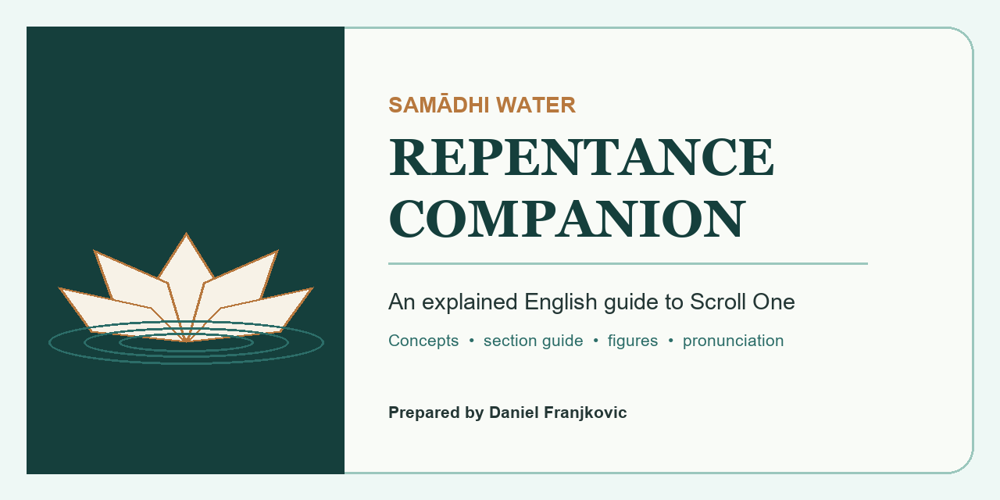
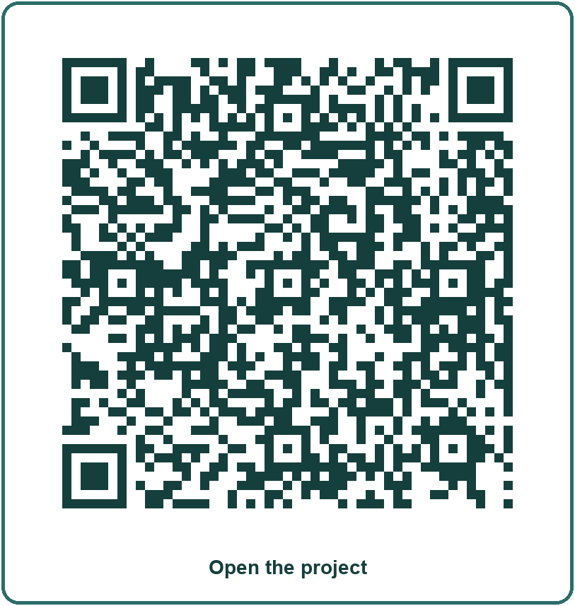

# Samādhi Water Repentance Companion

A concise, illustrated English guide to Scroll One of Fo Guang Shan Hsi Lai Temple's *Liturgy of the Samādhi Water Repentance of Kindness and Compassion*.

The project helps a beginner understand what the service is doing, why each section is chanted, which Buddhist concepts it assumes and how its Buddhas and bodhisattvas relate to the practice.

**Prepared by Daniel Franjkovic**  
<daniel.franjkovic@outlook.com.au>

## Download

- [Print-ready PDF](releases/samadhi-water-repentance-scroll-one-companion.pdf)
- [Official Hsi Lai Temple Scroll One](https://www.hsilai.org/tc/events/eBooks/FGSHsiLaiTemple__WaterRepentance_SCROLL_01.pdf)
- [Fo Guang Shan Buddhist Glossary](https://www.fgsitc.org/glossary/)

## Read online

- [Complete companion in one Markdown file](SAMADHI_WATER_REPENTANCE_COMPANION.md)
- [Practice companion](PRACTICE_COMPANION.md)
- [Core Buddhist concepts](CONCEPTS.md)
- [Buddhas and bodhisattvas](FIGURES.md)
- [Pronunciation guide](PRONUNCIATION.md)
- [Consolidated three-scroll glossary](GLOSSARY.md)
- [References](REFERENCES.md)
- [Editorial analysis](EDITORIAL_ANALYSIS.md)
- [Copyright and method](source-notes/COPYRIGHT_AND_METHOD.md)
- [Scroll One page map](source-notes/SCROLL_ONE_PAGE_MAP.md)

## What this guide adds

- a page-by-page explanation of Scroll One;
- a clear account of karma, repentance, rebirth, the six realms, emptiness, Pure Land and merit;
- a full explanation of the six senses;
- beginner profiles with pictures, stories, iconography, pronunciation and practice pathways;
- simple diagrams for the ritual sequence and difficult doctrines;
- careful treatment of disputed history and unclear ritual terms;
- concise Vietnamese name equivalents only where they help recognition.

## Scope

The English translation is the main source. Chinese and Mandarin pinyin were consulted only when an English term was compressed or unclear. The source does not contain Vietnamese, so Vietnamese material is a small supplementary bridge rather than a parallel translation.

The companion explains a Chinese Mahāyāna liturgy as practised in a Fo Guang Shan context. It does not claim that every Buddhist tradition uses the same terminology or interpretation.

## Copyright

The three source PDFs are copyrighted by Fo Guang Shan Hsi Lai Temple and are not included in this repository. The project links to the official editions and paraphrases them for educational commentary.

The new written material is available under [CC BY-NC-SA 4.0](LICENSE.md). Artwork retains the licence stated in its caption. Fo Guang Shan, Hsi Lai Temple and the source translators do not endorse this independent companion.

## Repository

Planned public address: <https://github.com/CircuitDanny/samadhi-water-repentance-companion>
