# The Samādhi Water Repentance Companion: Master Edition

Prepared by Daniel Franjkovic

Expanded companion edition, September 2026.

<!-- Generated by build_guides.py from the component Markdown. Edit the components, then rebuild. -->

# Orientation

This master edition brings the three practice companions, core concepts, illustrated figure profiles, pronunciation guide and glossary into one volume. Use the short visual maps here before entering the detailed material.

## A first-time route through the companion

You do not need to read the volume from front to back before attending or studying the service.

1. Read the three-scroll journey below so you know where the liturgy is going.
2. Use the companion for the scroll being practised and read its “What is happening” and “Why it matters” notes beside the source text.
3. When a sacred name recurs, use **Buddhas and bodhisattvas in the three scrolls** for identity, relationships and practice relevance. The opening comparison table is enough for a first encounter.
4. Use the **Pronunciation guide** before chanting and follow the officiant during communal practice. Use the **Glossary** when a hard term affects the meaning of a passage.

Three editorial signals help you judge what you are reading. **Canonical account** identifies a story found in a cited Buddhist scripture. **Traditional account** identifies a recognised religious narrative without presenting it as modern historical biography. **Reading note** explains difficult or uncertain source wording without claiming to correct the official liturgy.

## How the three scrolls work together

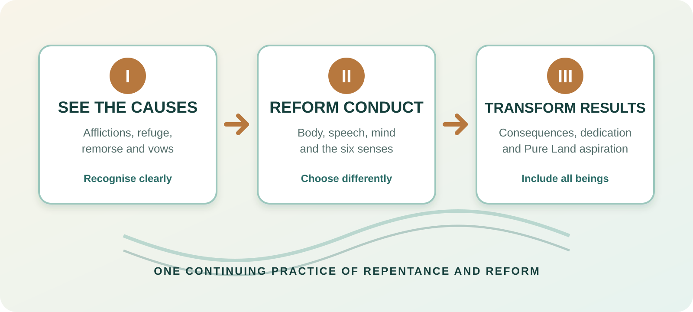

The scrolls form one continuing movement. Scroll One identifies the afflictions that disturb the mind. Scroll Two examines the actions those afflictions produce through body, speech and the six senses. Scroll Three considers painful results, renews the commitment to change and dedicates the practice to all beings.

> **In simple terms:** see the cause, reform the conduct, face the results and direct the benefit towards awakening.

## Why some “English” lines are not English

Lines such as *ripa ripate*, *oṃ sambhara sambhara hūṃ* and *gate gate pāragate* are not faulty English translations. They are **transliterations**: sacred sounds written with the Latin alphabet so they can be recited.

The source pages show three layers:

1. a pinyin line guiding the Chinese liturgical pronunciation;
2. Chinese characters, many chosen historically to represent the sounds of an Indic formula; and
3. a Sanskrit or Sanskrit-derived Latin-letter form.

The sound travelled from India through Central Asian and Chinese transmission, while spoken languages changed. For that reason, there is no single modern spelling that perfectly recreates every ancient syllable. Some chants can be partly translated, while others have a clear ritual purpose but no secure word-for-word English meaning.

> **Best chanting rule:** in communal practice, follow the officiant and the pinyin rhythm in the Fo Guang Shan text. Use this guide's English sound cues for preparation and understanding, not to override the living temple tradition.

Each scroll section now explains the chant beside the place where it occurs. The pronunciation part later in this volume gathers every formula into one reference.

## The ten directions

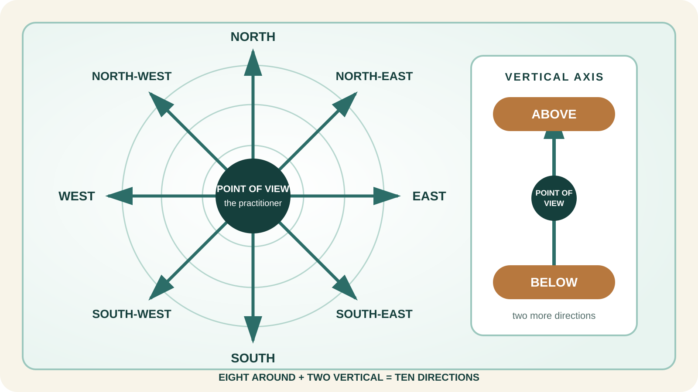

The **ten directions** are east, south-east, south, south-west, west, north-west, north, north-east, above and below. The centre marks the practitioner's point of view and is not an eleventh direction.

When the liturgy honours the Buddhas of the ten directions, it means Buddhas everywhere, without limiting the refuge or offering to one place. The phrase is a traditional way of expressing an all-encompassing field of awakened presence.

## Buddhas and bodhisattvas at a glance

A **Buddha** has completed awakening. A **bodhisattva** follows the path to Buddhahood for the benefit of all beings. Maitreya is presently understood as a bodhisattva and the future Buddha of this world.

| Figure | Role in the practice | Quality or pathway |
|---|---|---|
| **Śākyamuni Buddha** | Teacher of the Dharma in our world | Understand suffering and follow the path |
| **Vairocana Buddha** | Embodies all-pervading awakened reality | Illuminate confusion with wisdom |
| **Amitābha Buddha** | Buddha of the Western Pure Land | Recollection, aspiration and non-retrogression |
| **Medicine Master Buddha** | Associated with healing and supportive conditions | Apply a fitting remedy and use life well |
| **Dīpaṃkara Buddha** | Ancient Buddha linked with Śākyamuni's long path | Make a vow that can mature over time |
| **Prabhūtaratna Buddha** | Awakened witness in the *Lotus Sūtra* | Face the truth and make reform accountable |
| **Maitreya Bodhisattva** | Future Buddha of this world | Loving-kindness, patience and hope |
| **Avalokiteśvara Bodhisattva** | Embodies responsive compassion | Hear suffering and respond wisely |
| **Mañjuśrī Bodhisattva** | Embodies wisdom | Cut through confusion and fixed views |
| **Samantabhadra Bodhisattva** | Embodies great vows and practice | Turn aspiration into sustained action |
| **Mahāsthāmaprāpta Bodhisattva** | Represents the strength of mindful recollection | Gather the mind into one clear direction |
| **Kṣitigarbha Bodhisattva** | Vows to aid beings in difficult realms | Stay present where suffering is greatest |
| **Mahāvyūha Bodhisattva** | Associated with great spiritual adornment | Let virtues beautify conduct |

The names are invoked to orient the mind towards awakened qualities and vows. They are not presented as creator gods who erase responsibility for harmful action.

> **Reading tip:** use this chart for quick recognition. The illustrated profiles later in the volume explain each figure's name, appearance, story, pronunciation and connection to the Water Repentance.

### Three distinctions that prevent common mix-ups

| Do not collapse these together | Practical distinction |
|---|---|
| **A Buddha and a bodhisattva** | A Buddha has completed awakening. A bodhisattva is committed to full awakening for all beings. Maitreya is the main apparent exception because the liturgy anticipates his future Buddhahood. |
| **A recognition cue and a fixed portrait** | A sword, vase, stūpa, elephant or hand gesture can help identify a figure, but regional images vary. The figure profiles state where an identification is secure and where it is only a useful cue. |
| **Invoking help and surrendering responsibility** | Homage, refuge and name-recitation gather the mind around an awakened quality or vow. The repentance still requires honest disclosure, restraint, repair and changed conduct. |

# Beginning a Buddhist practice

This companion can help you understand a service and begin bringing its teaching into ordinary life. You do not need to memorise every sacred name before learning to act with care. Begin with a few teachings, try them honestly, and return with questions.

## What are we practising towards?

The Buddhist path aims at liberation from suffering and its causes. In this Mahāyāna companion, that aim includes the bodhisattva aspiration to awaken for the benefit of all beings. Calm, kindness and a more responsible life are meaningful developments along the way; the path reaches beyond simply feeling better for a moment.

Three kinds of training support each other: **ethical conduct** reduces harm, **meditative cultivation** steadies and clarifies the mind, and **wisdom** learns to see experience without the distortions of grasping. Chanting, generosity, study, meditation and repentance can contribute to these trainings when they shape how we live.

## The Four Noble Truths: a direction for understanding

**Dukkha** includes obvious pain and the unsatisfactoriness of relying on changing things for lasting security. The Four Noble Truths describe a task as well as a teaching:

| Truth | Plain meaning | Task |
|---|---|---|
| **Suffering** | Life includes distress, loss and the insecurity of clinging. | Understand it rather than hiding from it. |
| **Its origin** | Craving sustains suffering and continued becoming. | Let go of the craving that feeds it. |
| **Its cessation** | Freedom is possible when that craving ceases. | Realise this freedom directly. |
| **The path** | The Noble Eightfold Path cultivates the conditions for liberation. | Develop it through practice. |

This teaching does not mean every moment is miserable or that people deserve their pain. Notice a small example: criticism hurts, then the demand that everyone approve of you adds another struggle. Recognising that demand gives you somewhere to practise without denying the original hurt.

*Teaching source: [SN 56.11, Setting the Wheel of Dhamma in Motion](https://www.accesstoinsight.org/tipitaka/sn/sn56/sn56.011.than.html). The everyday example is companion commentary.*

## The Eightfold Path: eight qualities developed together

“Right” here means conducive to awakening. These are mutually supporting qualities, not eight exams that must be passed in order. The examples below are starting points, not complete definitions.

| Quality | Meaning and an everyday beginning |
|---|---|
| **Right view** | Understand suffering, its causes and the path. Ask what your choices are feeding. |
| **Right intention** | Cultivate relinquishment, goodwill and harmlessness. Pause before acting from spite. |
| **Right speech** | Avoid lies, division, cruelty and empty chatter. Say what is true and useful with care. |
| **Right action** | Refrain from killing, stealing and sexual misconduct. Respect life, belongings and relationships. |
| **Right livelihood** | Support yourself without harmful or dishonest means. Consider who is affected by your work. |
| **Right effort** | Prevent and relinquish unwholesome states; cultivate and sustain wholesome ones. Make the helpful choice easier to repeat. |
| **Right mindfulness** | Attend clearly to body, feeling, mind and mental phenomena. Recognise anger before it becomes a reply. |
| **Right concentration** | Cultivate collected attention, developed fully in the meditative absorptions. Begin by returning gently to a suitable meditation object. |

*Teaching source: [SN 45.8, An Analysis of the Path](https://www.accesstoinsight.org/tipitaka/sn/sn45/sn45.008.than.html). Everyday applications are companion suggestions.*

## The Five Precepts: protecting everyday life

The Five Precepts are training commitments for lay practice. They ask us to refrain from taking life, taking what is not given, sexual misconduct, false speech and intoxicants that lead to heedlessness. They cultivate reliability in the places where our choices affect others.

Begin by noticing the positive responsibility within each commitment: protect life, respect what belongs to others, act responsibly in intimate relationships, speak truthfully and protect clear judgement. This is a practical explanation, not a replacement wording for a precept ceremony.

When you fall short, admit what happened, stop the harm, make appropriate repair and renew the training. Repentance supports that process. Reciting a confession while deliberately continuing the same harm misses its purpose.

*Sources: [AN 8.25, Being a Lay Buddhist](https://www.accesstoinsight.org/tipitaka/an/an08/an08.025.kuma.html), and Fo Guang Shan's [Five Precepts: Freedom of the Heart](https://www.fgsitc.org/five-precepts-freedom-of-the-heart/).*

## Refuge, learning and belonging

Taking refuge is orienting your life towards the **Buddha**, the awakened teacher; the **Dharma**, the teaching and its practice; and the **Sangha**, the community that embodies and transmits the path. The Core concepts section explains the different uses of “Sangha”.

You can begin learning, practising generosity and observing your conduct while asking questions. If you wish to take refuge formally, ask a monk, nun or recognised teacher at your temple what the commitment and ceremony mean in that community. A book cannot confer refuge or replace that relationship.

At an unfamiliar service, arrive a little early, ask where visitors sit, and follow the officiant's guidance. Learn one chant or gesture at a time. If kneeling or bowing is difficult, ask about a suitable seated alternative. Understanding can grow alongside respectful participation.

## A simple daily rhythm

The following ten-minute routine is a companion suggestion. Adapt it with your teacher; it is not a compulsory Buddhist liturgy.

1. **Set an intention, one minute.** Remember the Triple Gem and choose a concrete intention such as speaking patiently today.
2. **Settle attention, five minutes.** Sit comfortably and notice the natural breath without forcing it. When you notice wandering, return gently. If your temple teaches Buddha-name recollection, you can use that familiar practice instead.
3. **Study and reflect, two minutes.** Read a short passage. Put one teaching into your own words and identify one place to apply it.
4. **Review and dedicate, two minutes.** Acknowledge something wholesome and something needing care. Choose a realistic repair or restraint. Dedicate the benefit beyond yourself.

Carry one action into the day: listen without interrupting, give without demanding recognition, check a rumour before repeating it, or apologise without an excuse. These ordinary choices show whether the practice is reaching body, speech and mind.

## Common misunderstandings to leave behind

| Misunderstanding | A more useful understanding |
|---|---|
| **Karma means everything is deserved.** | Intention matters, but events have many conditions. Respond to suffering with compassion, not blame. |
| **Impermanence means nothing matters.** | Conditions change, so care and effort can make a difference. |
| **Non-self means I do not exist or need not take responsibility.** | It questions an independent, permanent self; it does not erase everyday responsibility. |
| **Emptiness means nothing exists.** | Things depend on conditions rather than existing through a fixed essence. Causes and consequences still matter. |
| **Non-attachment means not loving people.** | Care can become more generous when it is less possessive. |
| **Devotion can replace ethical conduct.** | Homage and recitation support a path that also requires restraint, wisdom and compassionate action. |

The later Core concepts section develops each distinction. When an explanation remains unclear, keep the question open and bring it to a teacher rather than forcing a quick answer.

## Bringing the Water Repentance home

Before a service, choose one pattern to understand. During the chanting, return to that intention whenever a long list becomes tiring. Afterwards, choose one action that would make the repentance true in daily life.

For example, after regretting harsh speech, practise pausing before the next difficult conversation and make a sincere apology where appropriate. You need not recount another person's private pain publicly in order to take responsibility.

At the end of a week, ask: Am I noticing harmful impulses earlier? Am I more truthful, generous and willing to repair harm? Am I learning to meet people with compassion and clearer understanding? These questions offer useful reflection without turning practice into a scorecard or claiming a spiritual attainment.

# Part I - Scroll One

## An explained companion to Scroll One

**Prepared by Daniel Franjkovic**\
<daniel.franjkovic@outlook.com.au>

For other Buddhist terms, visit the [Fo Guang Shan International Translation Center Glossary](https://www.fgsitc.org/glossary/).

This companion explains the English text of the 2022 Fo Guang Shan Hsi Lai Temple edition. It does not reproduce or replace the liturgy. Keep the [official Scroll One PDF](https://www.hsilai.org/tc/events/eBooks/FGSHsiLaiTemple__WaterRepentance_SCROLL_01.pdf) beside this guide when reading or chanting.

## How to use this guide

Read “The Buddhist world behind the words” first if the terms karma, Pure Land, emptiness or bodhisattva are new. Then use the page-by-page guide below while following the source.

Source-page references use the PDF page number. The smaller printed number inside the liturgy starts later and is different.

You do not need to stop chanting to resolve every unfamiliar term. Before a section, read **What is happening?** and **What to attend to**. During the liturgy, notice the movement from naming a problem to making a constructive vow. Return to the fuller notes afterwards. Instructions for communal movement and timing still come from the officiant.

> **In simple terms**\
> The practice asks: What has caused harm? Can I admit it without hiding? What conditions fed it? What will I do differently? How can the benefit of that change include others?

## What the title means

- **Kindness and compassion** name the attitude towards oneself and all beings.
- **Samādhi** is a collected, steady mind that is not swept away by reactions.
- **Water** symbolises cleansing and refers to the spring in the traditional Wuda story.
- **Repentance** means acknowledging harm and reforming future conduct.
- **Liturgy** means a structured communal service of chant, movement, reflection and dedication.

## The practice at a glance

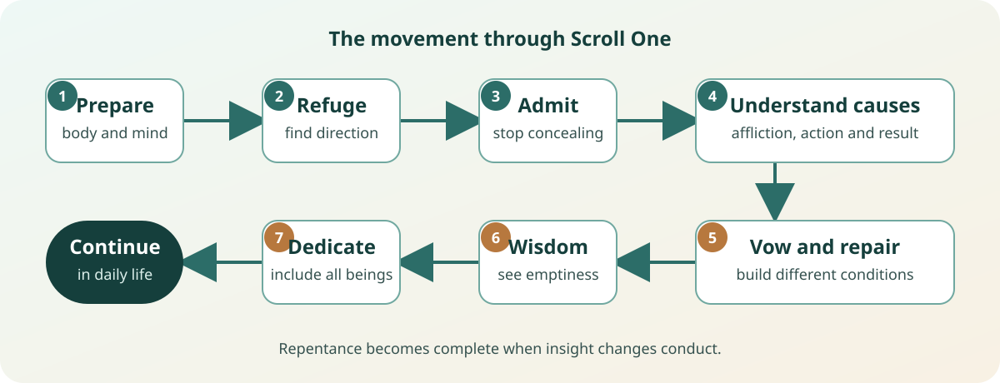

The ritual is not simply a long confession. It moves from reverence and attention to honest acknowledgement, analysis of causes, vows, wisdom and dedication.

| Movement | Question carried into practice |
|---|---|
| Prefaces and Wuda narrative | Why can acknowledged harm be changed? |
| Praise, visualisation and offering | What quality of attention am I bringing? |
| Refuge and collective confession | What have body, speech and mind been serving? |
| Three obstructions and seven minds | What caused the harm, what followed, and what attitude supports repair? |
| Affliction lists and vows | Which recurring pattern needs a wholesome replacement? |
| Mantra, offering and memorial dedication | How can any benefit extend beyond me? |

# Guide to Scroll One

## 1. Imperial Preface for Water Repentance

**Source pages 3 to 4**

### What is happening?

A Ming-period imperial preface explains the title and recommends the practice. It defines samādhi as a mind that does not indulge or chase sensation, then compares repentance with washing a body, garment or vessel.

### Why is it here?

The preface gives the reader a moral frame before the chanting begins: actions have effects, the mind is central, and sincere reform can change the conditions that support suffering.

### What does it mean?

“Samādhi water” is both story and metaphor. The water cleanses because it is joined with collected awareness, truthfulness and change. The point is not that ordinary water magically deletes the past.

### Difficult wording on this page

| Source phrase | Plain-English reading | Reading caution |
|---|---|---|
| “proper sensation” | A settled awareness that does not chase or indulge sensory experience | This is the edition's unusual gloss for *samādhi*, not a standard definition of a bodily sensation. |
| “no part of it remains cleansed” | Washing leaves no part **uncleansed** | The next two comparisons say that no dirt or impurity remains. “Cleansed” is therefore an apparent typographical error in the English source. |
| “square inch of space” | Moral change is located in the intimate work of mind or heart | The English syntax is compressed, so the guide does not claim a more exact technical meaning. |
| “specs of dust” | Specks of dust, used to suggest an incalculable number | This is another apparent English typo, not a special Buddhist term. |

### What to attend to

Notice that all three washing comparisons involve action. Water is available, but the body, garment or vessel is actually washed. In the same way, repentance includes recognition and a change of conduct, not a declaration that consequences have vanished.

### Beginner notes

- **National Master** was an honorific for a highly respected monastic teacher associated with the imperial court.
- **Karmic enmity** means hostility carried and reinforced through intentional actions, traditionally across lives.
- **Trichiliocosm** is an ancient Buddhist expression for an immensely vast world-system.
- The preface is dated 24 July 1416, much later than the traditional Tang setting of Wuda's story.

## 2. Preface of the Water Repentance

**Source pages 4 to 5**

### What is happening?

The liturgy tells its traditional origin narrative. Wuda Zhixuan cares for a sick monk when others avoid him. Later, after receiving an imperial throne and becoming proud, Wuda develops a human-faced tumour. The tumour speaks as a former enemy. Honoured Kanaka directs Wuda to wash it with water from a spring, ending the feud.

### Why is it here?

The story makes invisible patterns visible. Pride weakens vigilance. Kindness creates a future refuge. Retaliation persists until its causes are understood and released.

### What does it mean?

The tumour represents unresolved harm that cannot be escaped by status, learning or denial. Wuda's healing is not only the removal of pain. It is reconciliation with a being presented as his enemy across lives.

The story names the earlier opponents as Yuan Yang and Yao Cuo. It is not necessary to remember the court history to follow the ethical point: one person's past participation in another's death becomes a grievance, and neither prestige nor avoidance resolves it. Care shown to the sick monk later becomes the condition through which help arrives.

> **Historical note**\
> The Wuda account is the liturgy's traditional explanation. Modern scholarship finds the exact authorship uncertain and notes that versions of the attribution were questioned in medieval China. The guide treats the story as a sacred origin narrative, not verified medical history.

### Beginner notes

- **Kāmalā disease** is an old medical term associated with jaundice and severe illness.
- **Honoured Kanaka** is the mysterious awakened helper in the narrative. The text does not give a historically verifiable biography.
- The story assumes rebirth and karmic continuity. It should not be used to blame an ill person for unknown past conduct.

> **Read illness responsibly**
>
> The source uses a frightening illness inside a sacred origin story. It does not provide a method for diagnosing why a particular person is ill. Respond to illness with care, treatment and practical support. Do not turn another person's pain into speculation about guilt.

## 3. Prostrations and the True Incense Praise

**Source page 7**

### What is happening?

The assembly bows, prostrates three times and praises the “true incense” of ethical discipline and concentration.

### Why is it done?

The body enters the practice before the main confession begins. Prostration softens pride, while incense makes intention visible through fragrance rising and spreading.

### What does it mean?

The real offering is not smoke alone. Ethical conduct and a steady mind are the fragrance the practitioner is asked to cultivate.

### What to attend to

Let the first bows mark a change of pace. The useful question is not whether the movement looks perfect, but whether body and attention arrive together. If you are studying privately, pause long enough to notice defensiveness, hurry or distraction before continuing.

> **Look for this in a temple**\
> Three prostrations often express complete homage to the Buddha, Dharma and Sangha. Follow the officiant's pace if attending a service.

## 4. Retelling the Wuda story

**Source pages 8 to 10**

### What is happening?

A formal verse retells the origin story in elevated ritual language. It moves from pride and karmic enmity through the journey to Kanaka and the cleansing water.

### Why is it done?

Repetition changes the story from background information into contemplation. Practitioners are invited to recognise their own pride, grudges and hidden patterns.

The elevated wording can be difficult to parse. On source page 8, the sentence beginning “The Honored One practiced kindness” is grammatically incomplete in English. Its surrounding lines still make the ritual movement clear: the awakened response benefits beings, the illness is presented as provisional or dreamlike, and the old grievance is brought to the cleansing water. The guide does not silently invent a missing subject or verb.

### Beginner notes

- **Ten unwholesome deeds** are killing, stealing, sexual misconduct; false, divisive, harsh and careless speech; greed, ill will and wrong views.
- **Five degenerations** describe a troubled age marked by decline in lifespan, beings, afflictions, views and the age itself.
- **Nine grades of lotuses** are traditional levels of rebirth in Amitābha's Pure Land.

## 5. Samantabhadra visualisation

**Source pages 10 to 12**

### What is happening?

The assembly invokes Samantabhadra, then imagines the bodhisattva approaching on a white elephant amid light, flowers, music and countless awakened beings.

### Why is it done?

Samantabhadra represents great vows expressed as conduct. The visualisation turns the imagination towards a world shaped by wisdom, beauty and purposeful action.

### What does it mean?

The scene should not be read like a newspaper report. It is sacred imagery that trains perception. Light represents wisdom; flowers represent virtue and impermanence; the elephant represents calm strength; its six tusks are commonly linked with the six perfections.

The six perfections are generosity, ethical discipline, patience, diligent effort, meditation and wisdom.

> **Why this matters**\
> Repentance is incomplete if it only looks backward. Samantabhadra asks what vow and practice will replace the harmful pattern.

### What to attend to

Do not try to construct every visual detail at once. Choose one feature and its quality: steady strength in the elephant, practical commitment in Samantabhadra's vows, or wisdom in the light. Then ask what that quality would change in the next ordinary decision you make.

## 6. Refuge and universal offering

**Source pages 12 to 15**

### What is happening?

The assembly prostrates to the Buddha, Dharma and Sangha, kneels with incense and flowers, and imagines the offering multiplying throughout all worlds.

### Why is it done?

Taking refuge establishes the direction of the practice. The universal offering expands generosity beyond the limits of what is physically present.

### What does it mean?

The language in which every offering contains all offerings reflects the Flower Adornment vision of interdependence. A small sincere act can participate in a much wider field of benefit.

This is the first major widening of the scroll. The Wuda story begins with one feud and one healing; the offering now reaches the ten directions. The transition teaches that personal repair is not sealed off from the welfare of others.

### Beginner notes

- **Ten directions** means everywhere: the four main directions, four intermediate directions, above and below.
- **Dharma realm** means the whole field of beings and phenomena.
- **Bodhi mind** is the resolve to awaken for the benefit of all beings.
- **Non-arising** means insight that phenomena do not appear from an independent permanent essence.

## 7. Prayer of entering repentance

**Source pages 15 to 18**

### What is happening?

The assembly formally enters the repentance sanctuary. Practitioners purify body, speech and mind, take refuge, confess and ask the awakened assembly to witness their sincerity.

### Why is it done?

Ritual boundaries help the mind stop treating the words as ordinary reading. Kneeling, joined palms, flowers and incense support concentrated honesty.

### What does it mean?

“Purifying the three karmas” means bringing bodily conduct, speech and intention into alignment. “Four forms of birth” and “six realms” place the confession within the traditional scope of all sentient life.

The Seven Ancient Buddhas then situate the practice in a lineage of awakening extending beyond one historical age.

### What to attend to

The source repeatedly asks that body, speech and mind become pure. Read “pure” here as freed from the harmful direction being confessed. A useful review is concrete: what did the body do, what did speech communicate, and what intention or assumption drove them?

## 8. Opening confession and Buddha-name litany

**Source pages 19 to 23**

### What is happening?

The assembly admits disbelief, arrogance, neglect of family, intoxicant use, killing, sexual craving and other harmful conduct. It then invokes Buddhas, bodhisattvas and sacred assemblies.

### Why is it done?

Naming patterns weakens concealment. Reciting awakened names provides a contrasting field of qualities: wisdom, compassion, strength, vows and liberation.

### What does it mean?

The passage uses “we” and covers more wrongdoing than any one reader may have committed. Communal repentance is deliberately comprehensive. A practitioner can acknowledge the pattern without making a false personal confession.

> **Reading responsibly**\
> Do not mechanically claim an action you did not commit. Attend to the forms of harm that genuinely apply, the social conditions that allow harm and the commitment to prevent it.

Collective confession works at three levels. You can acknowledge conduct you personally recognise, remain alert to ways you benefit from or fail to interrupt wider harm, and cultivate concern for actions committed by beings generally. None of these requires a false admission. If a line does not describe you, let it train recognition and prevention rather than forcing a private memory to fit it.

### What to attend to

When the litany shifts to Buddha and bodhisattva names, notice the change in emotional direction. The assembly has named confusion and harm, then turns towards qualities that make another response possible. Refuge is not a way to avoid repair. It supplies a model, teaching and community for carrying it out.

### Beginner notes

- **Field of merit** means a person or community in relation to whom wholesome action bears abundant benefit, like a well-tended field bearing crops.
- **Pratyekabuddha** means one who awakens without teaching a dispensation to the world.
- **Four fruitions and four progressions** are four stages of early Buddhist awakening, each viewed as path and result.
- **Devas and nāgas** are non-human beings in traditional Buddhist cosmology.

## 9. The three obstructions

**Source pages 23 to 24**

### What is happening?

The liturgy organises an immense range of wrongdoing into three connected obstructions: afflictions, karma and painful results.

### Why is it done?

This turns a catalogue of faults into a diagnosis. If a practitioner sees only the painful result, the inner cause may continue. If they analyse affliction but ignore conduct, insight remains abstract.

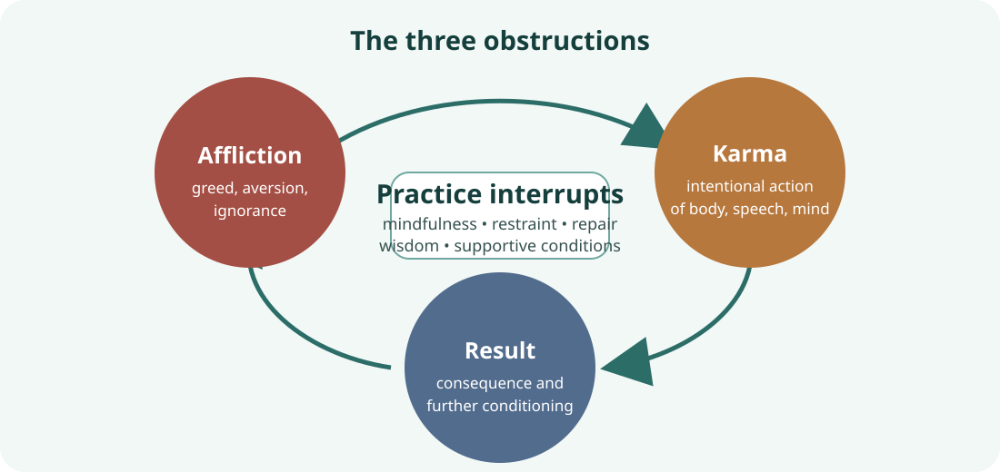

### What does it mean?

- An **affliction** disturbs clear awareness.
- **Karma** is the intentional action it conditions.
- A **result** is the consequence and further conditioning that follow.

Each can feed the next. The cycle can also be interrupted at every point through mindfulness, restraint, repair, wisdom and supportive conditions.

| Everyday sequence | Where practice can interrupt it |
|---|---|
| Resentment is rehearsed until it feels justified | Name the affliction and check the story being repeated. |
| A cutting message is drafted and sent | Pause, do not send it, and choose truthful speech that does not humiliate. |
| Trust is damaged and more resentment follows | Acknowledge impact, apologise without excuses, repair what can be repaired and change the conditions for recurrence. |

The three obstructions are a diagnostic sequence, not a claim that every painful event can be traced to one visible fault. Many conditions interact, and the liturgy does not give a practitioner grounds to judge another person's suffering.

## 10. The seven kinds of mind

**Source pages 24 to 31**

### What is happening?

The assembly cultivates seven attitudes before the detailed confession.

| Attitude | Practical meaning |
|---|---|
| **Remorse and shame** | Admit that the action fell below one's ethical capacity. |
| **Fear** | Take consequences seriously instead of assuming they can be avoided. |
| **Dispassion** | See that compulsive pleasure and identity cannot provide lasting security. |
| **Bodhi mind** | Make reform part of awakening for all beings. |
| **Equality of friend and foe** | Refuse to limit compassion to people one likes. |
| **Gratitude to the Buddha** | Repay the teaching by practising and sharing it. |
| **Emptiness of transgression** | Take responsibility without fixing anyone as permanently corrupt. |

### Why is it done?

Repentance can fail through denial, panic, self-hatred, resentment or empty performance. The seven minds create a balance of urgency, compassion and wisdom.

### Difficult body imagery

The list of body parts and the nine openings is an ancient contemplation of the body as physical, changing and not fit for idealised attachment. It is not a statement that bodies are morally dirty or that bodily care is wrong.

### “Friends and foes as equal”

Equality means equal concern for awakening and freedom from suffering. It does not require trusting an unsafe person, abandoning boundaries or pretending that harmful conduct is acceptable.

### “Transgressions are empty”

The text says transgressions arise and cease through conditions. This is not an escape from accountability. It explains why accountability can lead to change.

### What to attend to

The seven minds are meant to correct one another. Concern about consequences without compassion can become panic. Emptiness without remorse can become evasion. Equality without boundaries can expose someone to further harm. A balanced reading holds responsibility, the possibility of change and care for everyone affected.

The phrase “permanence, bliss, self-nature, and purity” on source page 28 uses affirmative Mahāyāna language for the realised freedom of a Buddha's nirvāṇa. “Self-nature” here should not be read as the ordinary ego becoming eternal. The surrounding aspiration is towards wisdom, a purified Buddha-field and benefit to beings.

## 11. Repentance for the obstruction of afflictions

**Source pages 32 to 42**

### What is happening?

The first of the three obstructions becomes the focus. The text begins with greed, anger and ignorance, then expands into a long sequence of numbered lists.

### Why is it done?

The sheer range prevents a practitioner from reducing wrongdoing to a few obvious acts. Affliction includes views, habits, doubts, emotional reactions and subtle attachments.

### How to read the numbered lists

Treat them as a map of comprehensiveness, not a memory test. A few groups deserve immediate recognition:

- **three poisons**: greed, hatred and ignorance;
- **five coverings**: sense desire, ill will, dullness, restlessness and doubt;
- **six senses**: eye, ear, nose, tongue, body and mind;
- **eight sufferings**: birth, ageing, illness, death, separation from what is loved, meeting what is disliked, not getting what is wanted and distress connected with clinging to the five aggregates;
- **ten afflictions**: a scholastic list of primary disturbed states and wrong views;
- **eighteen realms**: six faculties, six objects and six consciousnesses;
- **108 afflictions**: a comprehensive symbolic count of the many ways a mind becomes troubled.

The glossary explains every named group at the level the source supports. It marks lists whose exact members vary or are not supplied.

| Source label | Useful reading during the liturgy | Caution |
|---|---|---|
| Eight Defilements, page 37 | Mental stains that cloud clear awareness | The source does not enumerate a definitive eight here, so do not force one later list into the passage. |
| Nine Conditions, page 38 | The many supports through which confused consciousness and action arise | It may refer to a technical analysis of sensory consciousness, but the exact intended list is disputed. |
| Three Vows, page 39 | A compact aspiration that wrongdoing be replaced by liberating aims | The three are not named in the English text. Several Buddhist triads share this title. |
| 108 afflictions, pages 38 and 41 | A comprehensive count for the many ways the mind becomes troubled | The practice point is breadth, not arithmetic mastery. |

### What to attend to

Listen for the repeated grammar: “because of” a disturbed condition, harmful actions occur; “through the merits” of repentance, a positive capacity is sought. That pattern is more important for a beginner than remembering every number. Choose one recognised pattern and pair it with one replacement, such as envy with appreciative joy, agitation with steady attention, or stinginess with a planned act of generosity.

### From confession to vows

The numerical confession is answered by positive aspirations: wisdom, faith, the six perfections, the factors of awakening and the bodhisattva grounds. This structure matters. The practitioner does not merely remove a fault but develops a capacity that makes recurrence less likely.

## 12. Rectifying the past and cultivating the future

**Source pages 43 to 50**

### What is happening?

The text explains repentance directly: correct the past, cultivate the future, end harmful patterns and give rise to virtues. It asks the practitioner to make the body dignified, the mind reverent and the practice sincere.

### Why is it done?

The warning against hidden conduct targets the belief that an unseen act does not matter. Buddhist ethics focuses on what conduct does to the mind and to beings, not only on whether a human authority discovers it.

### King Yama and the wardens of hell

The courtroom scene dramatizes unavoidable accountability. Enemies testify about violence and theft; the offender cannot transfer the consequence to family or wealth.

Traditionally, Yama is a ruler or judge connected with the realms of the dead. He is not an all-powerful creator and Buddhist hell is not eternal. Some readers also understand the scene as a psychological image of actions returning through memory, habit, fear and damaged relationships.

The scene also explains why the scroll places reform before death imagery. Family, status and possessions cannot perform an ethical choice on someone else's behalf. The practical emphasis is to repair while there is time, not to become absorbed in guessing a future sentence.

### The four elements, five aggregates and six senses

The text compares the four elements to snakes, the five aggregates to bandits and the six senses to an empty formation. These are warnings against clinging. They do not teach hatred of the body or the senses.

The positive conclusion is the Noble Eightfold Path: right view, intention, speech, action, livelihood, effort, mindfulness and concentration.

“The six senses as a formation of emptiness” is awkward source wording. It does not mean that sight, hearing or touch should be hated or destroyed. The senses, their objects and the resulting consciousness arise through conditions and contain no permanent owner. That makes them workable: contact can be noticed before it hardens into grasping or aversion.

The source prints “Dhama Body” on page 40 in the phrase “Five Parts [of the Dhama Body]”. This is an apparent typo for **Dharma Body**. The five parts are ethical discipline, concentration, wisdom, liberation, and knowledge or vision of liberation.

## 13. Seven Buddhas mantra and exiting repentance

**Source pages 51 to 54**

### What is happening?

The assembly chants the Seven Buddhas Offence-Extinguishing Mantra, recalls the cleansing spring, announces completion of the first scroll and dedicates the merit.

### Why is it done?

The mantra seals the confession in a sacred sound formula. The exit prayer prevents an abrupt return to ordinary activity and directs the result towards a wider field.

### What does it mean?

The source provides a Sanskrit-derived recitation rather than a prose translation. Its liturgical function is purification. The following verse gives its practical interpretation: the water of samādhi cleanses old enmity, then compassion for oneself becomes compassion for others.

Dedication includes Dharma protectors, spirits, living relatives, ancestors, friends, enemies and all beings. The aspiration to the Pure Land gives this shared benefit a direction towards awakening.

### What to attend to

Let the exit prayer gather the whole scroll into one movement: causes have been examined, responsibility has been taken, and the benefit is released. If you noticed a specific repair during the confession, write it down after the service so that dedication does not replace follow-through.

### Why these words are not English

The English heading names the chant, but the line beneath it is a **transliteration**, meaning sacred sounds written in the Latin alphabet. These sounds began in an Indic language, were represented phonetically with Chinese characters, and were then transmitted through centuries of Chinese Buddhist chanting. The Chinese characters in this part often represent sound rather than an ordinary Chinese sentence.

This is why a line such as *ripa ripate* looks like English letters but is not English. Some Sanskrit words remain recognisable, while other syllables cannot be translated securely. In group practice, the officiant and the pinyin line in the temple text are the pronunciation authority. The cue below is only a calm first reading of the source's Latin-letter line.

### Chant guide: Seven Buddhas Offence-Extinguishing Mantra

**Where:** source PDF page 51, printed page 45.

> **Source form:** *ripa ripate kuha kuhate tranite nigalate*\
> *vimarite mahāgate jāmlamcamte svāhā*\
> **Easy cue:** *REE-pah REE-pah-tay, KOO-hah KOO-hah-tay, TRAH-nee-tay, NEE-gah-lah-tay; VEE-mah-ree-tay, mah-HAA-gah-tay, JAHM-lahm-CHAHM-tay, SWAA-hah.*

**What it means:** There is no responsible word-for-word translation of the whole formula. *Mahā* means “great”, *gate* is related to going or having gone, and *svāhā* is a traditional ending that seals or completes a mantra. Its Chinese title gives the reliable overall meaning: a mantra of the Seven Buddhas for extinguishing offences.

**Why it is chanted:** It gathers attention, expresses the intention that harmful karma and its obstructions be purified, and seals the confession before the exit prayer. It should be understood as a purification formula, not as a hidden English sentence.

## 14. Noon Offering Before the Buddhas

**Source pages 55 to 58**

### What is happening?

The assembly invokes the Triple Gem, major Buddhas and bodhisattvas, then chants formulas for transforming food, sweet dew and universal offering.

### Why is it done?

Food, one of life's basic supports, becomes a practice of gratitude and impartial generosity. The offering is imagined as reaching Buddhas, sages and all beings in the six realms.

### What does it mean?

“Transformation” and “sweet dew” express abundance and relief. The physical portion may be limited, but the vow to nourish and include beings is not.

The transition from confession to food offering is deliberate. Ethical practice is tested in how life's supports are received and shared. Notice gratitude for the people, labour and living systems that made the meal possible, then widen the wish from “may I be fed” to “may beings have what supports life and practice”.

### Chant guide: Transformation of Food Dhāraṇī

**Where:** source PDF page 57, printed page 51. It is repeated on source pages 61-62 in the memorial rite.

> **Source form:** *Namaḥ sarva-tathāgatāvalokite; oṃ sambhara sambhara hūṃ*\
> **Easy cue:** *NAH-mah SAR-vah tah-THAA-gah-TAA-vah-loh-kee-tay; ohm SUM-bha-rah SUM-bha-rah hoom.*

**Plain meaning:** “Homage to all the Tathāgatas who behold”, followed by a formula calling the offering to be gathered, supplied or made abundant. *Hūṃ* is a forceful closing syllable and is gently nasalised.

**Why it is chanted:** A limited physical portion is imaginatively transformed into an offering sufficient for innumerable beings. The point is boundless generosity, not a claim that the food's chemistry visibly changes.

### Chant guide: Sweet Dew Dhāraṇī

**Where:** source PDF page 57, printed page 51. It is repeated on source page 62.

> **Source form:** *Namaḥ surūpāya tathāgatāya tadyathā; oṃ suru suru pra suru pra suru svāhā*\
> **Easy cue:** *NAH-mah soo-ROO-paa-yah tah-THAA-gah-taa-yah tud-yuh-THAA; ohm SOO-roo SOO-roo prah SOO-roo prah SOO-roo SWAA-hah.*

**Plain meaning:** The opening honours the Beautiful-Form Tathāgata and introduces the formula with “thus”. The repeated *suru* sounds do not have a secure separate English meaning here. “Sweet dew” translates *amṛta*, the deathless nectar used as an image of Dharma relief and liberation.

**Why it is chanted:** It expresses the wish that the offering become cooling, nourishing relief for hungry or distressed beings and lead beyond suffering.

### Chant guide: Universal Offering Dhāraṇī

**Where:** source PDF page 58, printed page 52. It is repeated on source page 62.

> **Source form:** *Oṃ gagana sambhava vajra hoḥ*\
> **Easy cue:** *ohm GAH-gah-nah SUM-bha-vah VAJ-rah hoh.*

**Plain meaning:** The recoverable words suggest “born or arisen from space” and *vajra*, the diamond or thunderbolt symbol of indestructible awakened power. *Hoḥ* is a concluding ritual syllable. The formula is better understood by its function than forced into a complete English sentence.

**Why it is chanted:** It expands the offering beyond one altar or one group, imagining it as vast as space and available throughout the Dharma realm.

### Chant cue within the Celestial Kitchen Praise

**Where:** source PDF page 58, printed page 52.

> **Source form:** *Oṃ suru-sarva tathāgata tadyathā suru svāhā*\
> **Easy cue:** *ohm SOO-roo SAR-vah tah-THAA-gah-tah tud-yuh-THAA SOO-roo SWAA-hah.*

**Plain meaning and purpose:** *Sarva tathāgata* means “all Tathāgatas” and *tadyathā* means “thus”. The *suru* sounds are retained rather than guessed at. Within the praise, the line consecrates the food offering and directs it towards all Buddhas and beings.

### Beginner notes

- **Vulture Peak** is the site near ancient Rājagṛha associated with important Mahāyāna teachings, especially the *Lotus Sūtra*.
- **Medicine Master Buddha** represents healing and conditions supportive of practice.
- **Sanghārāma Bodhisattvas** are guardians of Buddhist monasteries and practice places.
- **Dhyāna bliss** is the joy and ease associated with meditative collectedness.

## 15. Memorial Altar Dedication

**Source pages 59 to 64**

### What is happening?

The service invokes Amitābha, chants the *Heart Sūtra*, recites the Rebirth in the Pure Land Dhāraṇī, repeats offering formulas and makes a final dedication.

### Why is it done?

The memorial rite joins compassion for the deceased with wisdom about emptiness. Grief is not denied. It is held within a practice that refuses to cling to a fixed self while aspiring towards favourable conditions for awakening.

### What does the *Heart Sūtra* mean here?

Avalokiteśvara sees that the five aggregates are empty of independent essence and crosses beyond suffering. The sūtra then removes every possible object of clinging, even Buddhist teachings and attainment. Its mantra points beyond ordinary conceptual grasping.

This does not say that people or grief are unreal. It says they arise through conditions and cannot be possessed as permanent, separate things.

### What to attend to

The memorial sequence holds grief and wisdom together. Bring the deceased to mind without trying to manufacture a particular feeling. The practice offers remembrance, recitation and a direction towards awakening; it does not ask the mourner to deny loss or claim certainty about a person's present state.

### Chant guide: Heart Sūtra mantra

**Where:** source PDF page 61, printed page 55.

> **Source form:** *gate gate pāragate pārasaṃgate bodhi svāhā*\
> **Easy cue:** *GAH-tay GAH-tay PAA-rah-gah-tay PAA-rah-sung-gah-tay BOH-dhee SWAA-hah.*

**Plain meaning:** A common interpretive rendering is “gone, gone, gone beyond, gone completely beyond, awakening, svāhā”. It is not a command to travel physically. It points to wisdom crossing beyond clinging and fixed concepts.

**Why it is chanted:** The mantra condenses the Heart Sūtra's movement beyond fear and attachment into a memorable closing formula.

### Chant guide: Rebirth in the Pure Land Dhāraṇī

**Where:** source PDF page 61, printed page 55.

> **Source form:** *Namo'mitābhāya tathāgatāya tadyathā; [oṃ] amṛtod bhave amṛta-siddhaṃ bhave; amṛta-vikrānte amṛta-vikrānta; gāmini gagana kīrta kāre svāhā*\
> **Easy cue:** *NAH-moh ah-mee-TAA-bhaa-yah tah-THAA-gah-taa-yah tud-yuh-THAA; ohm uh-MRIH-tohd BHAH-vay, uh-MRIH-tah SID-dhum BHAH-vay; uh-MRIH-tah vee-KRAAN-tay, uh-MRIH-tah vee-KRAAN-tah; GAA-mee-nee GAH-gah-nah KEER-tah KAA-ray SWAA-hah.*

**Plain meaning:** The opening is clear: “Homage to Amitābha Tathāgata; thus”. *Amṛta* means “deathless” and also “nectar”, while *siddhaṃ* concerns accomplishment. Later words suggest powerful advance, going and space, but the transmitted grammar is not secure enough for a confident full translation.

**Why it is chanted:** The overall purpose is purification, recollection of Amitābha and aspiration for rebirth in Sukhāvatī, where practice can continue towards awakening without ordinary regression.

### Why Amitābha?

Amitābha's vows and Pure Land provide a focus for remembrance, trust and aspiration. “Guide and Receiver of the West” expresses the hope that beings will be welcomed into conditions where practice continues without regression.

### When you hear “Nam Mô A Di Đà Phật”

This Vietnamese Buddha-name recitation means **“Homage to Amitābha Buddha”** or **“I take refuge in Amitābha Buddha”**. A rough Southern Vietnamese cue is *nahm moh ah yee dah fuht*. The last word, *Phật*, ends with a short, unreleased “t”. Follow the temple's tones and rhythm when chanting with the community.

Reciting the name is not simply praying to the “next layer”. It recollects Amitābha and voices the wish to be reborn after this life in **Sukhāvatī**, his Western Pure Land or Buddha-field. The liturgy pictures the nine grades of lotus blossoms as one's parents: this is transformational or lotus birth rather than ordinary birth from a womb.

> **The lotus with your name:** Some later Pure Land teaching materials say that sincere faith, vows, name-recitation and practice nourish a lotus in Sukhāvatī associated with the practitioner, sometimes pictured as bearing the practitioner's name. This is a devotional visualisation, not a sentence found in the Water Repentance or the shorter *Amitābha Sūtra*. Its practical message is that each recitation strengthens one's direction towards the Pure Land, and the opening lotus represents awakening and seeing Amitābha.

### The closing synthesis

The final wish names Chan, Pure Land, precepts and the patience of equality. It is a compact picture of integrated East Asian Mahāyāna practice:

- Chan steadies and examines the mind;
- Pure Land directs recollection and aspiration;
- precepts guide conduct;
- equality extends patience and compassion without discrimination.

# A practical way to carry the text into daily life

After reading a section, use four short questions:

1. **What happened?** Name the action without disguise.
2. **What fed it?** Notice craving, aversion, ignorance and surrounding conditions.
3. **What can be repaired?** Apologise, restore, protect or seek help where appropriate.
4. **What will replace it?** Make a specific vow and build conditions that support it.

Then dedicate any benefit beyond yourself. This is the ethical movement at the heart of Scroll One.

For a recurring pattern, make the replacement observable. “Be kinder” is hard to test. “Wait ten minutes before replying when angry”, “repay the amount on Friday”, or “ask before sharing someone else's story” creates a condition that can actually support reform.

# Part II - Scroll Two

Scroll Two turns the general framework of repentance into a detailed examination of afflictions, intentional action and ethical conduct. Its movement is practical: observe the mind, understand consequences, confess harmful patterns and make vows that replace them.

This guide explains the English translation without reproducing the full liturgy. Page numbers refer to Fo Guang Shan Hsi Lai Temple's 2022 electronic edition.

For each section, read the short explanation before opening the corresponding source pages. During chanting, follow the repeated movement: recognise a condition, name the conduct it produces, then hear the vow that redirects it. You can return to the technical lists after the service. Communal movement, pace and pronunciation remain under the officiant's guidance.

## Before beginning

- The repeated **we** is the voice of a community. A practitioner does not need to claim an action they did not commit.
- The lists are intentionally comprehensive. Their purpose is to make unnoticed forms of harm visible.
- Traditional statements about karmic results express the moral cosmology of the liturgy. Karma is complex and unfolds through many conditions; the text is not offering a simple formula for judging another person's life.
- Repeated Buddha names, prostrations and vows divide the long confession into cycles of recognition, refuge and renewed direction.
- A karmic explanation in the source expresses its traditional worldview. It does not establish the cause of a particular illness, disability, loss or abuse, and it should never be used to blame someone who is suffering.

## The movement of Scroll Two

| Movement | What changes |
|---|---|
| Offering and entry | Attention is gathered and placed before awakened qualities. |
| Four observations | Regret becomes an examination of causes, effects, present capacity and the goal. |
| Afflictions and karma | Inner disturbance is connected with intentional action over time. |
| Body, speech and senses | General confession becomes recognisable conduct. |
| Counter-vows | Each harmful pattern is given a practical replacement. |
| Mantra, exit and dedication | The session is sealed and its benefit is shared. |

# Guide to Scroll Two

## 1. Flowers Presented Praise

**Source page 3**

### What is happening?

The assembly bows and offers flowers to Mañjuśrī and Samantabhadra. Blossoms are imagined filling the golden hall and becoming golden lotuses.

### Why is it done?

Flowers prepare the mind through beauty, generosity and impermanence. They bloom and fade, reminding practitioners that conditions change. Their transformation into lotuses expresses the possibility that ordinary, changing life can become a path of awakening.

### Beginner notes

- **Mañjuśrī** represents wisdom that sees clearly.
- **Samantabhadra** represents great vows carried into action.
- A **lotus** grows from mud without being stained by it. It commonly symbolises awakening within the conditions of saṃsāra.
- The **Universal Offering Bodhisattvas** are invoked as an assembly representing offerings extended without limit.

### What to attend to

Flowers do not last, but offering them is not pointless. Their brief beauty becomes a reminder that changing conditions can be used wisely. Begin the scroll by asking which habit is still changeable because it is not fixed.

## 2. Prayer of Entering Repentance

**Source pages 4-8**

### What is happening?

The assembly formally enters the second session. It offers incense and flowers, confesses disrespect, harmful desire, anger and killing, then seeks refuge and invokes Buddhas and bodhisattvas.

### Why is it done?

The entry prayer gathers body, speech and mind before the detailed confession. The ornate images establish the sanctuary as a place where ordinary habits can be examined in the presence of awakened qualities.

### What does it mean?

The passage contrasts being bound by obstruction with the Buddha's freedom and compassion. Seeking the Buddha's support does not replace personal responsibility. It places reform within a relationship of refuge, teaching and encouragement.

### Beginner notes

- The **two obstructions** are usually the obstruction of afflictions and the subtler obstruction to complete knowledge.
- **Inverted views** are ways of seeing that reverse Buddhist priorities, such as treating the impermanent as permanent or the unreliable as a lasting refuge.
- The **thirty-two responses** evoke compassionate forms adapted to the needs of beings.
- The **thirty-two marks** are traditional signs of a great person or Buddha.
- An **asaṃkhyeya kalpa** is an incalculably long period used to express the vast cultivation of Buddhahood.

The phrase “when the two practices are perfectly illuminated” on source page 4 does not name the pair. The English edition gives too little information to identify it securely. It is safest to hear the line as praise for complete cultivation rather than supply a guessed technical list.

### What to attend to

Notice the alternation between confession and invocation. The assembly does not remain inside self-accusation. It acknowledges obstruction, then turns towards compassion, wisdom and patient effort as resources for change.

## 3. The Four Kinds of Observation

**Source pages 8-11**

### What is happening?

Before confessing further, the reader is asked to contemplate four subjects:

| Observation | Plain meaning |
|---|---|
| **Causes and conditions** | Harm does not appear from nowhere. It develops through ignorance, habits, influences and choices. |
| **Results and effects** | Intentional actions shape experience and future tendencies. Privilege and pleasure do not provide permanent protection. |
| **One's own body** | Awakening remains possible, but afflictions conceal that capacity. |
| **The Tathāgata's body** | The Buddha represents wisdom, compassion and freedom that are not ruled by ordinary grasping. |

### Why is it done?

Repentance becomes more than regret when the practitioner understands what supported the action, what it produces and what different direction is possible.

### Images used in the passage

- A **fish biting a hook** mistakes danger for food.
- A **silkworm forming a cocoon** becomes trapped by what it produces.
- A **moth entering a flame** is destroyed by unexamined attraction.
- A person **holding a boulder while sinking** cannot escape while refusing to release the cause of sinking.

> **In simple terms**
> Look honestly at how harm begins, where it leads, what the mind could become and what awakening looks like.

### Try the four observations with one event

Suppose an angry message damaged a relationship:

1. **Causes and conditions:** fatigue, rehearsed resentment, a notification and the wish to win all contributed.
2. **Results and effects:** the message relieved tension briefly but increased fear or mistrust.
3. **One's own body:** the capacity to notice, restrain, apologise and learn is still present.
4. **The Tathāgata's body:** the direction is speech informed by wisdom and compassion, not merely a more polished argument.

This exercise is a practical reading aid, not a claim that every situation has one simple cause.

## 4. Afflictions That Obstruct Practice

**Source pages 11-16**

### What is happening?

The liturgy names afflictions that obstruct almost every level of Buddhist learning, meditation and bodhisattva practice. It moves from basic access to the Triple Gem through advanced concentrations, liberations, powers, perfections, stages and vows.

### Why is the list so long?

It shows that an affliction is not only an unpleasant feeling. Greed, aversion and delusion can prevent a person from recognising teachers, hearing the Dharma, sustaining meditation, understanding emptiness or serving others effectively.

### How to read the advanced lists

The passage is a map of the path, not a demand that beginners master every numbered teaching during the service.

- **Breath mindfulness** and **counting the breath** steady attention.
- **Kindness, compassion, appreciative joy and equanimity** are the four immeasurable attitudes.
- **Foundations of mindfulness, proper exertions, faculties, powers and means to accomplishment** belong to the traditional factors supporting awakening.
- **Six perfections** are generosity, ethics, patience, effort, meditation and wisdom.
- **Four means of embracing** are giving, kind speech, beneficial action and cooperation.
- **Ten stages** describe the progressive maturation of a bodhisattva.

| Source language | Plain meaning | How much a beginner needs here |
|---|---|---|
| Four immeasurables | Loving-kindness, compassion, appreciative joy and equanimity | Notice which attitude directly counters the present affliction. |
| Thirty-seven factors of awakening | Several related groups covering mindfulness, effort, concentration, discernment and the path | Hear them as a complete training system; memorisation is not required during the rite. |
| Four means of embracing | Giving, kind speech, beneficial action and cooperation | These show how inner practice becomes skilful relationship. |
| Powers, liberations and samādhis | Advanced capacities and meditative freedoms | The confession says affliction can obstruct even refined practice; it does not claim the chanter has attained these states. |

The source on page 12 prints “contemplation of of impurities”. The repeated **of** is an apparent typographical error. The practice meant is contemplation of bodily unattractiveness or impurity, traditionally used to loosen obsessive attachment. It is not a claim that a body or person is morally dirty.

### What the vows add

The section does not end with self-criticism. It dedicates the confession towards freedom from compulsive rebirth, access to good teachers, mastery of helpful methods and the ability to teach beings without attachment.

## 5. Karmic Obstacles and the Timing of Results

**Source pages 17-23**

### What is happening?

Having addressed afflictions, the liturgy turns to karma, the intentional actions shaped by those afflictions. It answers an old question: why can a person doing good experience difficulty, while someone acting badly appears to prosper?

### The text's answer

It describes three times in which karmic results may mature:

1. **In the present life**
2. **In the next life**
3. **In a later life**

The point is that visible circumstances do not reveal the whole network of causes. A wholesome action is still worthwhile even when its result is not immediate.

### Key ideas

- **Karmic power** means the capacity of intentional action to condition later experience.
- A **virtuous friend** or **spiritual friend** is someone who supports ethical and liberating practice.
- **Five grave deeds**, **major precept offences** and **improper livelihoods** are named as serious obstacles because they damage beings, community and trust.
- An **icchantika** is portrayed in some Mahāyāna texts as a person whose wholesome roots or aspiration have become extremely obstructed. The term does not need to be read as an eternal identity.

> **Why this matters**
> The section encourages persistence. Present difficulty is not proof that wholesome practice has failed, and present comfort is not proof that harmful conduct is harmless.

### Karma without fatalism

The three timings explain why the liturgy does not expect a simple, immediate moral scoreboard. They do not mean that present choices are powerless. Intention, habit, other people's actions, material conditions and many supporting causes meet in any lived event. The useful response is to strengthen wholesome causes now, repair foreseeable harm and help relieve suffering rather than speculate about an invisible past.

In an early Buddhist definition, karma is intention expressed through body, speech and mind. Fo Guang Shan teaching likewise presents habits, actions and present choices as conditions through which a life can change. See [Aṅguttara Nikāya 6.63](https://suttacentral.net/an6.63/en/thanissaro) and Fo Guang Shan International Translation Center's [*The Buddhist Perspective on Life and Destiny*](https://www.fgsitc.org/wp-content/uploads/2023/04/A5-The-Buddhist-Perspective-on-Life-and-Destiny-2019.pdf).

### What to attend to

When the source contrasts a harmful person who appears comfortable with a good person who is suffering, resist using it to rank real people. Its practice point is narrower: immediate appearances are not enough to make harmful action wise or wholesome action futile.

## 6. Repentance for Killing and Harm

**Source pages 23-31**

### What is happening?

The detailed confession begins with the three physical actions, starting with killing. It includes hunting, fishing, warfare, slaughter, captivity, habitat destruction, indirect participation, careless injury and everyday actions that may harm small creatures.

### Why is the scope so wide?

The precept is not limited to personally taking a human life. The text asks practitioners to notice intention, encouragement, profit, enjoyment, systems of violence and carelessness.

### The kinship argument

The liturgy imagines all beings as former relatives across beginningless rebirth. This is meant to widen compassion beyond the present family or species. A being who now looks unfamiliar may once have been closely connected to us.

### Traditional consequences

The text associates killing with fearful rebirths, illness and shortened life. Its practical direction is clear: protect life, reduce cruelty, cultivate compassion and help frightened beings feel safe.

These associations state the liturgy's karmic teaching, not a medical diagnosis. Illness, disability or early death does not prove that the affected person killed in a former life. The proper response to suffering is care and protection, not interrogation about presumed guilt.

### The vow after confession

The positive replacement for killing is active care. The assembly vows to teach helpful Dharma, relieve fear and make its presence a condition of peace for other beings.

### What to attend to

The section expands responsibility from a direct act to ordering, encouraging, profiting, taking pleasure or failing to take reasonable care. Apply that widening honestly and proportionately. A workable vow might be to stop sharing violent humiliation as entertainment, choose a less harmful purchase where a real option exists, or protect an animal in immediate danger. It is not useful to turn unavoidable contact with living systems into paralysing guilt.

## 7. Repentance for Stealing

**Source pages 32-38**

### What is happening?

The liturgy examines taking what has not been given. It includes robbery, coercion, corrupt government, misuse of religious property, unpaid loans, trespass, false measures, commercial deception, embezzlement and exploitation.

### What does stealing mean here?

It is broader than secretly taking an object. The central question is whether another person's resources, labour, trust or common property are being taken without free and informed consent.

### Why are temple goods treated seriously?

Offerings to the Buddha, Dharma and Sangha are held for communal religious purposes. Misusing them breaks both stewardship and the donors' trust.

### The positive practice

The section turns greed into **dānapāramitā**, the perfection of generosity. Instead of asking only, "What must I not take?", it asks, "What can I freely give for the welfare and awakening of others?"

### Everyday forms of taking

The source's examples include false measures, unpaid debts and misuse of entrusted goods. Present-day parallels can include concealing fees, claiming another person's work, keeping money transferred by mistake, using community funds for private benefit, or taking someone's time through a promise one never intends to honour. The common thread is advantage gained without free and informed agreement.

Repair should fit the harm: return an item, repay a debt, correct a record, credit the creator, disclose the conflict or establish proper controls. When direct contact would endanger someone or compound harm, seek suitable professional or community guidance rather than treating confession as permission to intrude.

## 8. Repentance for Sexual Desire and Misconduct

**Source pages 38-40**

### What is happening?

The liturgy examines sexual craving as a powerful form of attachment and confesses conduct that violates trust or ethical restraint.

### What is the Buddhist concern?

The issue is not that affection or the body is inherently evil. The concern is craving that treats another person as an object, breaks commitments, causes betrayal or overwhelms clear judgement.

### Monastic and lay contexts

The communal text speaks across different vows. Monastics undertake celibacy. Lay ethics commonly focus on avoiding sexual misconduct, coercion, exploitation and betrayal.

The source reflects premodern assumptions about marriage, gender, celibacy and sexual categories. Its phrase “five kinds of people” is not explained in the English edition, and the surrounding list should not be mapped casually onto present-day sexual orientations, gender identities or bodies. The clearest ethical concerns in the passage are coercion, voyeurism, betrayal, humiliation, harassment and the violation of another person's commitments or safety.

The stated karmic result that a man's wife will be unfaithful also reflects the source's historical social frame. Read it as part of the liturgy's traditional consequence language, not as permission to blame a betrayed partner or reduce women to rewards and punishments.

### The vow after confession

The imagery of luminous, transformed birth expresses freedom from compulsive desire and the wish to meet others with purity, dignity and wisdom.

“Born through transformation instead of from a womb” is sacred rebirth imagery. It does not make pregnancy, birth or bodies shameful. The contrast is between being driven by craving and arising in conditions represented as clear and supportive of awakening.

### What to attend to

Ask about agency and impact rather than only desire: Was agreement free, informed and ongoing? Was trust broken? Was a power difference exploited? Was another person treated as a full human being? Repentance requires safety, boundaries and repair. It does not require a victim to reconcile with, trust or contact the person who harmed them.

## 9. The Four Unwholesome Verbal Actions

**Source pages 41-46**

### What is happening?

The assembly confesses four harmful uses of speech:

| Verbal action | Plain meaning |
|---|---|
| **False speech** | Deliberately misleading others. |
| **Divisive speech** | Setting people or groups against one another. |
| **Harsh speech** | Using words to wound, humiliate or inflame hatred. |
| **Idle or irresponsible speech** | Speech that wastes attention, distorts values or encourages heedlessness. |

The source moves between these categories rather than presenting them as a modern checklist.

### Why can speech be karmically powerful?

Words organise relationships and communities. A sentence can preserve trust, incite violence, spread false teaching or reconcile a conflict. Speech is therefore an intentional action, not merely sound.

The same analysis applies to typed and amplified speech. Forwarding a rumour, editing away context, piling onto a public humiliation, posting private information or using technically true words to create a false impression can reproduce the four verbal harms at scale.

### Claims of spiritual attainment

The text treats falsely claiming meditation or awakening as especially serious. Such claims exploit faith and misrepresent the path.

### The positive replacement

The vows seek truthful, harmonious, beneficial and timely speech, together with the confidence and skill to teach without deception.

“Idle” speech does not mean that every joke or ordinary conversation is wrong. The concern is heedless speech that consumes attention, excites craving or hostility, and leaves people less clear. Before speaking or posting, ask whether it is accurate, yours to share, suited to the time and likely to help.

## 10. Repentance Through the Six Sense Faculties

**Source pages 47-49**

### What is happening?

The confession reviews how the eye, ear, nose, tongue, body and mind become caught by attractive or repulsive objects.

| Faculty | Object | Common reaction |
|---|---|---|
| Eye | Forms and colour | Attraction, comparison, judgement |
| Ear | Sounds | Chasing praise or resisting criticism |
| Nose | Scents | Desire or aversion |
| Tongue | Tastes | Craving and excess |
| Body | Touch | Comfort-seeking and resistance |
| Mind | Thoughts and ideas | Grasping views, memories and fantasies |

### Why is mind a sense?

In Buddhist analysis, thoughts and mental images are objects known by mental consciousness, just as visible forms are known by visual consciousness. Mind is not presented as a permanent soul.

### The transformation

The vows do not ask practitioners to destroy the senses. They ask that seeing, hearing and thinking become clear, compassionate and free from automatic grasping.

### A pause at the point of contact

Use one sense event as a small practice:

1. Name the contact: “hearing criticism” or “seeing something desirable”.
2. Notice the first pull to defend, possess or reject.
3. Feel where that reaction appears in the body.
4. Delay the habitual action long enough to choose a response consistent with the vow.

This is where Scroll Two's long analysis becomes immediate. The senses are neither enemies nor a permanent self. They are changing processes in which a different action can begin.

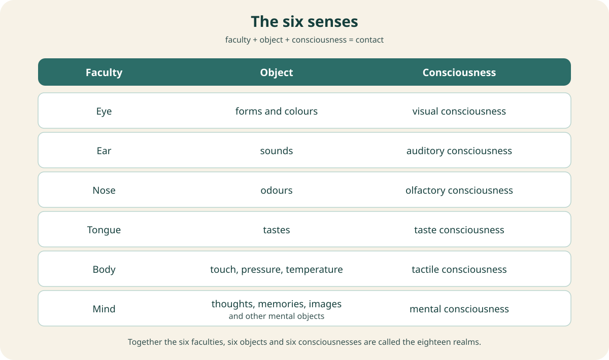

## 11. Seven Buddhas Offence-Extinguishing Mantra

**Source page 50**

### What is happening?

A short mantra marks the completion of Scroll Two's main confession.

### How should a beginner approach it?

The English heading names the chant, but the line beneath it is a **transliteration**, not an English sentence. Its sounds began in an Indic language, were represented phonetically with Chinese characters, and were transmitted through Chinese Buddhist chanting. Some Sanskrit elements remain recognisable, while other syllables cannot be translated securely.

Its ritual function is concentration, continuity with transmitted practice and the sealing of the confession.

Use the temple text and follow the officiant's rhythm. English phonetic spellings cannot fully reproduce the source sounds.

### Sound, meaning and purpose

**Where:** source PDF page 50, printed page 48.

> **Source form:** *ripa ripate kuha kuhate tranite nigalate*\
> *vimarite mahāgate jāmlamcamte svāhā*\
> **Easy cue:** *REE-pah REE-pah-tay, KOO-hah KOO-hah-tay, TRAH-nee-tay, NEE-gah-lah-tay; VEE-mah-ree-tay, mah-HAA-gah-tay, JAHM-lahm-CHAHM-tay, SWAA-hah.*

**What it means:** There is no responsible word-for-word translation of the whole formula. *Mahā* means “great”, *gate* is related to going or having gone, and *svāhā* is a traditional ending that seals or completes a mantra. Its Chinese title gives the reliable overall meaning: a mantra of the Seven Buddhas for extinguishing offences.

**Why it is chanted:** It gathers attention, expresses the intention that harmful karma and its obstructions be purified, and seals Scroll Two's confession of conduct before the exit prayer. In simple terms, the practitioner is acknowledging harm, asking that its obstructive force be cleared, and committing to move towards awakening.

## 12. Prayer of Exiting Repentance

**Source pages 51-52**

### What is happening?

The assembly formally leaves the second session. It acknowledges the practice completed, dedicates its merit and vows to become a support for the Buddhadharma and for living beings.

### Why is an exit prayer needed?

A ritual ending gathers the mind after an intense confession. It prevents the practice from stopping at remorse and directs its energy towards wisdom, service and continued cultivation.

### What to carry out of the session

Choose one promise small enough to verify. Examples include replacing an item by a stated date, correcting one misleading claim, adding a pause before sending angry messages, or changing a setting that repeatedly exposes someone to harm. The vow section supplies direction; ordinary follow-through gives it a body.

### Beginner notes

- The **other shore** is liberation from the compulsive cycle of suffering.
- **Pāramitā** means a perfection or practice carried to liberating completeness.
- To become the **pillars and crossbeams of the Buddhadharma** means to help sustain the teaching and community.

## 13. Verse of Dedication

**Source page 53**

### What is happening?

The merit of the session is shared universally. The verse joins kindness, compassion, joy and equanimity with gratitude, ethical practice, Chan and Pure Land aspirations.

### Why does Scroll Two end this way?

Dedication prevents the practice from being treated as private moral self-improvement. Whatever clarity or goodness has arisen is directed towards families, communities and all beings.

# Scroll Two in one view

| Movement | Purpose |
|---|---|
| Offering and entry | Establish reverence and collected attention. |
| Four observations | Understand causes, effects, present capacity and awakening. |
| Affliction confession | Identify what blocks learning and practice. |
| Karmic confession | Examine intentional action and its consequences. |
| Body, speech and senses | Apply the teaching to ordinary conduct. |
| Mantra, exit and dedication | Seal the practice and direct its benefit outwards. |

Scroll Two's central lesson is that repentance must reach behaviour. Insight into affliction becomes credible when killing is replaced with protection, stealing with generosity, misconduct with respect, harmful speech with truthful care and sensory grasping with mindful awareness.

The scroll does not ask for a flawless self-description. It asks for increasing accuracy: recognise what applies, do not pretend that what does not apply is a personal memory, and let even unfamiliar lines sharpen the ability to notice and prevent harm.

# Part III - Scroll Three

Scroll Three completes the Water Repentance. It examines damaged relationships with the Buddha, Dharma and Sangha, turns to the painful results of karma, dedicates the practice to all beings and closes with memorial and Pure Land rites.

This guide explains the English translation without reproducing the full liturgy. Page numbers refer to Fo Guang Shan Hsi Lai Temple's 2022 electronic edition.

Read the explanation for a section before following those pages in the source. During the rite, listen for the turn from feared result to compassionate transformation. The severe catalogues are not the last word: each is answered by refuge, a counter-vow or dedication. Follow the officiant for communal actions and pacing.

## Before beginning

- Scroll Three assumes the work of Scrolls One and Two. Affliction has been recognised, harmful actions confessed and positive vows established.
- Its descriptions of hells and rebirth belong to traditional Buddhist moral cosmology and ritual imagery. Some Buddhists read the realms primarily as objective rebirth destinations, some also use them as descriptions of states of mind, and many allow both levels.
- The aim of the severe imagery is urgency followed by transformation. The vows repeatedly turn prisons into Pure Lands, weapons into jewels and suffering into conditions for awakening.
- The memorial altar extends the practice to deceased people and other beings through recitation, offerings and dedication of merit.
- The source often links a form of suffering with past karma. This is its traditional ritual worldview, not evidence for diagnosing the cause of a real person's illness, disability, poverty, bereavement or abuse.

## The movement of Scroll Three

| Movement | Why it follows |
|---|---|
| Lamp and entry prayer | The final session begins by bringing light to difficult consequences. |
| Triple Gem confession | The practitioner repairs their relationship with the sources of guidance. |
| Everyday conduct | Respect becomes concrete in livelihood, restraint and community life. |
| Resultative obstruction | The effects of action and the urgency of impermanence come into view. |
| Realms and residual results | Compassion is extended across every painful condition. |
| Universal and memorial dedication | The practice is released towards living and deceased beings. |
| Hsing Yun prayer and final verse | The completed rite returns to daily conduct and society. |

# Guide to Scroll Three

## 1. Lamp's Radiant Light Praise

**Source page 3**

### What is happening?

The assembly bows and praises a lamp whose light reaches dark paths. The verse names King Yama and Dīpaṃkara Buddha.

### Why is it done?

Light represents awareness and wisdom. At the beginning of the final scroll, the lamp announces that even the darkest karmic condition can be seen clearly and approached through practice.

### Beginner notes

- **King Yama** is a traditional judge or administrator associated with the realms of the dead. He is not a creator god or an eternal ruler of damnation.
- **Dīpaṃkara**, whose name is associated with lamp light, is a Buddha of the distant past. Traditional accounts say that he predicted a future Buddhahood for the person who would become Śākyamuni.
- Lamps offered at an altar commonly symbolise the wish that wisdom dispel ignorance.

### What to attend to

The lamp does not deny darkness; it makes response possible. At the opening of this scroll, notice whether fear causes avoidance, fascination or care. The praise directs attention towards seeing clearly enough to act compassionately.

## 2. Prayer of Entering Repentance

**Source pages 4-7**

### What is happening?

The third session is opened through refuge, prostration and the transformation of body, speech and mind. Buddhas, bodhisattvas, sages and protective beings are invited to witness the practice.

### Why does the prayer repeat the number three?

The language links the third scroll with several Buddhist triads: the three karmas of body, speech and mind; the three vehicles; the three realms; the three bodies of a Buddha; and the threefold repetition of refuge and request.

### Beginner notes

- The **three vehicles** are paths associated with disciples, solitary buddhas and bodhisattvas. Mahāyāna texts often gather them within the ultimate aim of Buddhahood.
- The **three bodies** describe Buddhahood as truth or reality, transcendent enjoyment and compassionate manifestation.
- The **three realms** are the desire, form and formless realms within saṃsāra.
- The **four immeasurables** are loving-kindness, compassion, appreciative joy and equanimity.

**Reading note:** the English “our third practice, our third cleansing” on page 4 renders the Chinese idiom **三熏三沐**, literally three perfumings and three bathings. It expresses repeated preparation as a mark of reverence, rather than naming a technical meditation called “the third practice”. The third scroll is named separately later in the prayer. This distinction follows the Chinese source and the [Taiwan Ministry of Education dictionary's explanation of the idiom](https://dict.revised.moe.edu.tw/dictView.jsp?ID=144708&la=0&powerMode=0).

### What to attend to

The repeated triads make the whole person answerable. Body, speech and mind are gathered; different paths and realms are included; different dimensions of Buddhahood are invoked. The practical question is whether the ritual words, physical conduct and underlying intention agree.

## 3. Repairing the Relationship with the Triple Gem

**Source pages 8-13**

### What is happening?

The assembly confesses disrespect towards Buddha images, stupas and temples; careless handling or distortion of scriptures; contempt for monastics and teachers; misuse of religious identity; and neglect of sacred places.

### Why does material care matter?

Buddhist statues, books and buildings are not creator gods. They are supports for memory, teaching and community. Caring for them trains gratitude and preserves access to the Dharma for others.

### The three relationships

| Refuge | What can be damaged | Positive repair |
|---|---|---|
| **Buddha** | Disrespect, destruction or reducing awakening to an object of status | Reverence for awakening and care for its images |
| **Dharma** | Distorting, neglecting, withholding or using teachings for fame | Accurate study, preservation and sincere practice |
| **Sangha** | Contempt, exploitation, false representation or disruption | Respect, ethical support and harmonious community |

### Six points of reverent harmony

The vows refer to a community living harmoniously through shared bodily conduct, speech, intention, ethical discipline, understanding and use of resources. The precise wording varies across Buddhist sources, but the purpose is stable: practise together without rivalry and misuse.

### Ordinary ways the relationship is repaired

| Relationship | A present-day example of care |
|---|---|
| Buddha | Handle an image respectfully and remember that its purpose is awakening, not decoration or status. |
| Dharma | Quote a teaching accurately, include its context and correct an error once discovered. |
| Sangha | Avoid gossip that divides a community, use donated resources for their stated purpose and raise genuine concerns through responsible channels. |

Respect does not require concealing misconduct by a teacher or institution. Protecting people, keeping accurate records and seeking proper accountability can be ways of honouring the Dharma and Sangha.

> **Why this matters**
> Refuge is a lived relationship. Respect for the Triple Gem is shown through how teachings are handled, how communities are treated and whether practice is used honestly.

## 4. Remorse, Shame and Everyday Conduct

**Source pages 14-19**

### What is happening?

The text identifies remorse and shame as two protective qualities, then confesses arrogance, intoxication, overconsumption, improper livelihood, misuse of offerings, jealousy and neglect of practice.

### What do remorse and shame mean here?

- **Remorse** recognises that one's own harmful action should not be repeated.
- **Moral shame** recognises the dignity of oneself and others and refuses to encourage wrongdoing.

They are not permanent self-condemnation. They are the capacity to feel an ethical boundary and change direction.

The source says that a person without remorse and shame is no different from birds and beasts. This is forceful premodern rhetoric about moral heedlessness. It should not be used to dehumanise a person or demean animals. Its workable point is that recognising a boundary helps prevent further harm.

A related Mahāyāna source pairs sincere confession with the resolve not to repeat the act and uses cleansing-water imagery for shame and restraint. See BDK America's [*The Mahayana Sutra of Previous Lives and Contemplation of the Mind-ground*](https://bdkamerica.org/wp-content/uploads/2021/08/dBET_T0159_Previous-Lives_2021.pdf), pp. 72-74 of the translated text.

### Five pungent vegetables

Some East Asian monastic traditions avoid garlic, onions and related pungent plants, especially in periods of formal practice. Traditional explanations link their smell or stimulating effect with ritual purity and mental agitation. This discipline is distinct from the general lay precepts.

In the immediate source context, the concern includes strong odour around scriptures, images and the assembled community. Do not turn this passage into a universal medical claim or assume that every Buddhist follows the same dietary rule.

### Improper livelihood

The passage applies ethics to earning and receiving resources. It includes dealing in animals for slaughter, intoxicants, exploitation through debt and accepting religious support without living up to the responsibilities attached to it.

### The positive vow

The assembly vows to be kind, loyal, filial, humble, patient and careful with the senses and three karmas. Repentance is again completed by describing the conduct that should replace the fault.

### What to attend to

Translate an inherited virtue into safe, ethical conduct. Filial care can mean gratitude and practical support, but it does not require submitting to abuse. Loyalty does not mean hiding wrongdoing. Humility does not mean erasing one's needs. The vows are directed towards reduced harm and greater wisdom.

## 5. Resultative Obstructions and Impermanence

**Source pages 20-23**

### What is happening?

After afflictive and karmic obstructions, the liturgy turns to **resultative obstructions**, the painful conditions in which the effects of karma mature.

### Why does it speak so urgently about death?

The passage stresses that youth, wealth, status and even refined meditation do not make conditioned life permanent. The next breath is not guaranteed. Practice should begin while choice and support are available.

### The story of a deva

The text recalls a celestial being whose signs of approaching death are reversed through repentance. The story supports the ritual claim that sincere reform and wholesome conditions can alter the direction of a life.

### Subhadra and Udrakarāmaputra

The example of a highly accomplished meditator later falling into an animal birth warns that concentration alone is not final liberation. Temporary mastery of a subtle state is not the same as ending ignorance and rebirth.

The passage reports this as a teaching given to Subhadra about his teacher Udrakarāmaputra. It is a traditional example inside the liturgy, not a historically verified biography supplied by this guide.

> **In simple terms**
> Do not confuse a comfortable condition, high status or unusual meditation experience with complete freedom.

### Urgency without panic

The death reflection is meant to loosen postponement. It does not require predicting death, abandoning treatment or making reckless decisions. A grounded response is to complete a repair, clarify a will or responsibility, renew practice and give attention to someone while the opportunity exists.

## 6. Avīci and the Hell Realms

**Source pages 24-29**

### What is happening?

The text gives an elaborate description of Avīci and names many other hot, cold and specialised hells. The images include iron walls, fire, weapons, predatory beings and repeated injury.

### What is Avīci?

**Avīci** means "without interval". It is traditionally described as a hell of uninterrupted suffering produced by extremely destructive karma. It is not eternal in the sense of an unending divine sentence, but its duration is depicted as immense.

### How can the imagery be understood?

Recognised Buddhist readings include:

- **Cosmological:** hells are possible rebirth destinations within saṃsāra.
- **Psychological:** hatred, terror and compulsive violence can create hell-like experience in the present.
- **Ritual and ethical:** the extreme images break complacency and turn the mind away from cruelty.

These readings can overlap. The liturgy itself treats the realms as karmic realities while also using them as moral images.

The great walls, distances and durations signal overwhelming scale. Units such as the **yojana** are ancient and vary by source, so converting the numbers into a precise modern map would create false accuracy.

Some readers may find the graphic descriptions distressing. It is reasonable to pause, ground attention and return with support. The practice purpose is not to rehearse violence for its own sake, but to recognise the gravity of cruelty and strengthen the wish that suffering end.

### The decisive movement

The confession does not delight in punishment. Its vow is that Avīci become a Pure Land, instruments of torture become sources of peace and every suffering being encounter liberation.

### What to attend to

Keep listening until the transformation vow. A reading that stops at punishment misses the section's direction. The assembly imagines walls removed, weapons changed, wardens compassionate and beings able to hear the Dharma. Fear is converted into a programme of liberation.

## 7. Animals, Hungry Ghosts, Spirits and Asuras

**Source pages 30-36**

### What is happening?

After another Buddha-name litany, the text considers painful results associated with non-human realms.

| Realm or being | Central condition in the passage | Practice response |
|---|---|---|
| **Animals** | Ignorance, fear, confinement, labour and being harmed by others | Wisdom, freedom and protection of life |
| **Hungry ghosts** | Insatiable hunger and thirst | Generosity, contentment and the liberating "sweet dew" of Dharma |
| **Troubled spirits** | Distortion, insecurity and harmful livelihood | Honesty, beauty of character and benefit to others |
| **Asuras** | Conflict, jealousy and aggressive competition | Equanimity, non-deception and peace |

The source also associates ghosts, spirits and asuras with “hideousness” and deception. This is inherited karmic and aesthetic language. It must not be reversed into the claim that a person's appearance reveals character or past wrongdoing.

### Contentment

The section begins by contrasting desire with contentment. A person may possess little and still experience ease, or live in luxury and remain dissatisfied. Contentment does not mean refusing improvement. It means freedom from the belief that one more possession will finally make grasping secure.

### Returning by vow

The assembly vows not to fall helplessly into the lower realms, while allowing for compassionate return by a bodhisattva who deliberately enters difficult conditions to help beings.

### What to attend to

Each realm highlights a pattern that can be recognised without claiming that the realm is only psychological: fear and domination, unsatisfied craving, deception, or competitive anger. Pair recognition with the source's counter-practice. For example, notice one form of compulsive consumption and practise enoughness, or notice a rivalry and refuse the next deceptive move.

## 8. Residual Results Among Humans and Devas

**Source pages 37-40**

### What is happening?

The confession lists illness, conflict, separation, poverty, disaster, fear, failed relationships and many other forms of vulnerability in human and heavenly lives.

### What does "residual result" mean?

It is a remaining effect or tendency after a stronger karmic result has matured. The concept explains why difficulty can continue even within a comparatively fortunate rebirth.

### Why include heavenly lives?

Deva existence is pleasurable but impermanent. When its supporting karma is exhausted, decline and rebirth continue. This is why the Buddhist goal is liberation, not simply heaven.

### How to read the catalogue

The list is a communal confession within a traditional karmic worldview. Its practice purpose is compassion and urgency, not the confident diagnosis of any particular person's misfortune.

This caution is especially important because the source places disability, chronic illness, poverty, separation, disaster and hostile relationships inside its catalogue of “residual retributions”. The passage tells practitioners to repent and cultivate compassionate conditions. It does not authorise them to tell a disabled, ill or bereaved person that they caused their situation in a past life.

| Source pattern, pages 37-40 | Responsible reading |
|---|---|
| Illness or shortened life listed as karmic result | Receive this as the liturgy's general moral cosmology; use medical care and do not infer personal guilt. |
| Disability or an incomplete sense faculty listed as result | Do not treat disability as moral evidence or a person as spiritually deficient. Remove barriers and respond with respect. |
| Poverty, failed plans or separation listed as result | Material, social and interpersonal causes still matter. Offer practical help rather than a karmic verdict. |
| Conflict within families or relationships | Accountability belongs with harmful conduct. A victim is not responsible for another person's abuse. |

### What to attend to

Let the list widen compassion rather than narrow it into suspicion. Where the source names hunger, danger, exclusion or illness, ask what support can be offered now. The doctrine of karma does not cancel medicine, social responsibility, protection or grief.

## 9. Universal Vows and Dedication

**Source pages 41-43**

### What is happening?

The merits of repenting the three obstructions are dedicated to all beings. The assembly wishes for present safety, sufficient food and clothing, faith in the Triple Gem, rebirth in Amitābha's Pure Land and progress towards Buddhahood.

### Pure Land and liberation

Sukhāvatī is sought as an exceptionally supportive field for hearing the Dharma and advancing without ordinary obstacles. It is not merely a reward of celestial pleasure. Its purpose is the completion of the path for the benefit of beings.

The sequence matters. After surveying painful realms, the text does not settle for a more pleasant temporary rebirth. It seeks a Buddha-field where practice can continue without ordinary regression, then extends that aspiration to all beings.

### Endless dedication

The formula that dedication will continue until space, beings, karma and affliction end echoes Samantabhadra's vast vows. Because these fields are treated as immeasurable, the commitment is effectively without limit.

### What to attend to

Dedication changes possession into participation. Rather than treating merit as a private spiritual balance, the assembly wishes that whatever is wholesome becomes a condition for safety, understanding and awakening throughout the Dharma realm.

## 10. Final Mantra and Prayer of Exiting Repentance

**Source pages 43-46**

### What is happening?

The Seven Buddhas mantra seals the main repentance. The assembly then reviews the whole service: circumambulation, sūtra and mantra recitation, confession, prostration, Buddha-name chanting and offerings.

### Why review the actions?

The review gathers a long multi-session ritual into one field of merit. It also acknowledges that outward completion is not enough if the confession was insincere, so the assembly asks to repent once more.

This final review is an integrity check, not an invitation to endless self-doubt. Ask whether attention, words and conduct were reasonably aligned. If not, recognise the gap, renew the intention and continue without pretending that repetition itself guarantees change.

### Why “ripa ripate” is not English

The English heading names the chant, but the line beneath it is a **transliteration**, meaning sacred sounds written in the Latin alphabet. The sounds began in an Indic language, were represented phonetically with Chinese characters, and were then transmitted through centuries of Chinese Buddhist chanting. The Chinese characters in this part often represent sound rather than an ordinary Chinese sentence.

Some Sanskrit elements remain recognisable, while other syllables cannot be translated securely. In group practice, the officiant and the pinyin line in the temple text are the pronunciation authority.

### Chant guide: Seven Buddhas Offence-Extinguishing Mantra

**Where:** source PDF page 43, printed page 41.

> **Source form:** *ripa ripate kuha kuhate tranite nigalate*\
> *vimarite mahāgate jāmlamcamte svāhā*\
> **Easy cue:** *REE-pah REE-pah-tay, KOO-hah KOO-hah-tay, TRAH-nee-tay, NEE-gah-lah-tay; VEE-mah-ree-tay, mah-HAA-gah-tay, JAHM-lahm-CHAHM-tay, SWAA-hah.*

**What it means:** There is no responsible word-for-word translation of the whole formula. *Mahā* means “great”, *gate* is related to going or having gone, and *svāhā* is a traditional ending that seals or completes a mantra. Its Chinese title gives the reliable overall meaning: a mantra of the Seven Buddhas for extinguishing offences.

**Why it is chanted:** It gathers attention, expresses the intention that harmful karma and its obstructions be purified, and seals the three-scroll confession before the final exit prayer.

### Important references

- **Infinite Life Tathāgata** is Amitāyus, the long-life aspect or name of Amitābha.
- The **Lotus Treasury** is a vast purified cosmos associated with Mahāyāna vision.
- The **Dragon Flower assemblies** are future teaching assemblies under Maitreya Buddha.
- The **four kindnesses** commonly include parents, sentient beings, rulers or society, and the Triple Gem. Lists vary by source.

## 11. Memorial Altar Dedication

**Source pages 47-51**

### What is happening?

The service turns explicitly towards deceased beings. It invokes Amitābha, recites the Heart Sūtra and several dhāraṇīs, transforms food and water symbolically into boundless offerings, dedicates merit and respectfully sends off the sacred assembly.

### Why Amitābha?

Amitābha is invoked as the guide and receiver of the Western Pure Land. In East Asian memorial practice, his name expresses the wish that deceased beings encounter clarity, support and a favourable rebirth in Sukhāvatī.

### Why the Heart Sūtra?

The Heart Sūtra teaches that the five aggregates and all phenomena are empty of independent, permanent essence. In a memorial setting, this wisdom loosens fearful attachment to fixed identity while compassion continues to care for the deceased.

The pairing is deliberate: Amitābha gives the memorial aspiration a compassionate destination, while the *Heart Sūtra* prevents the mourner from turning any person or state into a fixed possession. Neither element asks for certainty about where a particular deceased person has gone.

### The four dhāraṇī functions

| Recitation | Ritual purpose |
|---|---|
| **Rebirth in the Pure Land Dhāraṇī** | Supports aspiration towards Amitābha's Pure Land. |
| **Transformation of Food Dhāraṇī** | Imagines a limited offering becoming sufficient for innumerable beings. |
| **Sweet Dew Dhāraṇī** | Offers cooling nourishment and Dharma relief to thirsty beings. |
| **Universal Offering Dhāraṇī** | Extends the offering throughout the whole Dharma realm. |

Dhāraṇī syllables should be learned from the temple's liturgical text and sound model rather than reconstructed from English spelling. The cues below are calm first readings of the source's Latin-letter lines, not replacements for the officiant.

### Chant guide: Heart Sūtra mantra

**Where:** source PDF page 49, printed page 47.

> **Source form:** *gate gate pāragate pārasaṃgate bodhi svāhā*\
> **Easy cue:** *GAH-tay GAH-tay PAA-rah-gah-tay PAA-rah-sung-gah-tay BOH-dhee SWAA-hah.*

**Plain meaning and purpose:** A common interpretive rendering is “gone, gone, gone beyond, gone completely beyond, awakening, svāhā”. It condenses the Heart Sūtra's movement beyond fear, clinging and fixed concepts.

### Chant guide: Rebirth in the Pure Land Dhāraṇī

**Where:** source PDF page 49, printed page 47.

> **Source form:** *Namo'mitābhāya tathāgatāya tadyathā; [oṃ] amṛtod bhave amṛta-siddhaṃ bhave; amṛta-vikrānte amṛta-vikrānta; gāmini gagana kīrta kāre svāhā*\
> **Easy cue:** *NAH-moh ah-mee-TAA-bhaa-yah tah-THAA-gah-taa-yah tud-yuh-THAA; ohm uh-MRIH-tohd BHAH-vay, uh-MRIH-tah SID-dhum BHAH-vay; uh-MRIH-tah vee-KRAAN-tay, uh-MRIH-tah vee-KRAAN-tah; GAA-mee-nee GAH-gah-nah KEER-tah KAA-ray SWAA-hah.*

**Plain meaning:** The opening is clear: “Homage to Amitābha Tathāgata; thus”. *Amṛta* means “deathless” and also “nectar”, while *siddhaṃ* concerns accomplishment. Later words suggest powerful advance, going and space, but the transmitted grammar is not secure enough for a confident full translation.

**Why it is chanted:** It expresses purification, recollection of Amitābha and aspiration that deceased and living beings reach Sukhāvatī, where practice can continue towards awakening without ordinary regression.

### Chant guide: Transformation of Food Dhāraṇī

**Where:** source PDF pages 49-50, printed pages 47-48.

> **Source form:** *Namaḥ sarva-tathāgatāvalokite; oṃ sambhara sambhara hūṃ*\
> **Easy cue:** *NAH-mah SAR-vah tah-THAA-gah-TAA-vah-loh-kee-tay; ohm SUM-bha-rah SUM-bha-rah hoom.*

**Plain meaning and purpose:** “Homage to all the Tathāgatas who behold”, followed by a formula calling the offering to be gathered, supplied or made abundant. It imaginatively transforms a limited portion into an offering sufficient for innumerable beings.

### Chant guide: Sweet Dew Dhāraṇī

**Where:** source PDF page 50, printed page 48.

> **Source form:** *Namaḥ surūpāya tathāgatāya tadyathā; oṃ suru suru pra suru pra suru svāhā*\
> **Easy cue:** *NAH-mah soo-ROO-paa-yah tah-THAA-gah-taa-yah tud-yuh-THAA; ohm SOO-roo SOO-roo prah SOO-roo prah SOO-roo SWAA-hah.*

**Plain meaning and purpose:** The opening honours the Beautiful-Form Tathāgata. The repeated *suru* sounds do not have a secure separate English meaning here. The chant expresses the wish that the offering become cooling “deathless nectar”, bringing nourishment, Dharma relief and liberation.

### Chant guide: Universal Offering Dhāraṇī

**Where:** source PDF page 50, printed page 48.

> **Source form:** *Oṃ gagana sambhava vajra hoḥ*\
> **Easy cue:** *ohm GAH-gah-nah SUM-bha-vah VAJ-rah hoh.*

**Plain meaning and purpose:** The recoverable words suggest “born or arisen from space” and *vajra*, the diamond or thunderbolt symbol of indestructible awakened power. The chant extends the offering throughout the whole Dharma realm.

### When you hear “Nam Mô A Di Đà Phật”

This Vietnamese Buddha-name recitation means **“Homage to Amitābha Buddha”** or **“I take refuge in Amitābha Buddha”**. A rough Southern Vietnamese cue is *nahm moh ah yee dah fuht*. The last word, *Phật*, ends with a short, unreleased “t”. Follow the temple's tones and rhythm when chanting with the community.

Reciting the name recollects Amitābha and voices the wish to be reborn after this life in **Sukhāvatī**, his Western Pure Land or Buddha-field. The dedication on source page 50 says that the nine grades of lotus blossoms serve as parents: this is transformational or lotus birth rather than ordinary birth from a womb.

> **The lotus with your name:** Some later Pure Land teaching materials say that sincere faith, vows, name-recitation and practice nourish a lotus in Sukhāvatī associated with the practitioner, sometimes pictured as bearing the practitioner's name. This is a devotional visualisation, not a sentence found in the Water Repentance or the shorter *Amitābha Sūtra*. Its practical message is that each recitation strengthens one's direction towards the Pure Land, and the opening lotus represents awakening and seeing Amitābha.

### Sending off the sacred

The rite concludes by thanking and respectfully releasing the invoked assembly. This gives a clear boundary to the ritual encounter.

### What to attend to

If a particular deceased person is in mind, dedicate without trying to force a sign or emotional experience. The rite supplies words, offerings and a direction of care. Grief may remain, and that is compatible with sincere practice.

## 12. Venerable Master Hsing Yun's Prayer

**Source pages 52-58**

### What is happening?

A modern prayer restates the Water Repentance in direct language. It confesses greed, pride, hatred, wrong views and carelessness, then uses memorable images of dams, ploughs, light and cleansing water.

### Why is it important?

The prayer connects the medieval liturgy with Fo Guang Shan's Humanistic Buddhist emphasis on daily life. Repentance is applied to relationships, society, confidence, compassion and practical service.

### Images to remember

- **Dams of repentance** stop the flood of desire.
- **Ploughs of repentance** level mountains of pride.
- **Clear pearls** purify confused or defiled awareness.
- **Dharma water** cleanses knots of karmic enmity.

### The final pathway

The prayer asks practitioners to use kindness and compassion to beautify life, joy and equanimity to improve society, precepts and meditation to regulate conduct, and wisdom to purify the mind. It is a concise programme for carrying the ritual into ordinary action.

The prayer carries the practice into social responsibility through kindness, compassion, joy, equanimity and the cleansing of enmity. As practical applications of the wider three-scroll ethic, this companion suggests caring for vulnerable people, refusing exploitation, using resources responsibly and contributing to peace. These examples are reading aids, not a quoted list from the prayer.

## 13. Final Verse of Dedication

**Source page 58**

### What is happening?

The complete three-scroll practice ends by dedicating its benefit throughout all Dharma realms. Chan, Pure Land, ethical discipline and patient equality appear together.

### What does this reveal about the tradition?

The liturgy is not limited to one narrow method. It brings together meditation, Buddha-name recollection, precepts, repentance, mantra, wisdom and universal vows within a Chinese Mahāyāna and Fo Guang Shan setting.

# Scroll Three in one view

| Movement | Purpose |
|---|---|
| Lamp and entry | Bring wisdom into the final session. |
| Triple Gem confession | Repair relationships with awakening, teaching and community. |
| Resultative obstruction | Face impermanence and the consequences of karma. |
| Realms of suffering | Turn fear and cruelty towards compassionate liberation. |
| Universal dedication | Share every benefit with all beings. |
| Memorial altar | Support the deceased through wisdom, offering and Pure Land aspiration. |
| Hsing Yun prayer | Carry repentance into daily life and society. |

Scroll Three's final message is transformation. Nothing harmful is denied, but no being is reduced forever to a harmful action or painful realm. Confession becomes vow, fear becomes urgency, offering becomes boundless and the merit of practice is released for the welfare and awakening of all.

After the final dedication, identify one result you can help change in the present: a damaged relationship that can be repaired safely, a material need you can support, a community resource you can protect, or a pattern of cruelty you can stop feeding. This gives the scroll's vast vows a concrete next condition.

# Part IV - Core concepts

These are the ideas a beginner needs before reading or chanting Scroll One. For the identity, stories and visual cues of named figures, go to **Buddhas and bodhisattvas in the three scrolls**. For a hard word in one passage, the alphabetical **Beginner glossary** is usually the faster route.

## Who was the Buddha?

**Śākyamuni Buddha** was Siddhārtha Gautama, a teacher in ancient India. Buddhist traditions remember him as a human being who awakened completely to the causes of suffering and the path that ends them. “Buddha” means “Awakened One”. “Śākyamuni” means “Sage of the Śākya people”.

The Water Repentance honours Śākyamuni as “our teacher”, while also naming other Buddhas. Mahāyāna Buddhism understands Buddhahood as an awakening realised by many Buddhas in different worlds and ages, not a title belonging to only one person.

## Buddha, bodhisattva, arhat and sentient being

| Term | Beginner meaning |
|---|---|
| **Buddha** | One who has fully awakened and perfected wisdom and compassion. |
| **Bodhisattva** | One committed to awakening for the benefit of all beings. The word can refer to a great figure such as Avalokiteśvara or to anyone genuinely following the bodhisattva path. |
| **Arhat** | A disciple who has overcome the causes of rebirth and attained liberation. Mahāyāna texts honour arhats while presenting full Buddhahood as the universal bodhisattva goal. |
| **Sentient being** | Any being capable of experience and suffering. In Buddhist cosmology this includes more than humans and animals. |

### Why the liturgy names so many figures

The repeated names create an awakened assembly before which confession and vows are made. They also bring different qualities into view: Śākyamuni as teacher, Mañjuśrī as wisdom, Avalokiteśvara as compassion, Samantabhadra as enacted vows, Kṣitigarbha as steadfast care and Amitābha as Pure Land aspiration.

Three actions can look similar on the page:

| Action | What it does in this practice |
|---|---|
| **Homage** | Expresses respect and turns attention towards awakening. |
| **Refuge** | Commits the practitioner to the Buddha, Dharma and Sangha as a direction of life and practice. |
| **Name-recitation or invocation** | Recollects a Buddha or bodhisattva and the qualities, vows or field of practice associated with that name. |

None of these means asking a creator god to erase the results of conduct. Their place in repentance is relational and practical: the practitioner stops hiding, remembers a wiser direction and makes a vow to act differently.

### Historical, cosmic and future language

The guide uses several descriptions of Buddhahood without treating them as competing biographies:

- **Śākyamuni** is the historical teacher of this world and age.
- **Vairocana** expresses all-pervading illumination and the Dharma-body dimension of Buddhahood.
- **Maitreya** is a bodhisattva now and the expected future Buddha of this world.
- **Buddhas of other worlds**, such as Amitābha and Medicine Master, are presented with their own Buddha-fields and vows in Mahāyāna tradition.

This is why “Buddha” in the Water Repentance can mean more than the historical life of Siddhārtha Gautama, while “our teacher” refers specifically to Śākyamuni.

## The Triple Gem

Taking refuge means choosing a reliable spiritual direction:

- **Buddha**: the awakened teacher and the possibility of awakening;
- **Dharma**: the teaching and practice that lead out of suffering;
- **Sangha**: in the strict sense, the community of realised disciples; in common temple use, also the ordained Buddhist community.

Refuge is not a request for a creator deity to take control. It is a commitment to learn from awakening, practise the path and rely on worthy companions.

## Karma

Karma means **intentional action** through body, speech or mind. Such actions shape habits, relationships, experience and, in traditional Buddhist teaching, future rebirth.

Karma is not fate. A past action is one condition among many, and present choices create new conditions. Nor is karma a reason to blame someone for illness, disability, violence or misfortune. An observer normally cannot know the complex causes of another person's suffering.

In Scroll One, karma appears in a practical sequence:

**affliction → intentional action → result**

Repentance works on this sequence by recognising the affliction, admitting the action, responding to its consequences and creating a different intention.

## Body, speech and mind

Buddhist ethics treats conduct as more than visible behaviour.

- **Body** includes actions such as protecting or harming, giving or stealing.
- **Speech** includes truthfulness, kindness, division, cruelty and careless talk.
- **Mind** includes intentions, desires, hostility and views.

The ten unwholesome deeds expand this model: three bodily actions, four kinds of harmful speech and three mental patterns. The aim is not anxious self-surveillance. It is to notice where suffering begins early enough to change course.

## The three poisons

The three poisons feed unwholesome action:

| Poison | Meaning | Helpful counter-practice |
|---|---|---|
| **Greed or craving** | Compulsive wanting and possessiveness. | Generosity and contentment. |
| **Hatred or aversion** | Hostility, rejection and the urge to harm. | Patience and loving-kindness. |
| **Ignorance or delusion** | Misunderstanding reality, especially permanence, self and consequences. | Study, attention and wisdom. |

They are called poisons because they distort the mind and spread suffering. They are conditions to be understood and transformed, not a permanent identity.

## Saṃsāra and rebirth

**Saṃsāra** is the continuing cycle of birth and death under the influence of ignorance, craving and karma. Even a pleasant life within saṃsāra remains unstable because its conditions change.

The companion's cycle diagram is deliberately simplified:

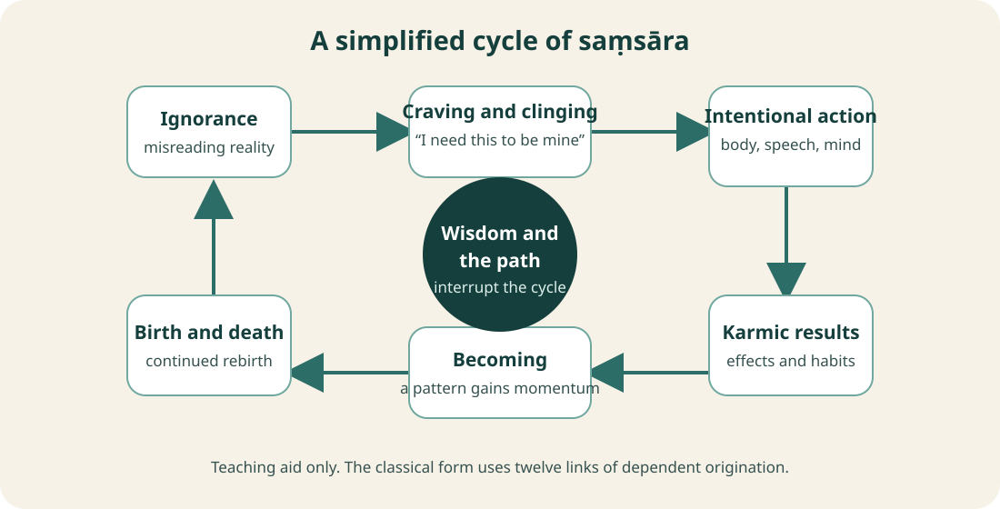

The fuller teaching of dependent origination uses twelve links. Its central point is that suffering arises dependently. When the supporting conditions cease, the suffering process can cease.

## The six realms

The liturgy speaks of six broad modes of rebirth:

| Realm | Traditional character | Why it is not liberation |
|---|---|---|
| **Devas** | Very pleasurable, long lives. | Pleasure can encourage complacency and eventually ends. |
| **Asuras** | Power, competition, envy and conflict. | Strength remains bound to comparison and hostility. |
| **Humans** | A mixture of pleasure, pain, choice and reflection. | Human life is impermanent, but its balance makes practice especially possible. |
| **Animals** | Vulnerability, fear, limited freedom and survival pressure. | Conditions make sustained understanding and choice difficult. |
| **Hungry ghosts** | Insatiable hunger and frustrated grasping. | Wanting cannot be satisfied by obtaining more of the same. |
| **Hells** | Intense pain, terror and confinement. | Suffering overwhelms the opportunity for calm practice, though it is not eternal. |

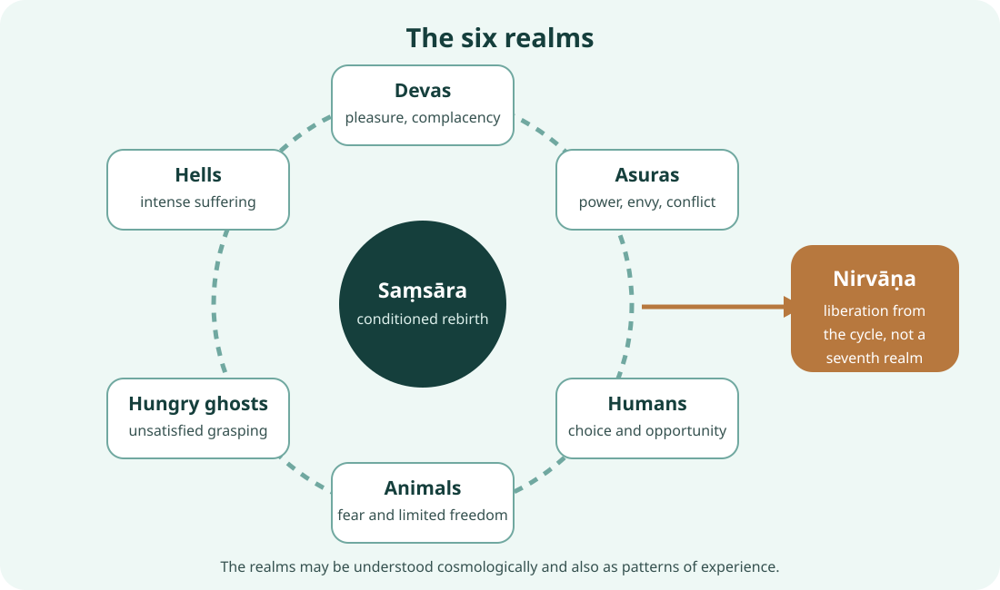

Many Buddhists understand these as real cosmological rebirths. Some also use them as descriptions of mental and social worlds experienced now. These readings can coexist. In either case, no realm is permanent and none equals nirvāṇa.

Human birth is called precious because it combines moral agency, awareness of suffering and access to the Dharma. This is an opportunity, not a claim that human beings are more worthy of compassion.

## Nirvāṇa

Nirvāṇa is liberation from greed, hatred, delusion and the rebirth they sustain. It is not simply a pleasant place after death and not the destruction of a permanent soul. Buddhism denies that such an unchanging soul can be found in the first place.

Texts often describe nirvāṇa through what has ended: grasping, fear, distortion and suffering. They also use positive language such as peace and freedom. Ordinary concepts cannot fully contain it.

## Pure Land

A **Pure Land** is a Buddha-field shaped by a Buddha's vows and awakening. Scroll One focuses on **Sukhāvatī**, Amitābha Buddha's Western Pure Land of Ultimate Bliss.

Pure Land practice commonly includes trusting Amitābha's vows, reciting his name, cultivating virtue, making an aspiration for rebirth there and dedicating merit. The aim is not endless heavenly pleasure. Sukhāvatī provides unusually favourable conditions in which awakening can continue without falling back.

### Is the Pure Land one of the six realms?

Not in the ordinary sense. The six realms describe conditioned rebirth driven by karma and affliction. Amitābha's Pure Land is presented in Mahāyāna sources as a Buddha-field oriented towards non-retrogression and liberation. Traditions differ in how they describe its ultimate status, but it should not be reduced to “Buddhist heaven”.

| Place named in the figure profiles | What it means here |
|---|---|
| **Tuṣita Heaven** | A deva realm within saṃsāra where Maitreya is traditionally understood to dwell before his future birth and awakening. |
| **Sukhāvatī in the west** | Amitābha's Pure Land, shaped by his vows as an exceptionally supportive field for progress towards awakening. |
| **Medicine Master's eastern pure land** | The Buddha-field associated with Medicine Master Buddha and his vows. It is distinct from Amitābha's Sukhāvatī. |

Direction in these devotional descriptions helps distinguish Buddha-fields and ritual relationships. It is not a modern astronomical map.

## Repentance and reform

The English title uses “repentance”, but the Chinese term **chànhuǐ** carries two linked ideas: acknowledging past wrong and changing future conduct.

A complete practice includes:

1. honestly recognising harm;
2. feeling appropriate remorse without self-hatred;
3. disclosing rather than concealing the fault;
4. resolving not to repeat it;
5. repairing harm where possible;
6. cultivating the opposite wholesome quality;
7. understanding that both the action and the person arose through conditions and can change.

There is no creator deity who cancels a sin. Repentance changes the mind and behaviour that support harmful karma. Its images of cleansing describe moral and mental purification.

Chinese Buddhist teaching often distinguishes two connected dimensions:

- **repentance in practice**: prostration, confession, restraint, offerings and vows;
- **repentance through principle**: insight that transgressions and the self have no fixed independent nature.

Scroll One contains both.

## Merit and dedication

**Merit** is the beneficial spiritual potential cultivated by wholesome action, such as generosity, ethical conduct, meditation, chanting or helping others. It is not a currency stored by a cosmic accountant.

To **dedicate merit** is to direct the benefit and aspiration beyond oneself. The liturgy dedicates merit to family, ancestors, deceased beings, friends, enemies and all sentient beings. This expresses gratitude, solidarity and the bodhisattva refusal to keep practice self-centred.

Buddhist traditions explain the mechanics of transfer in different ways. For a beginner, the safest meaning is that practitioners deliberately include others in the purpose, prayer and beneficial consequences of what they have done.

## The six senses

Buddhism counts the **mind** as the sixth sense. Each sense process has three parts: a faculty, an object and the consciousness that arises when conditions meet.

| Faculty | Object | Consciousness |
|---|---|---|
| eye | visible form and colour | visual consciousness |
| ear | sound | auditory consciousness |
| nose | odour | olfactory consciousness |
| tongue | taste | taste consciousness |
| body | touch, pressure, temperature and movement | tactile consciousness |
| mind | thoughts, memories, images and other mental objects | mental consciousness |

The source sometimes calls the objects “six dusts”. Dust is a metaphor for the way grasping at experience can cloud the mind. A sight or sound is not morally bad by itself.

The **eighteen realms** are these six faculties, six objects and six consciousnesses together. The model helps a practitioner observe experience as a conditioned process rather than immediately treating it as “me” or “mine”.

## The five aggregates

The *Heart Sūtra* analyses a person as five changing groups:

1. **form**: the body and material form;
2. **feeling or sensation**: pleasant, unpleasant or neutral tone;
3. **perception**: recognising and labelling;
4. **volitional formations**: intentions, habits and mental activities;
5. **consciousness**: awareness of an object through a sense.

No single aggregate is a permanent self, and no permanent self can be found apart from them. This does not deny a person's everyday existence. It challenges the idea of an independent, unchanging core.

## Emptiness

**Emptiness** means lack of independent, permanent essence. A flower depends on seed, soil, water, light, time and perception. A harmful habit depends on triggers, views, choices and repetition. Because these things are conditioned, they can change.

Emptiness therefore avoids two extremes:

- things do not exist as fixed, isolated substances;
- things are not meaningless or causally ineffective.

In repentance, this means: **the action matters, but it does not define an eternal self**.

## Attachment

Attachment is not every form of care or enjoyment. It is clinging that demands a person, object, view or identity provide lasting security despite change. It can turn love into possession, conviction into rigidity and pleasure into compulsion.

Non-attachment does not mean indifference. A bodhisattva cares deeply while trying not to control what cannot be possessed.

## Bodhi mind and Buddha-nature

**Bodhi mind**, or bodhicitta, is the resolve to attain full awakening for the benefit of all beings. It changes repentance from private guilt into a path of compassion.

**Buddha-nature** is the Mahāyāna teaching that awakening is possible for sentient beings. Traditions explain it in different ways. It should not be mistaken for a hidden permanent soul. In this guide it means that no being is fixed forever in delusion.

## Offerings, incense, bells and prostrations

- **Incense** represents ethical conduct, concentration and an intention spreading through the Dharma realm.
- **Flowers** represent beauty, generosity and impermanence because they blossom and fade.
- **Food offerings** train gratitude and generosity and are ritually extended to all kinds of beings.
- **Bells** gather attention, mark transitions and support a shared pace.
- **Prostrations** express refuge, gratitude and humility through the body. They are not worship of a creator.
- **Joined palms** bring two sides together and embody collected attention and respect.
- **Circumambulation** means walking respectfully around a sacred focus while chanting or recollecting the teaching.

Repeated recitation is a training of attention and intention. The number three often marks the Triple Gem or a complete ritual affirmation. The number 108 is a traditional comprehensive count of afflictions, which is why beads and bell strikes often use it.

## Mantra and dhāraṇī

A **mantra** is a sacred formula used to focus and protect the mind. A **dhāraṇī** is a related formula associated with retaining a teaching or invoking a ritual purpose.

The source prints several formulas in romanised Sanskrit or a Sanskrit-derived liturgical form. A line printed in Latin letters is therefore not necessarily an English translation. It is often a **transliteration**, a way of writing sounds from another language.

Their sounds have passed through Indian, Central Asian and Chinese transmission. Chinese characters were often selected for their approximate sound, and the pronunciation of Chinese then changed over many centuries. A neat word-for-word English translation is not always secure, and a modern reconstruction cannot prove exactly how every ancient reciter sounded.

The companion therefore does four things: preserves the source spelling, gives a gentle English sound cue, identifies words whose meaning is reasonably secure, and explains what the whole formula is doing in the ritual. Where the literal meaning is uncertain, the uncertainty is stated rather than filled with a guess.

In communal chanting, correct practice means following the officiant and the temple's transmitted rhythm. Pronunciation supports recollection, attention and intention; it is not a test of having a perfect foreign accent.

# Part V - Buddhas and bodhisattvas

Most of the principal figures are introduced in Scroll One and invoked again in Scrolls Two and Three. Dīpaṃkara Buddha appears in the lamp praise that opens Scroll Three. Pronunciations are practical English approximations; they do not reproduce every distinction in Sanskrit, Mandarin or Vietnamese.

## How to use these profiles

On a first reading, look for three things in each profile: **who the figure is**, **what the liturgy is doing by naming them**, and **which quality the name brings into repentance**. The story and artwork notes can wait until a second reading.

The labels matter:

- **Canonical account** means the story appears in a Buddhist scripture cited in the source trail.
- **Traditional account** means it belongs to a recognised devotional or narrative tradition, but the profile does not present it as modern historical biography.
- **Recognition cue** means an attribute often used in Buddhist art. Regional and historical forms vary, so one cue is rarely enough to identify an unlabelled image with certainty.

The Water Repentance invokes these figures as awakened teachers, witnesses and models of practice. Calling a name does not transfer moral responsibility to that figure. The practitioner still confesses, reforms conduct, makes vows and dedicates the benefit.

## Four titles first

| Title | Say it like | Meaning |
|---|---|---|
| **Buddha** | *BOOD-uh* | An Awakened One. |
| **Tathāgata** | *tuh-THAH-guh-tuh* | “Thus Come One”, a title of a Buddha. |
| **Bodhisattva** | *boh-dee-SUT-vuh* | One committed to Buddhahood for the benefit of all beings. |
| **Mahāsattva** | *muh-HAH-SUT-vuh* | “Great being”, an honorific for an advanced bodhisattva. |

## Relationships at a glance

| Grouping | Who appears together | Why it helps here |
|---|---|---|
| **Historical teacher and great attendants** | Śākyamuni with Mañjuśrī and Samantabhadra | Wisdom understands the fault; practice carries the remedy into action. This is a common East Asian artistic grouping, although the liturgy also invokes each figure separately. |
| **The two Buddhas in the treasure stūpa** | Śākyamuni and Prabhūtaratna | In the *Lotus Sūtra*, Prabhūtaratna witnesses Śākyamuni's teaching. Their pairing makes truth-telling and reliable witness especially relevant to confession. |
| **Western Pure Land triad** | Amitābha with Avalokiteśvara and Mahāsthāmaprāpta | Amitābha's vows are joined with compassion and the strength of recollection. Scroll One's memorial rite names all three together in the Lotus Pool assembly. |
| **The future Buddha** | Maitreya as bodhisattva now and Buddha in the future | This explains why the source calls Maitreya “Buddha” while many profiles and artworks call Maitreya a bodhisattva. |

These groupings are reading aids, not a claim that every temple image uses the same arrangement. The Medicine Master Buddha, Kṣitigarbha and other figures also have their own assemblies and iconographic traditions.

# Principal Buddhas

## Śākyamuni Buddha

**Say it like:** *SHAH-kyah-MOO-nee BOOD-uh*\
**Name meaning:** Sage of the Śākya people\
**Recognise him:** a monastic Buddha, often touching the earth with his right hand

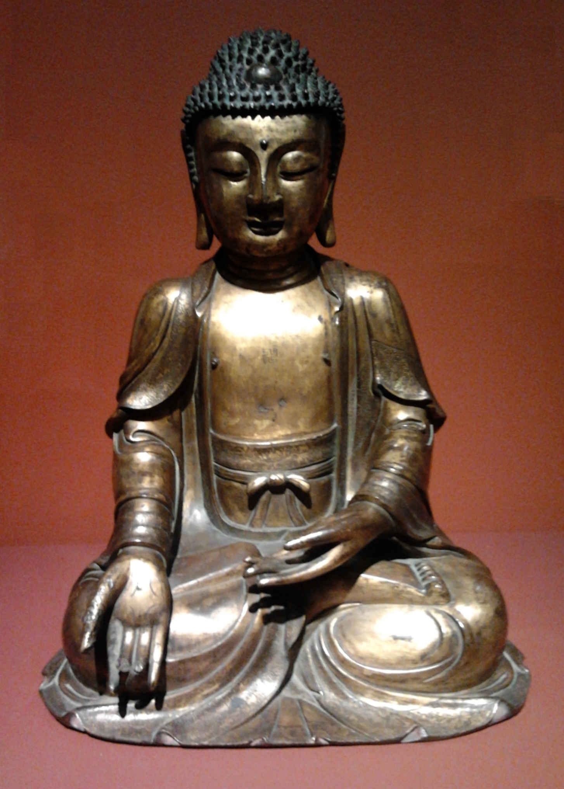

**Traditional life account:** Śākyamuni is the historical teacher of our world. Born Siddhārtha Gautama in ancient India, he left a privileged life, trained with other seekers, rejected both indulgence and punishing self-denial, awakened beneath the bodhi tree and taught a path out of suffering. Buddhist texts tell this life as both the career of a human teacher and the fulfilment of a bodhisattva path cultivated over many lives.

Scroll One calls him “our teacher”. This distinguishes him from the many Buddhas of other ages and worlds invoked in the service. When the liturgy addresses all Buddhas and then returns to Śākyamuni, it moves from universal refuge to the teacher whose Dharma is available in this world.

**Relationship and distinction:** a statue in monastic robes with an earth-touching right hand often represents Śākyamuni's awakening. Monastic robes alone are not decisive because many Buddhas share them. In East Asian art, Mañjuśrī and Samantabhadra may attend him as wisdom and practice.

**Why his name is invoked:** to take refuge in the teacher who made the path known in this world.

**Interesting fact:** “Buddha” is a title, not a surname. Śākyamuni is also the seventh of the Seven Ancient Buddhas named in the liturgy.

**Practice pathway:** see suffering clearly, understand its causes and train in the path that ends them.

**Source trail:** *Water Repentance*, Scroll One, pp. 15-23; [National Museum of Asian Art, Śākyamuni with Mañjuśrī and Samantabhadra](https://asia.si.edu/explore-art-culture/collections/search/edanmdm%3Afsg_F2007.7a-f/).

*Artwork: seventeenth-century Chinese bronze, National Museum in Warsaw. CC0 image via [Wikimedia Commons](https://commons.wikimedia.org/wiki/File:Qing_Dynasty_Shakyamuni_Buddha.jpg).*

## Vairocana Buddha

**Say it like:** *vie-ROH-chah-nah BOOD-uh*\
**Name meaning:** Illuminator, or the one who shines throughout\
**Recognise him:** a central cosmic Buddha, sometimes forming a wisdom-fist hand gesture

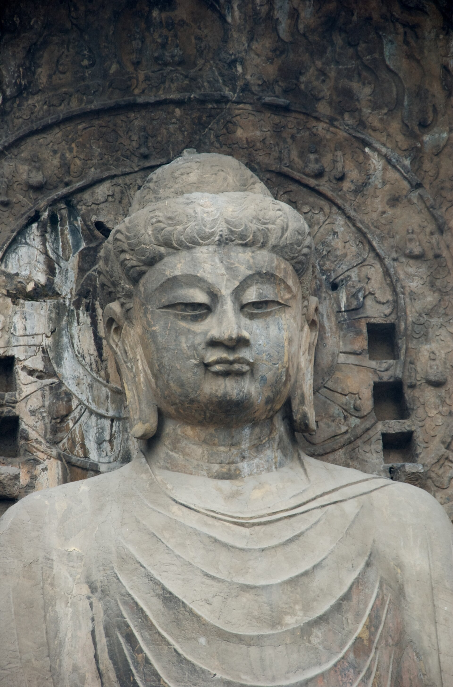

Vairocana embodies the Dharma body, awakened reality and wisdom present without limit. He is especially important in the *Flower Adornment Sūtra* world of vast, interpenetrating Buddha-fields. This does not mean a creator standing outside the universe. Vairocana expresses Buddhahood as all-pervading illumination and the truth realised by awakened wisdom.

The universal offerings in Scroll One fit this vision: one flower becomes limitless offerings, and a single act is understood within the whole Dharma realm.

**Why his name is invoked:** to illuminate hidden motives and place personal reform within a reality larger than the individual.

**Relationship and distinction:** Vairocana and Śākyamuni are both Buddhas, but their emphases differ in this guide. Śākyamuni is “our teacher” in history; Vairocana presents awakened reality in its cosmic or Dharma-body dimension. A wisdom-fist gesture can identify Vairocana in some East Asian esoteric images, but Longmen and other traditions use different forms.

**Interesting fact:** Vairocana is often associated with Mañjuśrī and Samantabhadra. Wisdom and practice reveal the awakened reality he represents.

**Practice pathway:** bring confusion into the light, then let clear seeing reshape conduct.

**Source trail:** *Water Repentance*, Scroll One, pp. 19-23; [Metropolitan Museum of Art, Buddha Vairocana and the wisdom-fist gesture](https://www.metmuseum.org/art/collection/search/73200).

*Artwork: Vairocana at Longmen Grottoes, China. Mario Biondi, [CC BY-SA 3.0](https://creativecommons.org/licenses/by-sa/3.0/), via [Wikimedia Commons](https://commons.wikimedia.org/wiki/File:Longmen.Vairocana.jpg).*

## Amitābha Buddha

**Say it like:** *ah-mee-TAH-bhah BOOD-uh*\
**Name meaning:** Infinite Light\
**Amitāyus:** *ah-mee-TAH-yoos*, Infinite Life\
**Recognise him:** seated in meditation or standing to welcome beings, often with Avalokiteśvara and Mahāsthāmaprāpta

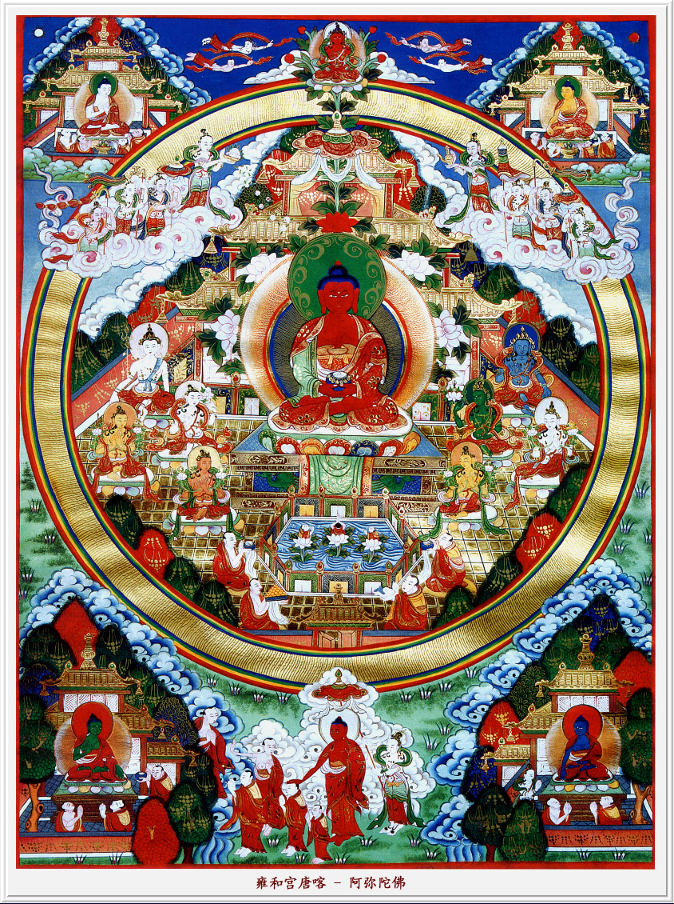

**Canonical account:** Mahāyāna Pure Land scriptures tell that Amitābha was once the bodhisattva Dharmākara. He made forty-eight vows to establish Sukhāvatī, the Western Pure Land of Ultimate Bliss, as an exceptionally supportive place for awakening. These are vows to create conditions for liberation, not a promise that ethics and practice no longer matter.

Scroll One turns towards Amitābha in its dedication, Noon Offering and memorial rite. Recollection of his name gathers attention, while aspiration for the Pure Land directs practice towards non-retrogression and liberation. The memorial rite's Lotus Pool assembly places Amitābha with Avalokiteśvara and Mahāsthāmaprāpta.

**Relationship and distinction:** Amitābha means “Infinite Light” and Amitāyus means “Infinite Life”. The names are closely related and often refer to the same Buddha, although particular ritual and artistic traditions may emphasise one aspect. Sukhāvatī is a Buddha-field for continuing towards awakening, not simply a permanent heaven within the six realms.

**Why his name is invoked:** for mindful recollection, confidence in awakening, care for the deceased and aspiration to favourable conditions for practice.

**Interesting fact:** Amitābha and Amitāyus are two aspects of the same Buddha, emphasising infinite light and infinite life. “Guide and Receiver of the West” is also Amitābha.

**Practice pathway:** return a scattered mind to one wholesome direction, then include all beings in the aspiration.

**Source trail:** *Water Repentance*, Scroll One, pp. 51-64; [Fo Guang Shan, *The Forty-Eight Vows of Amitabha Buddha*](https://www.fgsitc.org/the-forty-eight-vows-of-amitabha-buddha/); [Metropolitan Museum of Art, Amitābha triad](https://www.metmuseum.org/art/collection/search/39882).

*Artwork: ninth-century painting of Amitābha with eight great bodhisattvas. Public domain via [Wikimedia Commons](https://commons.wikimedia.org/wiki/File:Amitabha_Buddha_in_Tangka.jpg).*

## Medicine Master Buddha

**Say it like:** *MED-ih-sin MAS-ter BOOD-uh*\
**Sanskrit:** Bhaiṣajyaguru, approximately *bye-SHAJ-yah-GOO-roo*\
**Name meaning:** Medicine Teacher\
**Recognise him:** a Buddha holding a medicine bowl or medicinal plant, often blue in Tibetan art

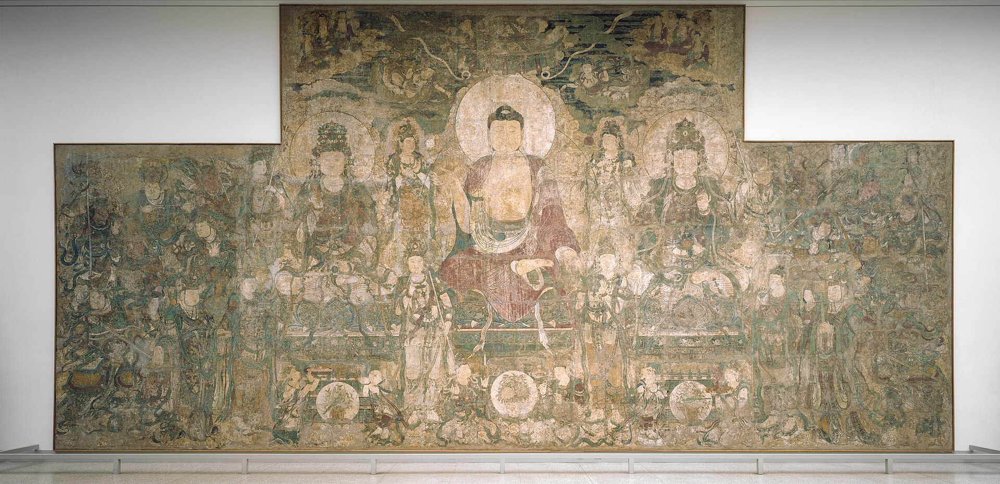

**Canonical account:** the *Scripture of Master of Medicine, Beryl Radiance Tathāgata* presents twelve vows concerned with bodily and mental suffering, material need, ethical confusion and conditions supportive of the path. Healing in this tradition is broader than the promise of a cure. It includes relief from suffering, access to necessities, ethical direction and a life used well.

Scroll One invokes him during the Noon Offering as “disaster-eradicating and longevity-extending”. This is a traditional devotional title, not a substitute for medical care.

**Relationship and distinction:** Medicine Master is associated with an eastern pure land and is often accompanied by Sunlight and Moonlight bodhisattvas and twelve guardian generals. This differs from Amitābha's western Sukhāvatī and its familiar attendant pair. A bowl, staff or medicinal fruit may help identify him, while blue skin is characteristic of some Tibetan images rather than a universal rule.

**Why his name is invoked:** to support healing, protection and the conditions in which wisdom and compassion can grow.

**Interesting fact:** his full title links healing with lapis-lazuli radiance, a clear blue brilliance associated with purity.

**Practice pathway:** identify the cause of harm, apply a fitting remedy and use restored strength to help others.

**Source trail:** *Water Repentance*, Scroll One, p. 55; [BDK America, *The Scripture of Master of Medicine, Beryl Radiance Tathāgata*](https://www.bdkamerica.org/product/the-scripture-of-master-of-medicine-beryl-radiance-tathagata-and-the-sutra-of-the-girl-candrottara/); [Metropolitan Museum of Art, Medicine Buddha mural](https://www.metmuseum.org/art/collection/search/42716).

*Artwork: Chinese mural of Medicine Master Buddha and his assembly, about 1319, Metropolitan Museum of Art. [Public domain](https://commons.wikimedia.org/wiki/File:Buddha_of_Medicine_Bhaishajyaguru_%28Yaoshi_fo%29_-_Google_Art_Project.jpg).*

## Dīpaṃkara Buddha

**Say it like:** *dee-PUNG-kah-rah BOOD-uh*
**Name meaning:** Maker of Light
**Recognise him:** an ancient Buddha standing or seated in monastic robes, sometimes connected with lamps

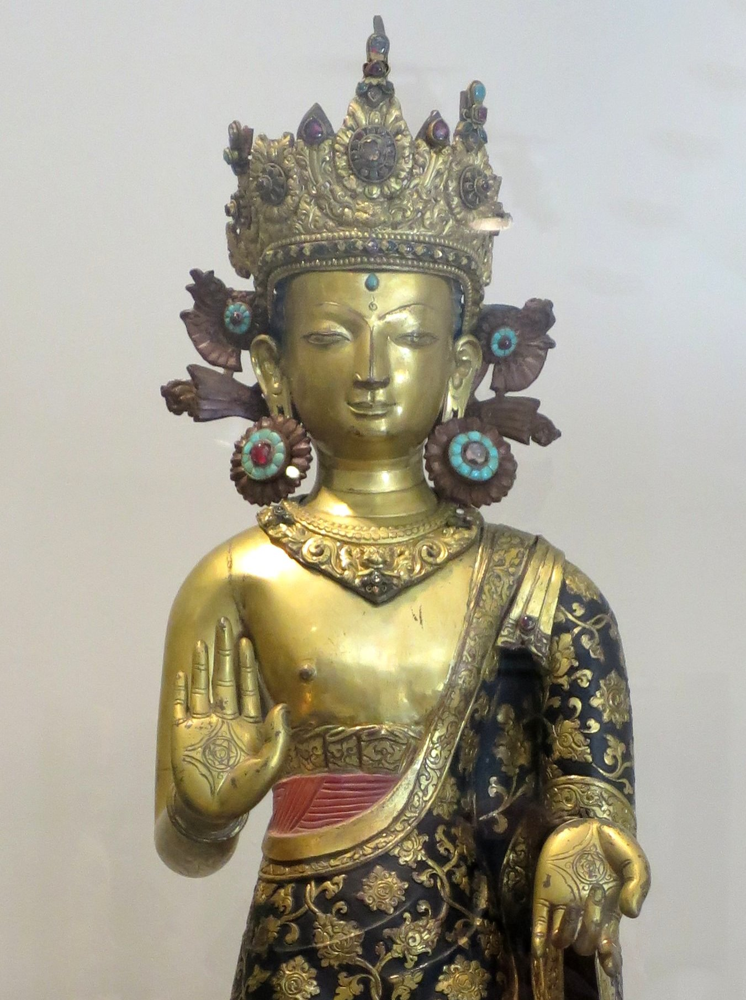

**Traditional account:** the future Śākyamuni was an ascetic named Sumedha, or Sumati in some retellings. Seeing muddy ground before Dīpaṃkara, he spread his hair across it so the Buddha could pass. Dīpaṃkara then predicted that he would one day become Śākyamuni Buddha. The name and details vary across textual and regional traditions, while the central point remains the prediction of future Buddhahood.

Scroll Three invokes Dīpaṃkara in the opening lamp praise. The link between his name and light makes him a fitting figure for wisdom illuminating dark paths.

**Relationship and distinction:** Dīpaṃkara is a Buddha of the distant past; Maitreya is the Buddha expected in the future; Śākyamuni teaches in the present age. Together they make one act of repentance part of a path extending beyond a single lifetime. Lamps are a strong thematic link to Dīpaṃkara's name, but they are not a unique identifier in art.

**Why his name is invoked:** to recall long-term aspiration, humility and confidence that a vow can mature across an immense path.

**Interesting fact:** the meeting between Dīpaṃkara and Sumedha became a frequent subject in Buddhist art because it represents a future Buddha receiving confirmation of his path.

**Practice pathway:** make a sincere commitment now, even when its full result lies far beyond the present moment.

**Source trail:** *Water Repentance*, Scroll Three, p. 3; [Norton Simon Museum, Dīpaṃkara Buddha](https://50.nortonsimon.org/collections/dipankara-buddha/); [Metropolitan Museum of Art, Dīpaṃkara and Sumedha](https://www.metmuseum.org/art/collection/search/42719).

*Artwork: Nepalese gilt image of Dīpaṃkara, about 1600-1650, Norton Simon Museum. CC0 image via [Wikimedia Commons](https://commons.wikimedia.org/wiki/File:%27Dipankara_Buddha%27,_Nepal,_Norton_Simon_Museum_%28cropped%29.JPG).*

## Maitreya

**Say it like:** *my-TRAY-yah*\
**Name meaning:** the Loving or Friendly One\
**Recognise him:** a princely bodhisattva, or in East Asia through the smiling monk Budai

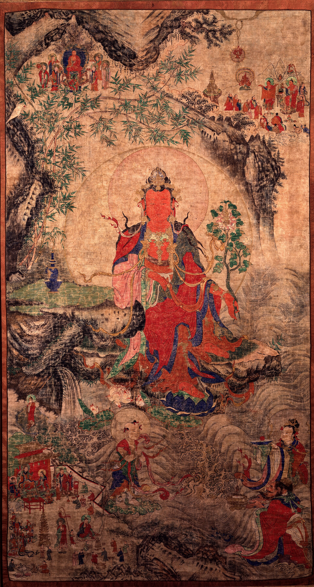

**Canonical account:** Maitreya is the bodhisattva who will become the next Buddha in this world after Śākyamuni's teaching has disappeared. Canonical and later Buddhist sources place him in Tuṣita Heaven while he awaits his final birth and future awakening.

Scroll One calls him “future descending-birth, honoured Maitreya Buddha”, speaking from the perspective of his future awakening.

**Relationship and distinction:** “Maitreya Bodhisattva” describes his present role; “Maitreya Buddha” anticipates his future awakening. These are two stages associated with one figure, not two separate sacred beings.

**Why his name is invoked:** to cultivate loving-kindness, patience and confidence that the Dharma can appear again in difficult times.

**Interesting fact:** the familiar round-bellied smiling figure in many East Asian temples is Budai, a Chinese monk later regarded as a manifestation of Maitreya. Princely images with a water flask belong to an older Maitreya tradition, so the two forms can look completely different.

**Practice pathway:** let repentance open a constructive future rather than remain fixed on the past.

**Source trail:** *Water Repentance*, Scroll One, pp. 15-23 and 55; [BDK America, *The Sutra That Expounds the Descent of Maitreya Buddha and His Enlightenment*](https://www.bdkamerica.org/product/the-sutra-that-expounds-the-descent-of-maitreya-buddha-and-his-enlightenment-and-the-sutra-of-manjusris-questions/); [Metropolitan Museum of Art, Maitreya and Tuṣita](https://www.metmuseum.org/essays/gandhara); [Metropolitan Museum of Art, Budai](https://www.metmuseum.org/art/collection/search/42545).

*Artwork: fifteenth-century painting of Maitreya, Rubin Museum of Art. Public domain via [Wikimedia Commons](https://commons.wikimedia.org/wiki/File:Bodhisattva_Maitreya,_the_Future_Buddha_-_Google_Art_Project.jpg).*

## Prabhūtaratna Buddha

**Say it like:** *prah-BOO-tah-RUT-nah BOOD-uh*\
**Name meaning:** Many Treasures\
**Recognise him:** seated beside Śākyamuni inside or above a treasure stūpa

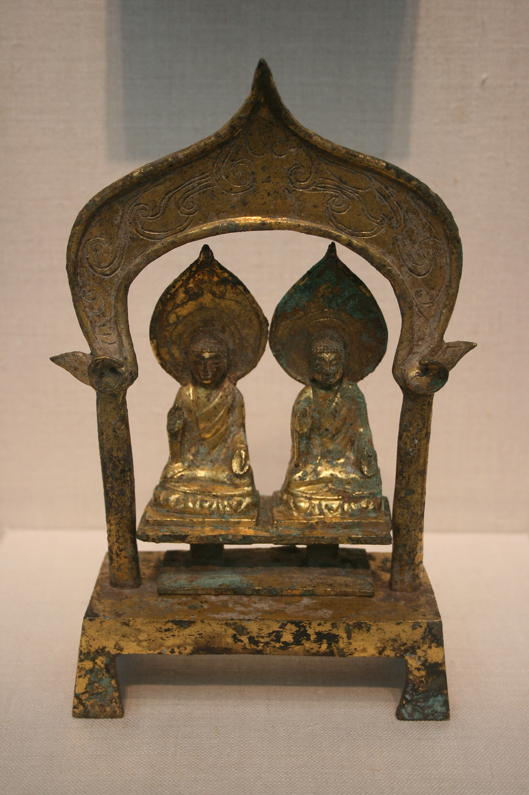

**Canonical account:** in Chapter 11 of the *Lotus Sūtra*, Prabhūtaratna's treasure stūpa rises from the earth wherever that teaching is proclaimed. He praises the teaching as true, invites Śākyamuni to share his seat and bears witness before the assembly.

Scroll One includes both the stūpa and Prabhūtaratna in its Samantabhadra visualisation and Buddha-name litany.

**Relationship and distinction:** paired Buddhas inside a stūpa commonly represent Prabhūtaratna and Śākyamuni. Prabhūtaratna is not the same figure as Dīpaṃkara, another Buddha of the past. In this guide, Dīpaṃkara points to the long maturation of a vow, while Prabhūtaratna points to witness and the continuity of true teaching.

**Why his name is invoked:** to place the practice before an awakened witness and affirm the continuity of the Dharma.

**Interesting fact:** East Asian images of two Buddhas seated together usually depict this scene, not two unrelated teachers.

**Practice pathway:** stop hiding the truth and make reform accountable before a worthy witness.

**Source trail:** *Water Repentance*, Scroll One, pp. 11-12 and 19-23; [BDK America, *The Lotus Sutra*, Chapter 11, PDF pp. 183-190](https://www.bdkamerica.org/product/the-lotus-sutra-revised-second-edition/).

*Artwork: Śākyamuni and Prabhūtaratna, China, dated 609. Gary Todd, CC0 via [Wikimedia Commons](https://commons.wikimedia.org/wiki/File:Sui_Gilt_Bronze_Buddha_of_Past_and_Present,_609_AD_%2810433528426%29.jpg).*

# Principal bodhisattvas

## Avalokiteśvara Bodhisattva

**Say it like:** *ah-vah-loh-kee-TAYSH-vah-rah*\
**Common English or Chinese name:** Guanyin, *gwahn-yin*\
**Name meaning:** commonly understood in East Asia as the one who observes the cries of the world\
**Recognise this figure:** a lotus, vase of pure water, willow branch, many arms, or a small Amitābha image in the crown

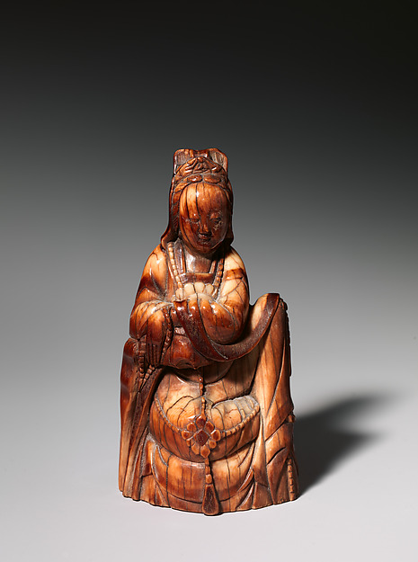

**Canonical account:** Avalokiteśvara embodies compassion that hears suffering and responds in whatever form can help. Chapter 25 of the *Lotus Sūtra* describes this responsiveness through many forms suited to different beings. In the *Heart Sūtra* recited during the memorial rite, this bodhisattva also embodies profound wisdom by seeing the five aggregates as empty.

**Relationship and distinction:** Guanyin is the Chinese name by which Avalokiteśvara is widely known. The small Amitābha image sometimes worn in the crown connects Guanyin with Amitābha's Pure Land. A vase and willow branch are common East Asian cues; a lotus and many-armed forms belong to other established forms. No single attribute appears in every image.

**Why the name is invoked:** for responsive compassion joined with insight.

**Interesting fact:** Indian images are often masculine. In China, Vietnam and other parts of East Asia, Guanyin is often represented in a feminine form. These are not separate bodhisattvas.

**Practice pathway:** listen fully before defending yourself, then respond in a way that actually reduces suffering.

**Source trail:** *Water Repentance*, Scroll One, pp. 19-23 and 59-64; [Fo Guang Shan, *The Heart Sūtra*](https://www.fgsitc.org/wp-content/uploads/2024/04/Heart-Sutra-2016.pdf); [BDK America, *The Lotus Sutra*, Chapter 25, PDF pp. 311-318](https://www.bdkamerica.org/product/the-lotus-sutra-revised-second-edition/); [Metropolitan Museum of Art, Avalokiteśvara and Mahāsthāmaprāpta](https://www.metmuseum.org/art/collection/search/44798).

*Artwork: Guanyin, China, late seventeenth to early eighteenth century, Metropolitan Museum of Art. [Public domain](https://www.metmuseum.org/art/collection/search/39856).*

## Mañjuśrī Bodhisattva

**Say it like:** *mun-joo-SHREE*\
**Name meaning:** Wondrous Glory or Wondrous Auspiciousness\
**Recognise this figure:** a flaming sword, wisdom scripture, lotus or lion mount

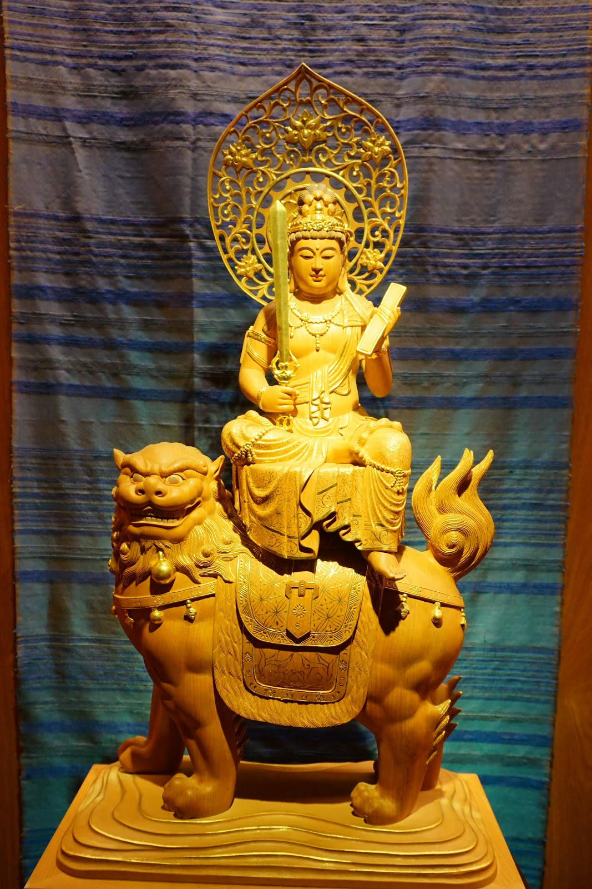

Mañjuśrī embodies the wisdom that recognises emptiness and cuts through confused views. In Mahāyāna sūtras he often asks or answers the question that exposes the heart of a teaching. “Wisdom” here is insight into conditions, impermanence and emptiness, joined with the ability to choose a skilful response.

**Relationship and distinction:** Mañjuśrī and Samantabhadra often attend Śākyamuni as wisdom and practice. The pairing is useful in repentance: understanding why harm arose is incomplete until a corrective action follows, while determined action without clear understanding can repeat the same confusion.

**Why the name is invoked:** to understand the conditions behind harmful action and avoid mistaking shame for wisdom.

**Interesting fact:** the sword is not a weapon against people. It represents insight cutting through ignorance. The lion expresses the fearless voice of the Dharma.

**Practice pathway:** ask which assumption, story or misperception allowed the action to seem reasonable.

**Source trail:** *Water Repentance*, Scroll One, pp. 19-23 and 55; [Metropolitan Museum of Art, Mañjuśrī's sword and wisdom text](https://www.metmuseum.org/art/collection/search/39420); [National Museum of Asian Art, Śākyamuni with Mañjuśrī and Samantabhadra](https://asia.si.edu/explore-art-culture/collections/search/edanmdm%3Afsg_F2007.7a-f/).

*Artwork: traditional image of lion-riding Mañjuśrī. Public domain via [Wikimedia Commons](https://commons.wikimedia.org/wiki/File:Manjusri_on_Lion.jpg).*

## Samantabhadra Bodhisattva

**Say it like:** *sah-MUN-tah-BHAD-rah*\
**Name meaning:** Universal Worthy or All-encompassing Good\
**Recognise this figure:** a white elephant, often with six tusks

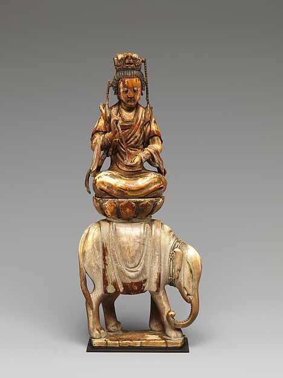

**Traditional practice account:** Samantabhadra embodies vows carried into practice. His ten great vows include homage, praise, offering, repentance, rejoicing in goodness, requesting the teaching, asking Buddhas to remain, learning, helping beings and dedicating merit. Several of these actions structure the Water Repentance itself.

Scroll One gives him its richest visualisation. The practitioner imagines Samantabhadra seated on a lotus, filling the Dharma realm with light and offerings, and then invokes him again at major transitions. The visualisation expands a physically limited offering into an intention directed towards all beings.

**Relationship and distinction:** Mañjuśrī represents insight and Samantabhadra represents its enactment. The white elephant and six tusks are common East Asian recognition cues. Fo Guang Shan reads the six tusks as the six perfections, although artistic details differ and an elephant alone does not prove an image's identity.

**Why the name is invoked:** to turn remorse into sustained compassionate conduct.

**Interesting fact:** Fo Guang Shan explains the six tusks as the six perfections. The white elephant joins purity with strong, steady movement.

**Practice pathway:** make the next wholesome action specific enough to perform and repeat.

**Source trail:** *Water Repentance*, Scroll One, pp. 11-15 and 55; [Fo Guang Shan, Samantabhadra Bodhisattva Shrine](https://www.fgs.org.tw/en/templetour/Index/8); [National Museum of Asian Art, Śākyamuni with Mañjuśrī and Samantabhadra](https://asia.si.edu/explore-art-culture/collections/search/edanmdm%3Afsg_F2007.7a-f/).

*Artwork: Samantabhadra riding an elephant, China, twelfth to fourteenth century, Metropolitan Museum of Art. [Public domain](https://www.metmuseum.org/art/collection/search/39634).*

## Mahāsthāmaprāpta Bodhisattva

**Say it like:** *mah-HAH-stah-mah-PRAHP-tah*\
**Name meaning:** Arrival of Great Strength\
**Recognise this figure:** beside Amitābha, often with a water-vase emblem in the crown

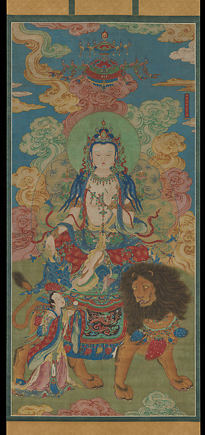

Mahāsthāmaprāpta represents the strength of wisdom, concentration and continuous recollection. Along with Avalokiteśvara, this bodhisattva attends Amitābha in the familiar Western Pure Land triad.

**Relationship and distinction:** Avalokiteśvara expresses responsive compassion; Mahāsthāmaprāpta expresses the strength that keeps recollection and aspiration steady. In some East Asian images, Avalokiteśvara has a small Amitābha in the crown and Mahāsthāmaprāpta has a vase emblem. Position alone is unreliable because arrangements can reverse or vary.

In Scroll One's memorial rite, the three sit together on lotus thrones. Their grouping joins the destination of practice, compassionate response and the collected strength needed to continue.

**Why the name is invoked:** to gather a scattered mind and sustain wholesome recollection.

**Interesting fact:** the “great strength” is not domination. It is the power of a mind no longer pulled in every direction.

**Practice pathway:** choose a wholesome recollection and return to it until it becomes stronger than the old reaction.

**Source trail:** *Water Repentance*, Scroll One, pp. 55-64; [Metropolitan Museum of Art, Amitābha triad](https://www.metmuseum.org/art/collection/search/39882); [Metropolitan Museum of Art, Avalokiteśvara and Mahāsthāmaprāpta](https://www.metmuseum.org/art/collection/search/44798).

*Artwork: Mahāsthāmaprāpta, China, late seventeenth to early eighteenth century, Metropolitan Museum of Art. [Public domain](https://www.metmuseum.org/art/collection/search/36069).*

## Kṣitigarbha Bodhisattva

**Say it like:** *kshih-tee-GAHR-bhah*\
**Name meaning:** Earth Treasury\
**Recognise this figure:** a monastic with a staff and wish-fulfilling jewel

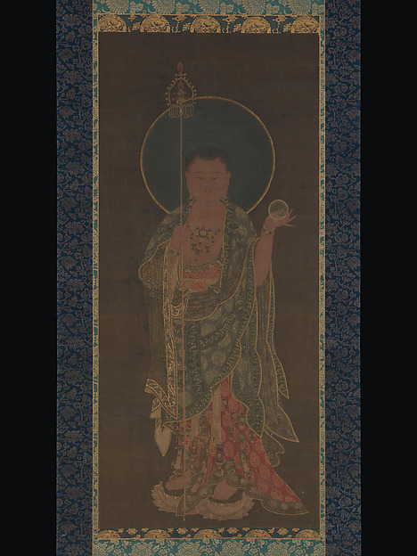

**Canonical account:** Kṣitigarbha is renowned for immense vows to help beings in the hells and other states of severe suffering. The *Sūtra on the Past Vows of Kṣitigarbha Bodhisattva* tells of earlier lives in which filial concern for a suffering mother expands into a vow to liberate all suffering beings. This makes the figure especially relevant to memorial dedication without limiting the compassion to one's own family.

**Reading note:** the popular formula “until the hells are empty, I vow not to become a Buddha” accurately expresses the tradition's ideal, but the 2026 BDK translation notes that this exact sentence does not appear in the sūtra. The guide therefore presents it as a traditional summary rather than a direct quotation.

**Relationship and distinction:** Kṣitigarbha often appears in monastic robes with a ringed staff and wish-fulfilling jewel. This is unusual among major bodhisattvas, who are often shown in princely dress. The Water Repentance's long accounts of painful realms make his refusal to abandon beings there directly relevant to its movement from remorse to universal care.

**Why the name is invoked:** to extend responsibility and compassion to beings who seem most difficult to reach.

**Interesting fact:** unlike princely bodhisattvas covered in jewels, Kṣitigarbha often appears as a simple monastic. The image suggests closeness to places of suffering.

**Practice pathway:** do not abandon the person or situation merely because help will be slow and difficult.

**Source trail:** *Water Repentance*, Scroll One, pp. 19-23 and 55; [BDK America, *Sūtra on the Past Vows of Kṣitigarbha Bodhisattva*, introduction at PDF pp. 56-58 and vow narrative at pp. 67-71](https://www.bdkamerica.org/wp-content/uploads/2026/07/dBET_Diamond_Ksitigarbha_GoldenLight.pdf); [Metropolitan Museum of Art, Kṣitigarbha as a monastic with staff and jewel](https://www.metmuseum.org/art/collection/search/53175).

*Artwork: Kṣitigarbha, Korea, first half of the fourteenth century, Metropolitan Museum of Art. [Public domain](https://www.metmuseum.org/art/collection/search/39883).*

## Mahāvyūha Bodhisattva

**Say it like:** *mah-HAH-VYOO-hah*\
**Name meaning:** Great Adornment or Great Array

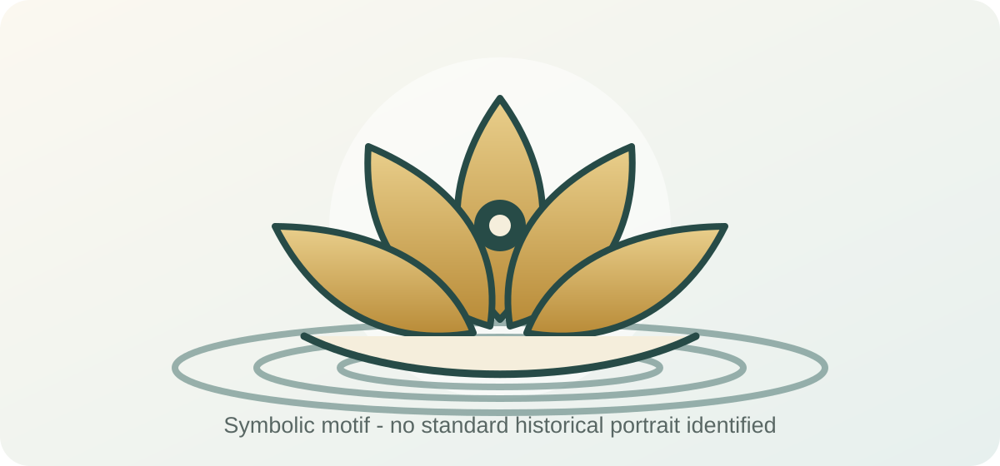

Scroll One includes Mahāvyūha in its repeated bodhisattva litany, as do Scrolls Two and Three, but the English source gives no independent story or identifying attributes. “Great Adornment” and “Great Array” are cautious ways to read the Sanskrit components of the name. They are reading aids, not a secure biography.

No securely standard portrait has been identified for this figure. The symbolic lotus avoids mislabelling a generic image. The practice pathway below is an application of the name's possible sense, not a claim that the liturgy supplies a separate Mahāvyūha teaching.

**Practice pathway:** adorn life through conduct rather than appearance alone.

**Source trail:** *Water Repentance*, Scroll One, pp. 19-23; Scroll Two, pp. 4-8; Scroll Three, pp. 4-7. No separate iconographic source is asserted.

# The Seven Ancient Buddhas

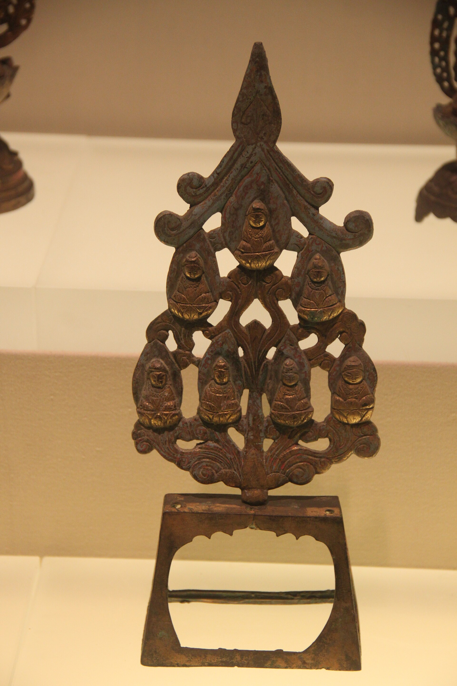

Scroll One invokes a traditional succession of seven Buddhas. The first three belong to a previous world age. The final four, ending with Śākyamuni, belong to the present fortunate age. Their recitation places one act of repentance within a long continuity of awakening.

An early Buddhist discourse preserved in Sanskrit and related traditions names the same sequence. The Water Repentance then names Maitreya separately as the future Buddha. Maitreya is therefore not an eighth member of this particular “Seven Ancient Buddhas” set.

| Buddha | Say it like | Note |
|---|---|---|
| **Vipaśyin** | *vih-PUSH-yin* | Often understood as Clear-Seeing. |
| **Śikhin** | *SHEE-kin* | A past Buddha, not Śikhin Brahmā. |
| **Viśvabhū** | *VISH-vah-BOO* | A Buddha of an earlier world age. |
| **Krakucchanda** | *krah-koot-CHUN-dah* | First Buddha of the present fortunate age. |
| **Kanakamuni** | *kah-nah-kah-MOO-nee* | Second Buddha of the present fortunate age. |
| **Kāśyapa Buddha** | *KAH-shyah-pah* | Buddha immediately before Śākyamuni, not the disciple Mahākāśyapa. |
| **Śākyamuni** | *SHAH-kyah-MOO-nee* | The historical teacher of our world. |

**Why the seven are invoked:** the liturgy confesses before a succession of awakened teachers rather than treating purification as a private invention. The repeated Seven Buddhas Offence-Extinguishing Mantra later gathers that continuity into a short closing chant. The title gives the secure ritual purpose; the transmitted syllables should not be turned into an invented word-for-word translation.

**Recognition limit:** sets of seven Buddha images may represent this succession, but unlabelled figures can look almost identical. Sequence, inscriptions and collection records are more dependable than guessing from robe or hand gesture alone.

**Source trail:** *Water Repentance*, Scroll One, pp. 15-18 and 51; [SuttaCentral, *Mahāvadāna*, “The Characteristics of the Seven Buddhas”](https://suttacentral.net/sf36/san/null).

*Artwork: Chinese sculpture of the Seven Buddhas, Tang to Five Dynasties period. CC0 via [Wikimedia Commons](https://commons.wikimedia.org/wiki/File:Tang_to_Five_Dynasties_Seven_Buddhas_%2817089332696%29.jpg).*

# Buddhas in the repeated litany

The source names several Buddhas without giving stories or distinctive iconography. Their liturgical purpose is clear: they form an awakened assembly before whom confession and vows are made. A long translated title can evoke wisdom, sovereignty, a lotus, a monastic robe or a lion's roar without giving enough evidence for a separate life story or portrait. The guide therefore explains recognisable name elements and does not invent biographies.

| Name | Easy pronunciation | Secure beginner note |
|---|---|---|
| **Nāgagotrodārajñānarāja** | *NAH-gah-goh-troh-DAH-rah-NYAH-nah-RAH-jah* | A Buddha whose long title is associated with a noble dragon or nāga lineage and wisdom. |
| **Nāgeśvararāja** | *nah-GAYSH-vah-rah-RAH-jah* | “Sovereign King of Nāgas” or “Dragon Sovereign King”. |
| **Buddhapuṇḍarīkadhyaneśvararāja** | *BOOD-dhah-poon-dah-REE-kah-DYAH-nay-shvah-rah-RAH-jah* | A title joining the awakening lotus, meditation and sovereign mastery. |
| **Kasayadhvaja** | *kah-SAH-yah-dvah-jah* | “Banner of the monastic robe”, an image of renunciation and the Dharma made visible. |
| **Siṃhanāda** | *SING-hah-NAH-dah* | “Lion's Roar”, an image of fearless Dharma teaching. |

These names are easiest to use as part of the litany's movement: bow, acknowledge the awakened witness, confess, and make the answering vow. For pronunciation, accuracy means a calm, recognisable reading and following the officiant rather than mastering every compound before participating.

# Ritual and collective invocations

Some titles sound like individual people but function more naturally as invocations of an image, quality or assembly.

| Invocation | Meaning in context |
|---|---|
| **Incense Cloud Canopy Bodhisattva-Mahāsattvas** | The fragrant offering imagined as a vast canopy reaching awakened assemblies. |
| **Precious Uḍumbara Blossom Bodhisattva-Mahāsattvas** | An auspicious blossom famous in Buddhist literature for rarity, used here in an offering and homage context. No secure individual biography is supplied. |
| **Equal Awakening Stage Bodhisattva-Mahāsattvas** | Advanced bodhisattvas at the stage immediately preceding complete Buddhahood. |
| **Pure Cool Ground Bodhisattva-Mahāsattvas** | A memorial invocation of purity and relief from the “heat” of affliction. |
| **Dhyāna Bliss Treasury Bodhisattva-Mahāsattvas** | A personified image of the deep joy and ease associated with meditation. |
| **Sanghārāma Bodhisattvas** | Protectors of monasteries and Buddhist practice places. |

The plural **bodhisattva-mahāsattvas** in these invocations is significant. It supports reading them as assemblies or personified ritual qualities unless a reliable source identifies an individual figure. This is why the guide provides no invented costume, life story or portrait for them.

**Source trail:** *Water Repentance*, Scroll One, pp. 7, 15, 51, 56, 58 and 59. These are the source locations of the six invocations listed above.

# Part VI - Pronunciation

This guide aims for a confident, recognisable first reading. It is not a substitute for listening to a temple officiant or trained language speaker.

Use **Buddhas and bodhisattvas in the three scrolls** when you need to know who a name identifies. Use this section when you know the figure and need a practical first pronunciation. Capital letters mark emphasis, not extra volume.

## Quick Sanskrit key

| Printed form | Approximate sound |
|---|---|
| **ā** | “ah”, held a little longer |
| **ī** | “ee” |
| **ū** | “oo” |
| **ś, ṣ** | “sh” for an easy first reading |
| **c** | “ch” |
| **j** | “j” as in “jam” |
| **ñ** | “ny” as in “canyon” |
| **kṣ** | roughly “ksh” |
| **ṃ, ṁ** | a nasal sound coloured by the next consonant |
| **bh, dh, gh** | a consonant followed by a light breath; plain “b”, “d” or “g” is acceptable for a beginner |

Capital letters below show the strongest syllable. Hyphens mark comfortable reading units rather than exact linguistic syllables.

## Names used often

| Name | Easy English pronunciation |
|---|---|
| **Śākyamuni** | *SHAH-kyah-MOO-nee* |
| **Vairocana** | *vie-ROH-chah-nah* |
| **Amitābha** | *ah-mee-TAH-bhah* |
| **Amitāyus** | *ah-mee-TAH-yoos* |
| **Maitreya** | *my-TRAY-yah* |
| **Bhaiṣajyaguru** | *bye-SHAJ-yah-GOO-roo* |
| **Dīpaṃkara** | *dee-PUNG-kah-rah* |
| **Avalokiteśvara** | *ah-vah-loh-kee-TAYSH-vah-rah* |
| **Guanyin** | *gwahn-yin* |
| **Mañjuśrī** | *mun-joo-SHREE* |
| **Samantabhadra** | *sah-MUN-tah-BHAD-rah* |
| **Mahāsthāmaprāpta** | *mah-HAH-stah-mah-PRAHP-tah* |
| **Kṣitigarbha** | *kshih-tee-GAHR-bhah* |
| **Prabhūtaratna** | *prah-BOO-tah-RUT-nah* |
| **Mahāvyūha** | *mah-HAH-VYOO-hah* |
| **Dharmākara** | *dhar-MAA-kah-rah* |
| **Tuṣita** | *TOO-shih-tah* |
| **Budai** | *boo-dye* |

### Same figure, another name

| Name you may encounter | Name used in these profiles | Reading note |
|---|---|---|
| **Guanyin** | Avalokiteśvara | The familiar Chinese name of the bodhisattva of compassion. |
| **Amituofo** | Amitābha Buddha | A Mandarin name-recitation form, approximately *ah-mee-twoh-foh*. |
| **Yaoshi Fo** | Medicine Master Buddha | Chinese for the Medicine Buddha. |
| **Dizang** | Kṣitigarbha | The Chinese name meaning “Earth Treasury”. |
| **Wenshu** | Mañjuśrī | The Chinese name of the bodhisattva of wisdom. |
| **Puxian** | Samantabhadra | The Chinese name of the bodhisattva of great practice and vows. |
| **Dashizhi** | Mahāsthāmaprāpta | The Chinese name of Amitābha's attendant associated with great strength. |
| **Mile** | Maitreya | The Chinese name of the future Buddha. |

These spellings help with recognition. Mandarin tones and local liturgical pronunciation should be learnt by listening. Also distinguish **Kāśyapa Buddha**, the Buddha before Śākyamuni in the Seven Ancient Buddhas, from **Mahākāśyapa**, Śākyamuni's disciple.

## Important Buddhist terms

| Term | Easy English pronunciation |
|---|---|
| **Buddha** | *BOOD-uh* |
| **bodhisattva** | *boh-dee-SUT-vuh* |
| **mahāsattva** | *muh-HAH-SUT-vuh* |
| **Dharma** | *DAR-muh* |
| **Sangha** | *SUNG-huh* |
| **Tathāgata** | *tuh-THAH-guh-tuh* |
| **Mahāyāna** | *muh-hah-YAH-nuh* |
| **samādhi** | *suh-MAH-dee* |
| **saṃsāra** | *sum-SAH-ruh* |
| **nirvāṇa** | *neer-VAH-nuh* |
| **karma** | *KAR-muh* |
| **sūtra** | *SOO-truh* |
| **dhāraṇī** | *DHAH-ruh-nee* |
| **pāramitā** | *pah-ruh-mee-TAH* |
| **prajñā** | *PRUJ-nyah* |
| **Sukhāvatī** | *soo-KHAH-vah-tee* |
| **Śāriputra** | *SHAH-ree-POO-truh* |
| **Uḍumbara** | *oo-DOOM-bah-rah* |
| **dhyāna** | *DYAH-nuh* |
| **stūpa** | *STOO-puh* |

## Chanting the non-English lines

The English headings translate the **names and purposes** of the chants. The Latin-letter lines beneath them preserve Sanskrit or Sanskrit-derived sounds. They are transliterations, not badly translated English.

The cues below pronounce the source's Latin-letter form. Fo Guang Shan communal chanting follows its Chinese liturgical transmission, so the pinyin line and the officiant take priority when their sound differs from this cue.

| Small form | Easy reading cue | Meaning or function |
|---|---|---|
| **namaḥ / namo** | *NAH-mah / NAH-moh* | Homage, honour or taking refuge. |
| **oṃ** | *ohm* | A sacred opening syllable. |
| **hūṃ** | *hoom*, ending nasally with the lips together | A forceful mantra syllable used to gather or seal intention. |
| **svāhā** | *SWAA-hah* | A traditional ending marking offering, fulfilment or completion. |
| **hoḥ** | *hoh*, ending with a soft breath | A concluding ritual syllable. |

### Seven Buddhas Offence-Extinguishing Mantra

**Appears in:** all three scrolls.

> **Source form:** *ripa ripate kuha kuhate tranite nigalate*\
> *vimarite mahāgate jāmlamcamte svāhā*\
> **Easy cue:** *REE-pah REE-pah-tay, KOO-hah KOO-hah-tay, TRAH-nee-tay, NEE-gah-lah-tay; VEE-mah-ree-tay, mah-HAA-gah-tay, JAHM-lahm-CHAHM-tay, SWAA-hah.*

The complete wording is not secure Classical Sanskrit and should not be forced into a word-by-word translation. Its title gives the dependable sense: purification of offences and karmic obstructions through the witness and blessing of the Seven Buddhas. *Mahā* means “great”; *gate* is related to going or having gone; *svāhā* closes the formula.

### Heart Sūtra mantra

**Appears in:** the memorial rites of Scrolls One and Three.

> **Source form:** *gate gate pāragate pārasaṃgate bodhi svāhā*\
> **Easy cue:** *GAH-tay GAH-tay PAA-rah-gah-tay PAA-rah-sung-gah-tay BOH-dhee SWAA-hah.*

A common interpretive sense is “gone, gone, gone beyond, gone completely beyond, awakening, svāhā”. It points beyond fear and clinging, not to physical travel.

### Rebirth in the Pure Land Dhāraṇī

**Appears in:** the memorial rites of Scrolls One and Three.

> **Source form:** *Namo'mitābhāya tathāgatāya tadyathā*\
> *[oṃ] amṛtod bhave amṛta-siddhaṃ bhave*\
> *amṛta-vikrānte amṛta-vikrānta*\
> *gāmini gagana kīrta kāre svāhā*\
> **Easy cue:** *NAH-moh ah-mee-TAA-bhaa-yah tah-THAA-gah-taa-yah tud-yuh-THAA; ohm uh-MRIH-tohd BHAH-vay, uh-MRIH-tah SID-dhum BHAH-vay; uh-MRIH-tah vee-KRAAN-tay, uh-MRIH-tah vee-KRAAN-tah; GAA-mee-nee GAH-gah-nah KEER-tah KAA-ray SWAA-hah.*

The opening means “Homage to Amitābha Tathāgata; thus”. *Amṛta* is “deathless” or “nectar”, and *siddhaṃ* concerns accomplishment. The overall function is purification and aspiration for rebirth in Amitābha's Pure Land. The later transmitted wording is not translated more narrowly than the evidence permits.

### Transformation of Food Dhāraṇī

**Appears in:** the Noon Offering and memorial rites of Scroll One, and the memorial rite of Scroll Three.

> **Source form:** *Namaḥ sarva-tathāgatāvalokite; oṃ sambhara sambhara hūṃ*\
> **Easy cue:** *NAH-mah SAR-vah tah-THAA-gah-TAA-vah-loh-kee-tay; ohm SUM-bha-rah SUM-bha-rah hoom.*

The opening honours all Tathāgatas who behold. The formula expresses gathering, supplying or making the offering abundant so that a limited portion can be offered to innumerable beings.

### Sweet Dew Dhāraṇī

**Appears in:** the Noon Offering and memorial rites of Scroll One, and the memorial rite of Scroll Three.

> **Source form:** *Namaḥ surūpāya tathāgatāya tadyathā; oṃ suru suru pra suru pra suru svāhā*\
> **Easy cue:** *NAH-mah soo-ROO-paa-yah tah-THAA-gah-taa-yah tud-yuh-THAA; ohm SOO-roo SOO-roo prah SOO-roo prah SOO-roo SWAA-hah.*

The opening honours the Beautiful-Form Tathāgata. The repeated *suru* sounds are retained without inventing a separate meaning. “Sweet dew” is deathless nectar, an image of cooling nourishment, Dharma relief and liberation.

### Universal Offering Dhāraṇī

**Appears in:** the Noon Offering and memorial rites of Scroll One, and the memorial rite of Scroll Three.

> **Source form:** *Oṃ gagana sambhava vajra hoḥ*\
> **Easy cue:** *ohm GAH-gah-nah SUM-bha-vah VAJ-rah hoh.*

The recognisable words suggest “arisen from space” and *vajra*, the diamond or thunderbolt symbol of indestructible awakened power. Its ritual purpose is to extend the offering throughout the whole Dharma realm.

### Celestial Kitchen Praise formula

**Appears in:** the Noon Offering of Scroll One.

> **Source form:** *Oṃ suru-sarva tathāgata tadyathā suru svāhā*\
> **Easy cue:** *ohm SOO-roo SAR-vah tah-THAA-gah-tah tud-yuh-THAA SOO-roo SWAA-hah.*

*Sarva tathāgata* means “all Tathāgatas” and *tadyathā* means “thus”. The *suru* sounds are preserved. The formula consecrates and universally directs the food offering.

## A small Vietnamese name bridge

The source PDF is not Vietnamese. This table is included only because an English reader may hear these names at a Vietnamese Mahāyāna temple.

Vietnamese tones matter, and the cues below are deliberately rough. Northern and Southern pronunciation differ, especially where a written **d** may sound closer to English “z” in the north and “y” in the south.

| English or Sanskrit name | Vietnamese name | Rough cue for recognition |
|---|---|---|
| Śākyamuni Buddha | **Phật Thích Ca Mâu Ni** | *fuht tick kah mow nee* |
| Amitābha Buddha | **Phật A Di Đà** | *fuht ah zee-dah* or southern *ah yee-dah* |
| Avalokiteśvara | **Quán Thế Âm** | *kwahn tay uhm* |
| Kṣitigarbha | **Địa Tạng** | *zee-uh tahng* or southern *yee-uh tahng* |
| Maitreya | **Di Lặc** | *zee luck* or southern *yee luck* |
| Mañjuśrī | **Văn Thù** | *vun too* |
| Samantabhadra | **Phổ Hiền** | *faw hee-en* |
| Medicine Buddha | **Phật Dược Sư** | *fuht zuhrk suh* or southern *yuhrk suh* |

### Nam Mô A Di Đà Phật

**Rough cue:** *nahm moh ah zee-dah fuht*, with Southern **Di** often nearer *yee*. *Phật* ends in a short, unreleased “t”.

**Meaning:** “Homage to Amitābha Buddha” or “I take refuge in Amitābha Buddha”. It is a Vietnamese form of Buddha-name recitation. Listen and follow the local temple's rhythm and tones rather than forcing the English cue.

The related Mandarin form, **Namo Amituofo** (*nah-moh ah-mee-twoh-foh*), also recollects Amitābha and expresses aspiration towards **Sukhāvatī**, his Western Pure Land. This is a Buddha-field with exceptionally supportive conditions for continued practice without retrogression, rather than another level of the six realms or an eternal heaven.

Pure Land liturgy pictures the nine grades of lotus blossoms as one's parents. In this imagery, a person is reborn through transformation from a lotus rather than gestated in a womb. The opening blossom represents seeing Amitābha, hearing the Dharma and awakening to non-arising.

> **A popular devotional image:** Some later Pure Land teaching pictures faith, vows, name-recitation and practice nourishing a lotus in Sukhāvatī, sometimes bearing the practitioner's name. It expresses confidence in future lotus birth. This detail appears neither in the Water Repentance nor in the shorter *Amitābha Sūtra*.

# Part VII - Glossary

This glossary is consolidated from the English translation in all three scrolls (175 PDF pages in total). Repeated terms are listed once. Sanskrit spellings generally follow the PDFs. Explanations describe how a term is used in this Chinese Mahāyāna Buddhist liturgy; they do not imply that every Buddhist tradition uses it in exactly the same way.

**Prepared by Daniel Franjkovic**\
Contact: <daniel.franjkovic@outlook.com.au>

For additional Buddhist terminology, visit the [Fo Guang Shan International Translation Center glossary](https://www.fgsitc.org/glossary/).

## How to use this glossary

Look up a word, numbered teaching, ritual action, title, place, or unusual expression in the alphabetical table. Cross-references are included in the explanation itself. Where the English edition uses an unusual translation, the explanation gives the more familiar Buddhist term. A few compressed phrases cannot be identified with certainty; these are described carefully and collected after the table.

The English translation was used to select the original glossary entries. Chinese characters and transliteration were consulted to identify unclear labels and, in this edition, to explain the chant passages. Recognisable Sanskrit words are explained, but uncertain transmitted syllables are not forced into invented translations.

## The six senses at a glance

In Buddhist analysis, the mind is the sixth sense. Each faculty meets a corresponding object, and the relevant consciousness arises. Together these form the basic structure of ordinary experience.

| Sense faculty | Sense object | Consciousness | Everyday example |
|---|---|---|---|
| Eye | Forms, colours, and shapes | Visual consciousness | Seeing a flower |
| Ear | Sounds | Auditory consciousness | Hearing a bell |
| Nose | Odours | Olfactory consciousness | Smelling incense |
| Tongue | Tastes | Taste consciousness | Tasting tea |
| Body | Tangible objects: pressure, texture, temperature, and pain | Tactile consciousness | Feeling warmth |
| Mind | Mental objects: thoughts, memories, images, emotions, and ideas | Mental consciousness | Remembering a conversation |

The relationship can be summarized as:

> sense faculty + sense object + corresponding consciousness → contact → feeling → possible craving, aversion, or confusion

The sequence is not a claim that every experience must end in craving or aversion. Practice develops mindfulness and wisdom so that contact and feeling can be known without automatically turning into grasping or rejection. “Mind” here means the faculty that knows mental events; it is not a permanent soul.

## Consolidated glossary

| Term / Phrase | Simple explanation |
|---|---|
| “3x” | Repeat the preceding chant, name, or action three times. |
| Affinities; virtuous affinities | Relationships and circumstances created by past and present actions. “Creating affinities” means forming helpful connections with people and with Buddhist practice. |
| Affliction | A mental state such as greed, anger, jealousy, pride, or ignorance that disturbs the mind and leads to suffering or harmful action. |
| Afflictions of views and thoughts; “thoughts after seeing the truth” | A distinction between mistaken beliefs cut through by insight and subtler emotional habits removed through continued cultivation. The PDF’s phrase “thoughts after seeing the truth” is awkward in English. |
| Ahaha, Ababa, Atata, and Alala Hells | Names representing cries or sounds made by beings suffering in extreme cold. They belong to the traditional cold-hell imagery, not to an ordinary spoken vocabulary. |
| Aloeswood; turuṣka incense | Aromatic materials burned as valuable ritual offerings. Turuṣka is an old name generally associated with frankincense or a similar imported resin. |
| Amitābha Buddha; Amitāyus; Infinite Life Tathāgata; Guide and Receiver of the West | Amitābha means “Infinite Light” and Amitāyus means “Infinite Life”. They are closely related names for the same Buddha in this text, although some rituals and artworks emphasise one aspect. “Guide and Receiver” describes Amitābha welcoming beings who aspire to rebirth in the Western Pure Land. |
| Ānāpānasmṛti | Mindfulness of breathing: calmly attending to inhalation and exhalation as a meditation practice. |
| Ancestral Master | A respected teacher in the historical lineage through which a Buddhist tradition or practice was transmitted. |
| Anuttarāsamyaksaṃbodhi | “Unsurpassed, complete awakening”: the full enlightenment attained by a Buddha. |
| Arhat | A person who has awakened through the Buddha’s teaching and is liberated from the cycle of rebirth. In Mahāyāna texts, this attainment is respected but distinguished from the bodhisattva path to full Buddhahood. |
| Asaṃkhyeya; asaṃkhyeya kalpa | Asaṃkhyeya means “incalculable.” An asaṃkhyeya kalpa is an unimaginably long span of time. |
| Asura | A powerful, competitive, and often jealous being in Buddhist cosmology, sometimes translated as a demigod or titan. |
| Attachment to precepts, rites, and rituals | Mistaking rules or ceremonies for ends in themselves, or believing that outward observance alone guarantees liberation. It does not mean that all precepts or rituals are rejected. |
| Avalokiteśvara Bodhisattva; Guanyin; Great Compassion; Compassionate Lord; Great Compassionate One | The bodhisattva who embodies compassion and responds to the suffering of beings. Guanyin is the familiar Chinese name. In the memorial rite, Avalokiteśvara is also the speaker of the *Heart Sūtra* teaching on the emptiness of the five aggregates. |
| Avīci Hell; Uninterrupted Hell | The most severe hell realm in the cosmology used by the text, where suffering is described as continuous. |
| Beginningless time | A conventional way of saying that no first beginning of the cycle of ignorance, karma, and rebirth can be identified. |
| Benefactor families | Lay donors and their households who support the temple or service and for whom blessings are dedicated. |
| Bhagavān; Great Awakened One; Honored One; World-Honored One | Reverential titles for a Buddha. Bhagavān is often rendered “Blessed One”; “Awakened One” explains the basic meaning of “Buddha.” |
| Bhaiṣajyaguru; Medicine Master Buddha; Medicine Buddha | The Buddha whose name means “Medicine Teacher”. His twelve vows address sickness, material need, ethical confusion and supportive conditions for awakening. A medicine bowl or medicinal fruit may identify him in art, but forms vary by region. |
| Bhikṣu | A fully ordained Buddhist monk. |
| Bhikṣuṇī | A fully ordained Buddhist nun. |
| Blue-robed child | A youthful ritual or iconographic attendant who presents flowers to the Compassionate Lord. The English text does not identify the figure more precisely. |
| Bodh Gaya | The place in present-day India where Śākyamuni Buddha attained awakening beneath the bodhi tree. |
| Bodhi mind; bodhi resolve; Mahāyāna aspiration | The intention to attain full Buddhahood in order to help all beings become free from suffering. Also called bodhicitta. |
| Bodhi; awakening | Awakening to reality and freedom from ignorance. “Bodhi” is the Sanskrit word commonly translated as enlightenment or awakening. |
| Bodhisattva | One committed to the path of full Buddhahood for the benefit of all beings. The word can refer to great celestial figures or to human practitioners following this vow. |
| Bodhisattva precepts | Mahāyāna ethical commitments centred on avoiding harm, cultivating goodness, and acting for the liberation of all beings. Different lineages transmit somewhat different formal lists. |
| Bodhisattva stages; Ten Grounds; First through Tenth Stages | Progressive levels of realisation and compassionate ability on the bodhisattva path. The Ten Grounds are advanced stages leading towards Buddhahood. |
| Bodhisattva-Mahāsattva | “Bodhisattva, great being”: an emphatic honorific for a highly advanced bodhisattva. |
| Brahmā; King Brahmā | A high celestial being associated with the form realm. He is powerful and long-lived but is not a creator god in the Buddhist framework of this text. |
| Buddha | An “awakened one” who has fully overcome ignorance and perfected wisdom and compassion. Śākyamuni is the Buddha of our historical world; the text also invokes many other Buddhas. |
| Buddha light; clouds of kindness | Devotional metaphors for the wisdom, protection, and compassion of a Buddha reaching and supporting beings. |
| Buddha nature; awakened nature; proper cause of awakening | The capacity or basis within sentient beings for awakening. It should not be read here as an ordinary permanent ego or soul. |
| Buddha-land | A realm associated with a Buddha and shaped by that Buddha’s vows and teaching activity. A purified Buddha-land is called a Pure Land. |
| Buddhadharma; Buddha Dharma | The Buddha’s teaching and the path of practice based on it. |
| Buddha’s work | Activity that teaches, protects, or otherwise helps beings move towards awakening. |
| Budai | A tenth-century Chinese monk remembered with a cloth sack, laughing face and round belly, and later revered as a manifestation of Maitreya. Budai and the princely bodhisattva Maitreya are two different visual forms connected by this East Asian tradition. |
| Buddhist names in the repeated litany: Nāgagotrodārajñānarāja, Nāgeśvararāja, Buddhapuṇḍarīkadhyaneśvararāja, Kasayadhvaja, and Siṃhanāda | Buddhas invoked by name in the ritual. The English text does not tell their stories; for a beginner, the important point is that each is honoured as a fully awakened Buddha. “Siṃhanāda” means “lion’s roar,” a common image for fearless teaching. |
| “Calculating every hour and selling the days” | Archaic wording for making profit through accumulating interest over time, especially exploitative moneylending. |
| Canonical account; traditional account; recognition cue | Labels used in the figure profiles. A canonical account appears in a cited Buddhist scripture. A traditional account belongs to a recognised religious narrative without being presented as modern historical biography. A recognition cue is an attribute often used in art, not a guarantee that every unlabelled image has been identified correctly. |
| Causes and conditions | The many factors on which an event or experience depends. Buddhism uses this phrase to reject the idea that things arise independently or without causes. |
| Celestial; heavenly being; deva | A being reborn in a heavenly realm because of wholesome karma. Devas enjoy great pleasure and long life but are still impermanent and within saṃsāra. |
| Chan | The Chinese Buddhist meditation tradition known as Zen in Japanese. |
| Circumambulation | Walking respectfully around a sacred image, altar, stūpa, or hall, usually keeping it to one’s right. |
| Compiled Method; repentance method; Dharma method | An organized practice or ritual procedure. “Method” here does not mean a scientific method. |
| Conditioned existence; conditioned phenomena | Things that arise because of causes and conditions and therefore change and cease. |
| Confession | Openly acknowledging harmful actions instead of hiding them. In this liturgy it is paired with repentance and a resolve to change. |
| Contemplation of impurities | Meditation on the body’s physical components and impermanence to reduce infatuation and attachment, not to encourage hatred of the body. |
| Dānapāramitā | The perfection of generosity: developing giving so fully that it supports the bodhisattva path to awakening. |
| Dedicating merit to the Three Realms | Using wholesome action mainly to seek better rebirth or pleasure within saṃsāra, rather than directing it towards liberation and the benefit of all beings. The text treats this as an incomplete use of merit. |
| Dedication of merits; dedication verse; dedicative report | Directing the hoped-for benefit of a practice towards other beings and towards awakening, rather than keeping the benefit for oneself alone. |
| Devas and nāgas; Eightfold Division of Devas and Nāgas | Traditional classes of nonhuman beings who attend and protect the Dharma. The full group commonly includes devas, nāgas, yakṣas, asuras, gandharvas, garuḍas, kiṃnaras, and mahoragas. |
| Deviant views; wrong views; other paths | Tradition-internal labels for beliefs considered to obstruct liberation, especially denial of ethical cause and effect or attachment to a permanent self. They can sound dismissive when applied to other religions or philosophies. |
| Dhāraṇī | A sacred recitation intended to retain a teaching, focus the mind, or invoke protection and blessing. Its Sanskrit sounds are often preserved rather than translated word for word. |
| Dharma | Depending on context: the Buddha’s teaching, the truth taught by the Buddha, a particular teaching or practice, or - when written as “dharmas” - phenomena or elements of experience. |
| Dharma body; non-dual Dharma body | The Buddha understood as ultimate truth or reality itself, not merely as a historical physical body. |
| Dharmākara Bodhisattva | Amitābha Buddha during the bodhisattva career described in Pure Land scriptures. Dharmākara's forty-eight vows establish the conditions of Sukhāvatī. The name therefore belongs to the vow-making story, while Amitābha names the Buddha after their fulfilment. |
| Dharma door; Dharma gate | A teaching or practice that provides an entry into understanding and liberation. “Eighty-four thousand Dharma gates” means an immense variety suited to different beings. |
| Dharma protector | A deity, spirit, or practitioner understood to guard Buddhist teachings, places, and communities. |
| Dharma realm; Dharma realms | The total field of reality and all beings and phenomena within it. In ritual language, “all Dharma realms” can simply mean everywhere and everything. |
| Dharma Talk by Officiant | Teaching or closing guidance given by the ritual leader after the liturgy. |
| Dharma throne; lion throne; jeweled or lotus throne | An elevated ceremonial seat for a Buddha image or teacher. “Lion” suggests fearless authority in teaching, not a throne made for a literal lion. |
| Dhyāna; meditative concentration | Deep, stable meditation. The Four Dhyānas are progressively quieter states associated with the form realm. |
| Dīpaṃkara Buddha | A Buddha of the distant past whose name means “Maker of Light”. A traditional account says he predicted the future Buddhahood of Śākyamuni after the bodhisattva spread his hair over muddy ground. Scroll Three invokes Dīpaṃkara in its lamp praise. |
| Dispassion | Freedom from compulsive craving and clinging. It means clear nonattachment, not coldness or lack of care. |
| Eight Cold and Eight Hot Hells; named hells such as Black String, Mountains of Knives, Trees of Swords, Boiling Cauldron, and Iron Bed | Traditional hell realms whose names describe particular forms of intense suffering. The liturgy uses vivid images to stress the gravity of harmful action. Buddhist readers differ over how literally or symbolically to understand them. |
| Eight Defilements | Mental stains that cloud clear awareness and condition harmful reactions. The source uses the numbered label but does not enumerate which eight are intended, so this guide does not impose a fixed list. |
| Eight Delusions; Eight Inversions | Eight ways of seeing qualities backwards. Four take what is impermanent, unsatisfactory, without a fixed self, and impure to be permanent, blissful, a self, and pure. In a Mahāyāna *Nirvāṇa Sūtra* framework, four more deny the ultimate permanence, bliss, true self, and purity attributed to a Buddha’s nirvāṇa. |
| Eight Difficulties | Eight situations considered especially obstructive to hearing and practicing the Dharma, such as rebirth in painful realms or at a time and place where the teaching is unavailable. |
| Eight kinds of voices; Four kinds of eloquence | Ideal qualities of awakened speech: a voice that is clear and fitting for listeners, together with unobstructed command of meaning, teaching, expression, and explanation. |
| Eight Liberations | Eight advanced meditative releases, moving from disciplined contemplation of form through the formless concentrations to complete cessation. |
| Eight Masteries of the Self | A Mahāyāna expression for the Buddha’s complete freedom and ability to manifest and act without the limitations of ordinary clinging. It is not the ordinary ego gaining total control. |
| Eight Precepts | A one-day or short-term lay discipline: refraining from killing, stealing, sexual activity, false speech, intoxicants, eating after noon, entertainment or adornment, and luxurious beds or seats. |
| Eight Seasonal Markers | Traditional observance dates tied to the changing seasons. The English text does not state exactly which calendar scheme is intended. |
| Eight Sufferings | Birth, ageing, illness, death, separation from what one loves, meeting what one dislikes, not getting what one wants, and suffering connected with the five aggregates. |
| Eight Worldly Winds | Gain and loss, praise and blame, fame and disgrace, pleasure and pain - the changing conditions that can push an unsteady mind around. |
| Eighteen Distinct Traits | Eighteen qualities traditionally said to distinguish a Buddha’s perfect conduct, mindfulness, concentration, wisdom, and liberating activity. |
| Eighteen Realms | The six sense organs, their six objects, and the six corresponding consciousnesses. Together they describe the structure of ordinary experience. |
| Eighty-Four Thousand Gates of Affliction | A conventional enormous number representing the full variety of mental defilements. It corresponds to the image of equally numerous Dharma gates that can remedy them. |
| Eleven Biases; Eleven Pervasive Afflictions | The PDF’s “Biases” translates a list of afflictions that spread through many other confused states. Seven concern misunderstanding the truth of suffering - five wrong views, doubt, and ignorance - and four concern its origin - wrong view, attachment to views, doubt, and ignorance. |
| Eleven Kinds of Emptiness | Eleven applications of insight into the lack of fixed, independent essence. Different scholastic presentations vary, and the PDF does not list the eleven. |
| Emptiness; empty nature | The teaching that things have no fixed, independent essence; they exist through causes, conditions, parts, and concepts. “Empty” does not mean that nothing exists or that actions have no consequences. |
| Enmity; karmic enmity; spiteful karma | A hostile relationship believed to have been created by past harm and carried forward through karmic causes. Repentance is presented as a way to end the cycle of retaliation. |
| Enter the Dharma flow | Become steadily aligned with the teaching and its movement towards awakening. “Flow” is a metaphor, not a physical stream. |
| Entering Repentance; Exiting Repentance | Formal prayers that open and close a scroll’s repentance service. |
| Equanimity | A balanced, impartial care that does not collapse into favoritism, hatred, or emotional reactivity. It is one of the Four Limitless Minds. |
| Essence and spirit | Traditional language for a person’s vital and conscious aspect. The wording should not automatically be taken as teaching an eternal soul, which Buddhism generally denies. |
| Eternal night | A metaphor for the long darkness of ignorance and repeated rebirth without awakening. |
| Eternalism and nihilism | Two rejected extremes: believing in an unchanging eternal self, or believing that persons and actions simply become nothing and therefore have no moral consequences. |
| Eternally abiding Buddha, Dharma, and Sangha | The Triple Gem understood as an enduring source of refuge beyond the lifespan of any one teacher or institution. |
| Expedient means; skilful means | A teaching or action adapted to a particular person’s needs and capacity in order to guide that person towards liberation. |
| Field of merit | A person or community towards whom generosity is considered especially spiritually fruitful, just as good soil helps a seed produce a crop. |
| Five Aggregates | Form or body, sensation, perception, volition or mental formations, and consciousness. Buddhism analyzes a person as these changing processes rather than as a permanent self. |
| Five celestial attendants; Five Divine Messengers | Signs that awaken a person to life’s vulnerability and moral urgency: a helpless infant, an aged person, a sick person, a person undergoing punishment for wrongdoing, and a dead person. “Messengers” is clearer than the PDF’s “attendants”; they are reminders, not a household retinue. |
| Five Coverings | Sense desire, ill will, drowsiness, restlessness and worry, and doubt - mental hindrances that cover clarity and concentration. |
| Five Degenerations | Five worsening conditions said to mark a troubled age: decline in the age itself, views, afflictions, living beings, and lifespan. “Defiled home of the five degenerations” means this difficult world. |
| Five Desires | Craving for pleasing sights, sounds, smells, tastes, and touches. Some monastic lists use the phrase more broadly for desired material supports. |
| Five Eyes | Five increasingly profound ways of “seeing”: ordinary physical sight, heavenly sight, wisdom insight, Dharma insight, and a Buddha’s complete vision. |
| Five Faculties and Five Powers | Faith, effort, mindfulness, concentration, and wisdom. They are “faculties” while developing and “powers” when firmly established. |
| Five Forms of Stinginess | Clinging possessively to one’s residence, supporters or family, material gains, praise, or knowledge of the Dharma. |
| Five Grave Deeds | The most serious traditional offenses: killing one’s mother, killing one’s father, killing an arhat, maliciously shedding a Buddha’s blood, and causing a schism in the Sangha. |
| Five kinds of people | The Chinese phrase in the sexual-conduct passage most likely refers to an ancient Vinaya classification of five types of *paṇḍaka* or “non-male” person. Those categories were based on premodern ideas about anatomy, castration, sexual function, and bodily transformation; the English edition does not name them individually. |
| Five Minds | A technical analysis of stages in a moment of perception, commonly described as first impression, searching attention, decision, wholesome or unwholesome response, and continuation. The PDF does not define the term. |
| Five Parts of the Dharma Body | Five perfected qualities: ethical discipline, concentration, wisdom, liberation, and knowledge or vision of liberation. The PDF once prints “Dhama Body,” apparently a typo for “Dharma Body.” |
| Five Precepts | Basic lay ethical commitments: refrain from killing, stealing, sexual misconduct, false speech, and intoxicants. |
| Five pungent vegetables | Strong-smelling plants traditionally restricted in some East Asian Buddhist diets, commonly garlic, onions, leeks, chives, and asafoetida or a related allium. |
| Five Realms | Heavenly beings, humans, animals, hungry ghosts, and hell beings. A Six Realms scheme counts asuras separately instead of grouping them with another realm. |
| Five signs of decay | Signs that a deva’s long heavenly life is ending, traditionally including fading adornments, wilting flowers, bodily changes, and loss of ease on the celestial seat. |
| Five Stages of Misconceptions | Five layers or “dwelling places” of delusion, from wrong views and desire-realm attachments through subtler attachments in higher realms to fundamental ignorance. |
| Five Types and Seven Categories of Vinaya Violations | Two technical ways of classifying monastic offenses by their kind and seriousness. The exact categories depend on the Vinaya system, and the PDF does not enumerate them. |
| Five Views | Belief in a permanent self, extreme views such as eternalism or annihilationism, denial of moral causation, treating one’s own wrong view as supreme, and clinging to rites as sufficient for liberation. |
| Five Wisdoms | Five dimensions of awakened knowing: the wisdom of reality itself, mirror-like wisdom, equality, discerning wisdom, and all-accomplishing wisdom. |
| Five worldly teachings; five worldly dharmas | The PDF contrasts these with the Noble Eightfold Path. A traditional commentary identifies the five as conventional names, conventional sentences, the five aggregates, the eighteen realms of experience, and the twenty-five modes of conditioned existence. The point is that analyzing ordinary conventions is not the same as following the path to liberation. |
| Flowers of transgression; causing them to wilt | A ritual metaphor: harmful actions are imagined as flowers that wither when their causes are confessed and abandoned. |
| Flying zombies; hundred monsters; evil ghosts | Premodern terms for feared supernatural beings, omens, or calamity-bringing forces. The PDF offers no taxonomy, and a modern reader need not treat them as medical explanations. |
| Form is emptiness; emptiness is form | The Heart Sūtra’s statement that physical and mental phenomena function conventionally but have no fixed, independent essence. Emptiness is not a separate substance behind form. |
| Four Attachments | Four rigid positions about phenomena: that all things are one, are different, are both one and different, or are neither. The point is that turning any of these conceptual positions into an absolute view becomes an obstruction. |
| Four Attachments or Stations of Consciousness | Four ways consciousness is described as settling on form, sensation, perception, and volitional formations. |
| Four Bindings; Four Shackles | Desire, anger, clinging to ineffective rites, and belief in a permanent self - forces said to tie beings to suffering. |
| Four Conditions | Four broad kinds of causal support: a direct cause, the immediately preceding condition, an object of attention, and other enabling conditions. |
| Four Desires; Four Cravings | Attachment to the four material requisites traditionally used by monastics: clothing, food, lodging, and medicine. The fault is compulsive attachment, not the practical use of necessities. |
| Four Dhyānas | Four progressively refined states of meditative absorption, moving from joyful collectedness to deep equanimity and stillness. |
| Four Elements | Earth or solidity, water or cohesion, fire or temperature, and wind or movement - the traditional analysis of physical matter and the body. |
| Four Elements as venomous snakes; Five Aggregates as bandits; Six Senses as an empty formation | Strong cautionary metaphors. They say that clinging to body and mind can betray or endanger us; they do not mean that the body, senses, or every experience is morally evil. |
| Four Emptinesses; four formless concentrations | Concentrations on infinite space, infinite consciousness, nothingness, and neither perception nor non-perception. “Emptinesses” here means formless meditative attainments, not four separate definitions of emptiness. |
| Four Faiths | Stable trust in the Buddha, Dharma, Sangha, and ethical conduct. |
| Four Forms of Birth; Four Forms of Existence | Traditional modes of rebirth: birth from a womb, from an egg, from moisture, or by spontaneous transformation. |
| Four Fruitions and Four Progressions | Four levels of early Buddhist awakening - stream-enterer, once-returner, non-returner, and arhat - each considered as the path towards it and the attainment of its result. |
| Four graspings | Clinging to sensual pleasure, views, rites and rules as ends in themselves, and a doctrine of a permanent self. |
| Four kindnesses | Great debts of gratitude, commonly understood in East Asian Buddhism as owed to parents, sentient beings, society or rulers, and the Triple Gem. Lists can vary. |
| Four Kinds of Fearlessness | A Buddha’s confidence in teaching: complete awakening, ending the outflows, identifying obstacles, and showing the path that ends suffering. |
| Four Kinds of Observation | The four reflections stated in Scroll Two: examine causes and conditions, karmic results, one’s own conditioned body, and the awakened qualities of a Buddha. |
| Four Kinds of Offering | The basic material supports offered to monastics: food, clothing, lodging or bedding, and medicine. |
| Four Lemmas | A four-way test of a claim: it is, is not, both is and is not, or neither is nor is not. It is used to expose the limits of rigid conceptual positions. |
| Four Limitless or Immeasurable Minds | Loving-kindness, compassion, appreciative joy, and equanimity extended without limit to all beings. |
| Four Lower Realms | Hells, hungry ghosts, animals, and asuras. Some passages instead say “Three Lower Realms,” omitting asuras as a separate lower category. |
| Four Major and Eight Major Offenses | Serious violations in particular monastic and lay-bodhisattva precept systems. The exact list depends on which precept code is meant, and the PDF does not identify the code. |
| Four Means of Embracing | Four ways a bodhisattva draws people towards well-being and the Dharma: generosity, kind speech, helpful action, and cooperation or empathy. |
| Four Noble Truths | The truth of suffering or dissatisfaction, its origin in craving and ignorance, its cessation, and the path leading to that cessation. |
| Four postures | Walking, standing, sitting, and lying down - the ordinary bodily positions in which mindfulness and non-harming are to be practiced. |
| Four Shared Traits | An unusual English rendering of the Chinese “four equal or immeasurable [attitudes].” In this passage it most naturally points to loving-kindness, compassion, appreciative joy, and equanimity extended impartially to all beings. |
| Four Torrents; Four Flows | Desire, continued existence, wrong views, and ignorance, pictured as strong currents carrying beings through saṃsāra. |
| Four Universal Vows | To save limitless beings, end limitless afflictions, learn limitless Dharma teachings, and attain unsurpassed Buddhahood. |
| Four Unobstructed Wisdoms | Unhindered understanding of meaning, teachings, language or expression, and confident explanation. |
| Fourfold training lists within the Thirty-Seven Factors | The Four Foundations of Mindfulness, Four Proper Exertions, and Four Bases or Means of Accomplishment: practices for mindful observation, wholesome effort, and focused spiritual power. |
| Friends and foes as equal; friends and foes benefit together | Impartial compassion: wishing liberation for those one likes and those with whom one has conflict. It does not require ignoring present danger or abandoning wise boundaries. |
| Front or back orifice | Blunt wording in a celibacy passage for sexual penetration involving the genitals or anus. It is describing violations of monastic “pure conduct,” not introducing a separate meditation term. |
| Fruits; fruitions; results and effects | The outcomes of causes, especially the pleasant or painful results attributed to intentional karma and spiritual practice. |
| Ganges sands; grains of dust | Stock images for a number so vast that it is effectively beyond counting. |
| Gate of Sweet Dew | A poetic name for liberating Buddhist teaching. Sweet dew or nectar represents the “deathless” relief of nirvāṇa. |
| Golden Sage; King of Awakening; Tamer | Honorific images for a Buddha: radiant with wisdom, sovereign in awakening, and able to guide difficult beings. |
| Guanyin | The Chinese name of Avalokiteśvara, the bodhisattva of compassion. A feminine Guanyin image and a masculine Indian Avalokiteśvara image represent the same bodhisattva in different cultural forms. |
| Heart Sūtra | A short and influential Mahāyāna scripture teaching the emptiness of the five aggregates and all fixed categories, while presenting wisdom beyond attachment as the way through suffering. |
| Heart Sūtra mantra; *gate gate pāragate pārasaṃgate bodhi svāhā* | A closing formula commonly understood as “gone, gone, gone beyond, gone completely beyond, awakening, svāhā”. It points to wisdom passing beyond clinging and fear, not to physical travel. |
| Heart Sūtra’s “no eyes … no path … no attainment” | Speech from the ultimate perspective of emptiness: none of these categories exists independently or can be possessed as a fixed thing. It is not a denial that eyes, ethical practice, or the path function in everyday life. |
| Heavenly or celestial eyes | A traditional supernormal ability to see far away, through obstructions, and into beings’ karmic destinies. It is also used figuratively for vision beyond ordinary sight. |
| Hell wardens; Ox-Headed Warden | Fearsome figures in Buddhist hell narratives who administer karmic punishment. They personify the unavoidable consequences described by the text. |
| Homage | A respectful salutation expressing reverence, gratitude, and willingness to learn. |
| Honored Kanaka | The saintly monk in the Water Repentance origin story who directs Wuda to the samādhi spring. He is traditionally identified with the arhat Kanakavatsa. |
| Hundred and One Essential Items | A traditional general expression for the many ordinary necessities of daily life, not necessarily a literal checklist of exactly 101 objects here. |
| Hundred Disagreements | A stock phrase for the many speculative positions produced by combining conceptual claims. “Ending” them means going beyond fruitless argument, not merely winning a debate. |
| Hungry ghost | A being in a painful realm characterised by extreme, unsatisfied hunger and thirst; a symbol and cosmological result of consuming greed and stinginess. |
| Iconography; recognition attribute | The visual conventions used to identify a sacred figure in art. For example, a wisdom sword often points to Mañjuśrī and a ringed staff often points to Kṣitigarbha. Attributes vary across regions, so one object by itself may not settle an identification. |
| Icchantika | A person described in some Mahāyāna texts as having cut off or rejected the roots of goodness and the wish for awakening. Later traditions debate whether anyone is permanently incapable of Buddhahood. |
| Ignorance | Not merely lack of information, but a basic misperception of reality - especially taking impermanent, conditioned experience to be a fixed self or lasting source of satisfaction. |
| Imperial and dynastic references: Western Han, Tang, Song, and Yongle reign | Historical markers locating the origin legend and its later transmission in Chinese history. They are not Buddhist stages or realms. |
| Impermanence | The fact that all conditioned things change and do not remain under complete control. |
| Incense Cloud Canopy | A ritual image in which incense smoke becomes a vast, protective offering above the assembly. It is also the title of the bodhisattvas invoked in that praise. |
| Inherent nature | A fixed, independent essence that something would possess by itself. The text says transgressions lack such a nature because they arise and cease through conditions. |
| Inverted views; inverted dream-like delusions | Seeing reality backwards - for example, treating the impermanent as permanent, suffering as lasting happiness, the non-self as a self, or the impure as pure. |
| Jambudvīpa; Jambudvīpan lifespan | In ancient Buddhist cosmology, the southern continent around Mount Meru, understood as the human world in which we live. |
| Join the palms | Place the hands together at the chest as a gesture of respect and collected attention. |
| Kalaviṅka | A mythical bird celebrated for an extraordinarily beautiful voice; the Buddha’s speech is compared to its song. |
| Kalpa | An immensely long cosmic period. Phrases such as “kalpas as numerous as dust” mean an inconceivably long time. |
| Kāmalā disease | An old medical term generally associated with jaundice. In the origin story it afflicts the sick monk whom Zhixuan compassionately nurses; it is separate from Wuda’s later human-faced tumour. |
| Karma and consciousness are suddenly empty | A realisation that karma and consciousness lack a permanent independent essence. It does not mean that ethical consequences are casually cancelled or that awareness becomes literal nothingness. |
| Karma; karmic action | Intentional action of body, speech, or mind and the causal pattern it creates. Karma is not simply fate, punishment, or everything that happens. |
| Karmic conditions | Circumstances shaped in part by earlier intentional actions and interacting present causes. |
| Karmic obstacles; karmic obstructions | Effects of past or present actions that make ethical conduct, meditation, understanding, or favourable circumstances harder. |
| Karmic retribution; residual retribution | The maturing result of intentional action. “Residual” retribution means effects that remain even after the main karmic result has been experienced. |
| Kindness, compassion, joy, and equanimity | The Four Limitless Minds: wishing happiness, wishing freedom from suffering, rejoicing in others’ good, and caring impartially. |
| King Yāma | The judge of the dead in Buddhist cosmology, who examines actions and assigns hell consequences. He is not an all-powerful creator or eternal devil. |
| Kṣitigarbha Bodhisattva | “Earth Treasury,” the bodhisattva especially associated in East Asian Buddhism with immense vows, rescuing beings in painful realms, filial gratitude and care for the deceased. The familiar saying about not becoming a Buddha until the hells are empty is a traditional summary; the exact sentence does not appear in the cited BDK translation of the *Sūtra on the Past Vows*. |
| Kumbhāṇḍa | A class of misshapen, potentially harmful spirit in Indian and Buddhist cosmology. |
| Lapis lazuli; beryl radiance | A brilliant blue precious-stone image associated with Medicine Master Buddha's radiance and pure land. A blue body is common in Tibetan Medicine Buddha art, but Chinese and Korean images may use other colours or rely on a bowl, staff or assembly for identification. |
| Last meal offered to a Buddha entering nirvāṇa | An allusion to the honoured final meal offered to Śākyamuni before his death and final nirvāṇa. The vow means wishing always to have the rare opportunity to support a Buddha. |
| Liberation; other shore | Freedom from affliction, suffering, and the cycle of rebirth. Crossing an ocean or reaching the “other shore” is a common metaphor for attaining it. |
| Liturgy | A fixed order of communal worship, chanting, movement, confession, and dedication. |
| Lotus birth; born through transformation | Rebirth in a Pure Land pictured as appearing within a lotus rather than being born through an ordinary womb. |
| Lotus with the practitioner's name | A later Pure Land devotional image in which faith, vows, name-recitation and practice nourish a lotus in Sukhāvatī associated with the practitioner, sometimes pictured as bearing the practitioner's name. This detail is not stated in the Water Repentance or the shorter *Amitābha Sūtra*. |
| Lotus Pool or Great Oceanic Assembly | The vast gathering of Amitābha, bodhisattvas, and Pure Land practitioners, poetically pictured around a lotus pool. |
| Loving-kindness | The sincere wish that beings be happy and encounter the causes of happiness. |
| Mahāsthāmaprāpta Bodhisattva | The bodhisattva “Arrival of Great Strength,” representing the power of wisdom and mindful recollection of Amitābha in Pure Land Buddhism. In the familiar triad, Mahāsthāmaprāpta and Avalokiteśvara attend Amitābha. |
| Mahāvyūha Bodhisattva | A bodhisattva invoked in the repeated litany. The English text supplies no separate narrative or visual attributes. “Great Adornment” and “Great Array” are cautious readings of the name, not a secure biography. |
| Mahāyāna; Great Vehicle | A broad Buddhist tradition centred on the bodhisattva path and full Buddhahood for the benefit of all beings. Chinese Buddhism, including this liturgy, is Mahāyāna. |
| Maitreya Bodhisattva; Maitreya Buddha | Maitreya is understood as a bodhisattva dwelling in Tuṣita now and as the Buddha who will awaken and teach in this world after Śākyamuni's dispensation has disappeared. The two titles describe present and future roles, not two figures. His name is connected with loving-kindness. |
| Manifested Buddha or bodhisattva; trillion-fold bodies; thirty-two responses | Different forms that an awakened being is said to display according to beings’ needs. The numbers emphasise limitless compassionate adaptability. |
| Mañjuśrī Bodhisattva | The bodhisattva who personifies profound wisdom. He is often shown with a sword that cuts through ignorance. |
| Mantra | A sacred formula recited for concentration, protection, purification, or blessing. The sound may be preserved even when a straightforward word-for-word translation is unavailable. |
| Mantra or dhāraṇī printed in Latin letters | A transliteration of sacred sounds, not an English sentence. In this liturgy the sound has often travelled through an Indic original, Chinese phonetic characters and a living Chinese chanting tradition. |
| Marks and characteristics; Thirty-Two Marks and Eighty Signs; ūrṇā | Idealised bodily features said to display a Buddha’s accumulated virtue. The ūrṇā is the white curl or mark between the eyebrows, sometimes poetically called jade. |
| Master Wuda Zhixuan | The eminent Chinese monk to whom the Water Repentance is attributed. In the origin legend, a painful human-faced tumour reveals an old karmic grievance and is cleansed with samādhi water. |
| Medicine Master Buddha | See **Bhaiṣajyaguru**. The Water Repentance invokes this Buddha in the Noon Offering with the devotional title “disaster-eradicating and longevity-extending”. |
| Memorial Altar Dedication | A ritual section directing merit towards people who have died and aspiring for their peaceful rebirth, especially in Amitābha’s Pure Land. |
| Merit and virtue; blessings | Beneficial spiritual qualities and results cultivated through ethical action, generosity, meditation, wisdom, and ritual. “Merit” is not a commercial credit that can simply purchase salvation. |
| Middle Way | Avoiding the extremes of self-indulgence and self-torment and, philosophically, avoiding rigid claims of absolute existence or absolute nonexistence. |
| Mind consciousness; mind organ | The mental faculty that notices ideas, memories, emotions, and other mental objects, treated in Buddhism as a sixth sense alongside the five physical senses. |
| Mind’s eye; wisdom life; wisdom root | Metaphors for the capacity to understand the Dharma. Afflictions “blind the mind’s eye” or “cut the wisdom root” when they undermine that capacity. |
| Mount Meru; Four Continents | The central mountain and surrounding human worlds in ancient Buddhist cosmology. They provide the traditional map used in many scriptures and rituals. |
| Mt. Jiulong; Nine Peaks; Western Shu; Pengzhou | Place names in the Wuda origin story, describing the mountain region where he seeks Honored Kanaka and finds the healing spring. |
| Mudrā; hand gesture | A formal hand position in Buddhist ritual and art. A mudrā can help identify an image, such as Śākyamuni's earth-touching gesture or one form of Vairocana's wisdom fist, but the same figure may use different gestures in different traditions. |
| Nāga | A powerful serpent or dragon-like being associated with water, treasure, and protection of the Dharma. |
| Nam Mô A Di Đà Phật; Namo Amituofo | Vietnamese and Mandarin forms of “Homage to Amitābha Buddha”. Reciting the name recollects Amitābha and expresses refuge and aspiration for rebirth in Sukhāvatī. |
| National Master | An honorific given by an emperor to an eminent Buddhist teacher who served or advised the state. |
| Nine Conditions | The Chinese term can refer to nine supports by which sensory consciousness arises, such as a functioning faculty, an object, light or space, attention, and continuity. Commentators on this exact repentance passage disagree about whether that technical list is intended, so the safest beginner meaning is “the many conditions through which confused consciousness and action arise.” |
| Nine Difficulties; Nine Vexations | The PDF’s “Difficulties” translates a term for nine occasions of resentment: thinking that someone harmed, harms, or will harm oneself; did so to someone one loves; or helped, helps, or will help someone one opposes. It shows anger multiplying across self/other and past/present/future. |
| Nine Empty Concentrations | A sequence of deep meditations, usually the Four Dhyānas, four formless attainments, and cessation. “Empty” here does not mean blank unconsciousness at every stage. |
| Nine Fetters | A list of bonds such as craving, anger, pride, ignorance, wrong views, clinging, doubt, envy, and stinginess that keep beings tied to saṃsāra. |
| Nine grades or stages of lotus blossoms | Nine traditional levels of rebirth in Amitābha’s Pure Land, reflecting different degrees of faith, practice, and realisation. |
| Nine obscurities covering the land | A poetic or cosmological image for widespread darkness dispelled by the Buddha’s teaching. The English text does not identify nine individual obscurities. |
| Nine Orifices | The body’s nine openings: two eyes, two ears, two nostrils, mouth, urinary opening, and anus. The contemplation emphasises the body’s physical, non-idealised nature. |
| Nine Severing Wisdoms; Nine Knowledges of Abandonment | An Abhidharma analysis of nine completed acts of abandoning groups of afflictions as insight penetrates the Four Noble Truths across the desire, form, and formless realms. “Wisdom” here means verified liberating knowledge that a particular bondage has been cut off, not nine clever ideas. |
| Ninety-Eight Afflictions; One Hundred and Eight Afflictions | Traditional comprehensive counts of defilements, produced by classifying basic afflictions across realms and stages of practice. “108 afflictions” is also a common symbolic total for the many ways the mind becomes troubled. |
| Nirvāṇa | Liberation in which greed, hatred, ignorance, and the causes of rebirth have been extinguished. It is not simply a heavenly place. |
| Noble Eightfold Path | Right view, intention, speech, action, livelihood, effort, mindfulness, and concentration - the practical path leading to the end of suffering. |
| Non-arising; state or patience of non-arising | Insight that phenomena do not arise as independent, permanent things. “Patience” here means a stable, unshaken acceptance of that realisation. |
| Non-retrogressing bodhisattva; non-retrogression | A stage from which progress towards Buddhahood will no longer fall back. In Pure Land aspiration, it means gaining conditions that keep practice moving towards awakening rather than repeatedly losing its direction. |
| Non-self | The teaching that no permanent, independent, fully controlling “I” can be found in the changing body and mind. It does not deny ordinary personhood or ethical responsibility. |
| Noon Offering Before the Buddhas | A midday food-offering service addressed to Buddhas, bodhisattvas, the Sangha, and - in expanded dedication - all beings. |
| Oṃ; hūṃ; svāhā; hoḥ | Common mantra syllables. *Oṃ* opens a sacred formula; *hūṃ* gathers or seals intention; *svāhā* marks offering or fulfilment; and *hoḥ* is a concluding ritual exclamation. Their function is wider than any single English substitute. |
| Ocean of the Flower Treasury; Lotus Treasury | Vast, interpenetrating Buddha-realms associated especially with Vairocana and the *Flower Adornment Sūtra*. In the liturgy they evoke the cosmic scope of awakening. |
| One Reality | The single, undivided truth of things as they are, beyond the fragmented way ignorance ordinarily perceives them. |
| One Vehicle | The Mahāyāna teaching that the Buddha’s various paths ultimately lead towards the one complete awakening of Buddhahood. |
| One-child mind of compassion | Caring for every sentient being with the urgency and tenderness a loving parent gives an only child. |
| Outflow | A deep mental taint or “leak,” such as craving or ignorance, that continually feeds suffering and rebirth. |
| Ox-Headed Warden, flaming pills, sword wheels, and other hell imagery | Deliberately shocking images of karmic suffering. They function as moral warning and cosmological description within the liturgy, not as instructions for human punishment. |
| Pāramitā; perfection; other shore of pāramitā | A virtue developed to the level that carries a bodhisattva to awakening. Pāramitā is traditionally associated with “reaching the other shore.” |
| Past Seven Buddhas: Vipaśyin, Śikhin, Viśvabhū, Krakucchanda, Kanakamuni, Kāśyapa, and Śākyamuni | A traditional succession of six Buddhas before Śākyamuni, followed by Śākyamuni as the seventh. They are invoked as witnesses and sources of the Dharma. |
| Patience of equality | Patient stability based on seeing beings and phenomena without rigid discrimination or favoritism. It does not mean passively accepting abuse. |
| Perfect Awakening, Wondrous Awakening, and Equal Awakening Stage Bodhisattvas | Titles for extremely advanced stages near Buddhahood in East Asian Mahāyāna systems. The ritual addresses all bodhisattvas at those levels collectively. |
| Permanence, bliss, self-nature, and purity | In Mahāyāna language, four positive qualities of complete nirvāṇa. “Self” or “self-nature” here points to freedom from the false ego and from change-driven suffering, not to an ordinary eternal personal soul. |
| Pillars and crossbeams of the Buddhadharma | A building metaphor for people who strongly support, preserve, and transmit Buddhist teaching and community. |
| Prabhūtaratna Buddha | “Many Treasures Buddha,” who appears in a jewelled stūpa in Chapter 11 of the *Lotus Sūtra*, praises Śākyamuni's teaching as true and shares his seat with him. The paired Buddhas in a stūpa are a common recognition scene. |
| Prajñā | Deep wisdom that directly understands reality, especially impermanence, non-self, dependent arising, and emptiness. |
| Prajñāpāramitā; Mahāprajñāpāramitā | The “perfection of wisdom,” the insight into emptiness that guides the bodhisattva path. “Mahā” means great. |
| Pratyekabuddha | A “solitary Buddha” who awakens to dependent origination without a Buddha teaching in the world, but does not establish a broad teaching dispensation. |
| Precepts | Ethical training commitments intended to prevent harm and support clarity, concentration, and compassion. |
| Proper Dharma; honoured Dharma | Respectful terms for teachings considered authentic and conducive to awakening. “Proper” contrasts with distorted teaching, not with ordinary etiquette. |
| Proper sensation | The preface’s unusual English gloss for samādhi. In context it means an undistracted, rightly settled awareness, close to “proper concentration,” not a particular physical sensation. |
| Prophecy or prediction of awakening | A Buddha’s assurance that a practitioner will attain Buddhahood in the future, often including the future Buddha’s name or realm. |
| Prostration; “touch our heads to the floor” | A full bow expressing humility, reverence, and the letting go of pride. Three prostrations are a common ritual set. |
| Pure Land; Western Pure Land; Realm of Ultimate Bliss | A realm established through Amitābha Buddha’s vows where conditions strongly support progress towards awakening. |
| Pure precepts; precepts, concentration, and wisdom | Ethical discipline purified of intentional violation, together with meditative stability and insight - the three core trainings of Buddhist practice. |
| Rājagṛha; Mount Vipula | Rājagṛha, present-day Rajgir in India, was an important city during the Buddha’s life. Nearby Mount Vipula is used in the text’s vast comparison of bones accumulated through rebirth. |
| Rākṣasa | An ogre-like, often flesh-eating spirit in Buddhist stories. “Rākṣasas of Affliction” personifies destructive mental states as predators. |
| Rebirth in borderlands; three evils | “Borderlands” is an old Buddhist term for places where the Dharma was believed unavailable; it should not be read as a modern judgment of ethnic worth. “Three evils” here most likely means the three lower realms. |
| Rebirth in future lives | The continuation of conditioned existence after death through karmic causation. Buddhism generally does not explain it as an unchanged soul moving from body to body. |
| Rebirth in the Pure Land Dhāraṇī | A Sanskrit-derived purification and aspiration chant honouring Amitābha Tathāgata. Its clearest words refer to homage, Amitābha and the “deathless” nectar of liberation; not every transmitted word has a secure literal translation. |
| Refuge; Three Refuges; “return our lives in refuge” | Entrusting one’s life and direction to the Buddha as teacher, the Dharma as path, and the Sangha as community. “Return our lives” is a literal, devotional way of saying “take wholehearted refuge.” |
| Remorse and shame | Healthy recognition of harm: remorse looks honestly at one’s own action, while moral shame includes concern for integrity and the effect on others. The aim is reform, not permanent self-hatred. |
| Repentance and reform | Acknowledging harmful actions, regretting them, making amends where possible, and resolving not to repeat them. The added word “reform” stresses changed conduct, not confession alone. |
| Resultative obstruction | Painful circumstances or rebirths understood as matured karmic results that obstruct practice. It is the third of the Three Obstructions. |
| Retributive body | The present body viewed as a result of past karma and as subject to ageing, illness, and death. |
| Ritual collective bodhisattva titles: Incense Cloud Canopy, Precious Uḍumbara Blossom, Universal Offering, Pure Cool Ground, Dhyāna Bliss Treasury, and Ascending the Path of Clouds | Devotional names addressing groups of bodhisattvas associated with the particular praise, offering, dedication, or closing action. They need not each be read as the biography of one separately identified historical person. |
| *Ripa ripate* | The opening of the Seven Buddhas Offence-Extinguishing Mantra. It is a transmitted sound formula rather than an English phrase. The overall purpose is purification and the clearing of karmic obstruction; the individual syllables cannot all be translated responsibly. |
| Sacred and ordinary beings | “Sacred” means awakened or highly realised beings; “ordinary” means those still governed by ignorance and affliction. |
| Śakra; Emperor Śakra; Lord of the Devas | The ruler of the Heaven of the Thirty-Three in Buddhist cosmology. He supports the Dharma but remains a conditioned, impermanent celestial being. |
| Śākyamuni Buddha; our teacher | The historical Buddha of our world, Siddhārtha Gautama, who awakened in India and taught the path followed in Buddhism. |
| Samādhi | Deep meditative collectedness in which the mind is stable, clear, and not scattered by ordinary reactions. |
| Samādhi water; Dharma water | In the origin story, spring water blessed by meditative and spiritual power; more broadly, a metaphor for the Dharma cleansing hatred, guilt, and karmic obstruction. |
| Samantabhadra Bodhisattva; King of Vows; Honored Universal Auspiciousness | The bodhisattva who represents great practice and vows, especially homage, offering, repentance, learning, helping beings, and dedicating merit. |
| Saṃsāra; cycle or wheel of birth and death; transmigration | Repeated conditioned birth and death driven by ignorance, craving, and karma. |
| Sanctuary of Awakening; repentance sanctuary; repentance altar | The consecrated ritual space and the practice performed there. “Sanctuary” can refer both to the physical hall or altar and to the full repentance ceremony. |
| Sangha | Most specifically, the ordained Buddhist community; as the third of the Triple Gem, it can also mean the noble community that has realised the teaching. |
| Sanghārāma; Sanghārāma Bodhisattvas | A monastery or monastic precinct; in East Asian ritual, “Sanghārāma Bodhisattvas” are guardian figures who protect monasteries and their communities. |
| Śāriputra | One of Śākyamuni Buddha’s leading disciples, renowned for wisdom. The Heart Sūtra addresses its explanation of emptiness to him. |
| Sarvajña; omniscience | Literally “all-knowing.” In this context it means a Buddha’s complete liberating knowledge of phenomena and the ways to guide beings. |
| Śāstra | A systematic Buddhist treatise or commentary that explains and analyzes teachings. |
| Scroll | One major division or volume of the liturgy. The three PDFs correspond to the upper, middle, and lower scrolls. |
| Secret verses | Mantras or dhāraṇīs recited in their traditional sounds. “Secret” suggests esoteric or spiritually potent language, not a hidden conspiracy. |
| Self-nature | Depending on context, either the mistakenly imagined fixed essence of a person or the deeper awakened nature spoken of in Mahāyāna. It should not be assumed to mean an eternal personal soul. |
| Sending-Off the Sacred | A closing ritual praise that respectfully concludes the presence or attention of the Buddhas, bodhisattvas, and protectors invoked during the service. |
| Sentient being | Any being capable of conscious experience and suffering. In Buddhist cosmology this includes humans, animals, devas, ghosts, and hell beings. |
| Seven Buddhas Offense-Extinguishing Mantra | A purification chant recited at the end of each scroll, beginning *ripa ripate*. The title states its reliable ritual purpose; the complete transmitted wording is not secure Classical Sanskrit and should not be forced into a word-for-word English sentence. |
| Seven Expedient Means | Seven preparatory stages towards direct insight: three broad stages of worthiness followed by Warmth, Summit, Acceptance, and Supreme Attribute. |
| Seven Factors or Limbs of Awakening | Mindfulness, investigation, energy, joy, tranquility, concentration, and equanimity - qualities cultivated together as awakening develops. |
| Seven Kinds of Mind | The seven attitudes listed in Scroll One: remorse and shame, fear of consequences, dispassion, bodhi mind, equality towards friends and foes, gratitude for the Buddha’s kindness, and understanding the empty nature of transgressions. |
| Seven limbs of complete precepts | The seven bodily and verbal branches of ethical conduct: not killing, stealing, or engageing in sexual misconduct, and not using false, divisive, harsh, or frivolous speech. They are the first seven of the Ten Wholesome Deeds; the remaining three concern the mind. |
| Seven Outflows | A technical list concerning ways defilements continue to “leak” through unguarded living and ways they are abandoned. The PDF names the group but does not give its seven members. |
| Seven Purities; Lotus of Seven Purities | Seven linked purifications: ethical conduct, mind, view, overcoming doubt, knowing what is and is not the path, knowing the course of practice, and liberating knowledge that severs defilement. The lotus is a poetic image for these purities unfolding through practice. |
| Seven Tendencies | Latent inclinations towards sensual desire, aversion, views, doubt, conceit, craving for continued existence, and ignorance. |
| Seven Treasures | A conventional set of precious materials, often including gold, silver, crystal, beryl, coral or pearl, and other gems; the exact list varies. |
| Six Consciousnesses | Visual, auditory, olfactory, taste, touch, and mental consciousness arising when a sense organ meets its object. |
| Six Dusts; six sense objects | Sights, sounds, smells, tastes, tangible objects, and mental objects. “Dusts” suggests that attachment to them can cloud the mind; the objects are not inherently evil. |
| Six Emotions; Six Perceptions; Six Sensations; Six Volitions; Six Passions; Six Doubts | Several sixfold analyses of how experience is noticed, felt, interpreted, intended, craved, or doubted through the six senses. The PDF names these technical groups without listing each set. |
| Six Faculties; six sense organs; six senses | Eye, ear, nose, tongue, body, and mind - the six capacities through which experience occurs. Each has its object and consciousness: eye-forms-visual consciousness, ear-sounds-auditory consciousness, nose-odours-olfactory consciousness, tongue-tastes-taste consciousness, body-tangible objects-tactile consciousness, and mind-mental objects-mental consciousness. |
| Six fasting days; three long fasting periods | Traditional lay observance times for stricter precepts, vegetarian practice, repentance, and merit-making: six days each lunar month and three longer periods during the year. Calendrical details vary. |
| Six Pāramitās; Six Perfections | Generosity, ethical discipline, patience, diligent effort, meditative concentration, and wisdom, cultivated for the benefit of all beings. |
| Six points of reverent harmony | Communal harmony in bodily conduct, speech, thought, ethical discipline, understanding, and fair sharing of material support. |
| Six recollections | Recollecting the Buddha, Dharma, Sangha, ethical conduct, generosity, and devas or the wholesome qualities represented by them. |
| Six Spiritual Powers | Traditional abilities arising from advanced practice: extraordinary movement or manifestation, heavenly sight, heavenly hearing, reading minds, recalling past lives, and knowing the ending of the outflows. |
| Six types of kin | A general traditional expression for one’s close family relations. Exact enumerations vary; in this liturgy it means the wider family, not six named supernatural beings. |
| Six Wondrous Gates | A meditation sequence usually explained as counting the breath, following it, stabilizing the mind, observing, turning awareness back, and purification. |
| Sixteen improper livelihoods | An ancient list of occupations organized around harm. It includes raising or buying animals for slaughter, fishing, hunting and trapping, robbery, execution or punitive confinement, malicious divisive speech, and coercive control of animals. The underlying principle is to avoid work built on killing, cruelty, exploitation, or deliberate harm. |
| Sixteen Understandings and Views | Sixteen aspects of insight into the Four Noble Truths - four ways of understanding each truth. |
| Sixty-Two Views | A traditional catalogue of speculative theories about self and world, especially eternalist and annihilationist positions, treated as traps of attachment. |
| Spiritual response; efficacious | A perceived sign that sincere practice has met with the compassionate activity of Buddhas or bodhisattvas. “Efficacious” means believed to produce a real religious effect. |
| Śramaṇa | A renunciant spiritual practitioner; in this Buddhist text it usually means a monk or nun. |
| Śrāvaka | Literally a “hearer”: a disciple who reaches liberation by hearing and practicing a Buddha’s teaching. Mahāyāna texts contrast this goal with the bodhisattva’s aim of full Buddhahood. |
| Śrotāpanna; stream-enterer | The first of four stages of arhat awakening, at which a practitioner has entered the irreversible stream towards liberation. |
| Stūpa | A sacred mound or monument that enshrines relics, scriptures, or associations with a Buddha or other revered teacher. |
| Suffering; dissatisfaction | Renderings of *duḥkha*: obvious pain as well as the deeper unreliability and inability of conditioned life to provide permanent satisfaction. |
| Supreme caste | Traditional Indian social-ranking language used in the Pure Land vow. In context it expresses a wish for an honoured and unobstructed rebirth in Amitābha Buddha’s land. |
| Sūtra | A scripture or discourse presenting Buddhist teaching, traditionally connected with the Buddha’s words. |
| Sweet dew; ambrosia | A symbol of the “deathless” freedom of nirvāṇa and the refreshing, life-giving quality of the Dharma. |
| Tathāgata | “Thus Come One” or “Thus Gone One,” a title a Buddha uses for one who has fully realised reality. |
| Tathāgata’s robes; armor of patience; bed of fearlessness; seat of empty phenomena; food of Dharma joy | Poetic images for living within the Buddha’s teaching, being protected by patient endurance, being free from fear, being grounded in emptiness, and being inwardly nourished by the Dharma. |
| Ten Afflictions | Commonly greed, anger, ignorance, pride, doubt, belief in a self, extreme views, denial of causality, attachment to wrong views, and attachment to rites as sufficient. |
| Ten Bonds; Ten Ensnaring Afflictions | Ten states that wrap around or entangle the mind: lack of inner shame, lack of concern about wrongdoing before others, envy, stinginess, agitated remorse, drowsiness, restlessness, mental dullness, rage, and concealment of one’s faults. |
| Ten Dedications | Ten stages on the bodhisattva path in which cultivated goodness is turned towards all beings and full awakening. |
| Ten Directions | North, south, east, west, the four intermediate directions, above, and below - a ritual way of saying everywhere. |
| Ten Illuminations | Ten forms of far-reaching bodhisattva knowledge in the *Flower Adornment Sūtra*, including knowledge of other minds, karmic continuity and rebirth, past and future, languages and meanings, and the nature of phenomena. They express unobstructed wisdom rather than literal lamps. |
| Ten Pāramitās | The Six Perfections plus skilful means, vows, spiritual power, and knowledge. |
| Ten Powers | Ten forms of a Buddha’s complete knowledge, including causes and effects, karmic results, beings’ capacities, meditative paths, past lives, rebirths, and liberation. |
| Ten Practices | Ten stages of compassionate bodhisattva conduct within the traditional fifty-two-stage path, following the Ten Abodes and preceding the Ten Dedications. |
| Ten Unwholesome Deeds or Karmas | Killing, stealing, sexual misconduct; false, divisive, harsh, and frivolous speech; greed, ill will, and wrong views. |
| Ten Vows | In this liturgy the phrase generally points to Samantabhadra’s great vows: homage, praise, offering, repentance, rejoicing, requesting teaching, asking Buddhas to remain, learning, helping beings, and dedicating merit. |
| Ten Wisdoms | Ten analytical and liberating knowledges, including understanding Dharma, comparison, conventional life, others’ minds, each Noble Truth, the ending of outflows, and non-arising. |
| The Thirty-Seven Factors of Awakening | A combined framework of Four Foundations of Mindfulness, Four Proper Exertions, Four Bases of Accomplishment, Five Faculties, Five Powers, Seven Factors of Awakening, and the Noble Eightfold Path. |
| The Three Thousand Etiquettes; Eighty Thousand Regulations | Large conventional numbers for the detailed rules of mindful monastic conduct. They stress care in everyday behaviour rather than requiring a beginner to locate 83,000 separate rules. |
| Thirty-six parts of the body | A contemplation listing bodily materials and organs to counter idealization, sensual attachment, and belief that the body is a pure, permanent self. |
| Three assemblies under the Dragon Blossom Tree | Three future gatherings at which Maitreya Buddha is expected to teach and liberate vast numbers of beings after awakening beneath the Dragon Blossom Tree. |
| Three Awakenings | Self-awakening, helping others awaken, and the complete perfection of both awakening and conduct. The triad describes the full accomplishment of a Buddha. |
| Three Bodies | The Dharma body as ultimate reality, the reward or enjoyment body experienced by advanced bodhisattvas, and manifested bodies that appear in worlds to teach. |
| Three Contemplations | Contemplating emptiness, provisional or conditioned existence, and the Middle Way that holds both without clinging to either extreme. |
| Three Delusions | In an East Asian Mahāyāna framework: delusions of views and desires, the innumerable misunderstandings that obstruct helping beings, and fundamental ignorance about reality. |
| Three Insights; Three Understandings | Knowledge of past lives, knowledge of beings’ deaths and rebirths, and knowledge that one’s own outflows have ended. The two English labels appear to point to this same traditional triad. |
| Three Karmas | Intentional action through body, speech, and mind. “Purifying the three karmas” means bringing all three into ethical and mindful alignment. |
| Three kinds of light | Sunlight, moonlight, and starlight. The hell passage imagines a darkness in which none of these three natural lights can be recognised. |
| Three Lower Realms | The animal, hungry ghost, and hell realms, regarded as especially painful rebirths. |
| Three minds | In the immediate context, most likely the mind as obscured by greed, anger, and ignorance, since those three afflictions are named in the lines that follow. The source uses a compressed poetic label rather than a formal enumeration. |
| Three Obstructions | Afflictive obstruction in the mind, karmic obstruction created by action, and resultative obstruction when painful consequences mature. |
| Three Outflows | Deep taints associated with sensual craving, craving for continued existence, and ignorance, which keep experience “flowing out” into rebirth. |
| Three Periods; three time periods | Past, present, and future. “Buddhas of the three periods” means Buddhas of all times. |
| Three Poisons | Greed, anger or hatred, and ignorance - the three basic causes of harmful action and suffering. |
| Three Realms | The desire realm, form realm, and formless realm - the full range of conditioned rebirth in this cosmology. |
| Three Samādhis | Three liberating concentrations: emptiness, signlessness, and wishlessness or aimlessness. |
| Three Sufferings | Painful suffering, suffering caused by change, and the pervasive unsatisfactoriness of all conditioned existence. |
| Three timings of karmic retribution | Results may mature in the present life, the next life, or a more distant future life. The passage uses this to explain why present fortune does not always match present conduct. |
| Three turnings of the Dharma wheel; third turning | A way of grouping the Buddha’s teachings into three major cycles or emphases. In the closing ritual, “third turning” also resonates with completing the third scroll and session. |
| Three Unstained Learnings | Ethical discipline, meditative concentration, and wisdom practiced free of the “outflows” that perpetuate rebirth. |
| Three Vehicles | Paths associated with the śrāvaka, pratyekabuddha, and bodhisattva. Mahāyāna texts often teach that these are ultimately gathered into the One Vehicle. |
| Three virtues and six flavors of food | A traditional ideal offering: food is clean, gentle or wholesome, and prepared in accordance with the Dharma, with the six tastes of bitter, sour, sweet, hot or pungent, salty, and mild. |
| Three Vows | A named set of aspirations in Scroll One. The English text does not identify the three, and several different Buddhist triads are called “Three Vows.” |
| Three Wisdoms | Wisdom that knows general reality, wisdom that knows the different paths and needs of beings, and a Buddha’s complete knowledge of all aspects. |
| Transformation of Food, Sweet Dew, and Universal Offering Dhāraṇīs | Offering chants understood respectively to multiply or transform food, purify it into liberating nectar, and extend the offering universally to sacred beings and beings in every realm. |
| Trichiliocosm; three-thousandfold world system | A vast traditional Buddhist cosmos containing an enormous number of worlds. It does not mean only three thousand planets. |
| Triple Gem | The Buddha, Dharma, and Sangha: the awakened teacher, the teaching and path, and the community that preserves and realises it. |
| Triple Invocation | Calling a sacred name three times to begin or focus a ritual section. |
| True Thusness; One Truth; true nature of reality | Reality as it is before it is distorted by craving, aversion, and fixed concepts. Also called suchness. |
| Tuṣita Heaven | The “Joyful” heaven where Maitreya is traditionally understood to dwell and teach as a bodhisattva before his future birth and awakening in this world. It remains part of Buddhist cosmology and should not be confused with Amitābha's Sukhāvatī. |
| Twelve Contacts; Twelve Sense Bases; Twelve Elements | The PDF’s “Twelve Contacts” translates the twelve entrances or bases: the six faculties - eye, ear, nose, tongue, body, and mind - plus their six objects - forms, sounds, odours, tastes, tangible objects, and mental objects. Their meeting provides the conditions for the corresponding consciousness. |
| Twelve Links of Dependent Origination | Ignorance, formations, consciousness, name-and-form, six sense bases, contact, feeling, craving, clinging, becoming, birth, and ageing-and-death - the cycle explaining how suffering continues. |
| Twelve-aspect Dharma Wheel | The Four Noble Truths each understood in three phases: recognising the truth, knowing the task it requires, and knowing that the task has been completed. |
| Twenty-Five Aspects of Self | A technical catalogue of ways a person can mistakenly identify a permanent self with body and mind. The English text gives the total but not the twenty-five individual views. |
| Two kinds of inverted views | Most likely distorted perception and distorted belief: first experiencing or imagining a sense object in a confused way, then forming and defending an incorrect view about it. Both make what is unstable and conditioned appear fixed or self-sufficient. |
| Two obstructions | Afflictive obstruction, which binds beings to suffering, and cognitive obstruction, which prevents complete knowledge and Buddhahood. |
| Two Truths | Conventional truth - how things function in everyday dependent reality - and ultimate truth - their emptiness of fixed, independent essence. |
| Udrakarāmaputra; state of neither thinking nor not-thinking | Udrakarāmaputra is the teacher called Uddaka Rāmaputta in many English sources. The state is the highest of the four formless concentrations, subtle but still within saṃsāra. |
| Uḍumbara blossom | A legendary flower said to appear extremely rarely, used as an image for the rare appearance of a Buddha or other auspicious event. |
| Upāsaka | A male lay Buddhist who has formally taken refuge and usually undertakes the Five Precepts. The corresponding term for a woman is upāsikā. |
| Vaipulya | “Extensive” Mahāyāna scriptures. “Slandering the Vaipulya” means rejecting or denigrating those expansive Mahāyāna teachings. |
| Vairocana Buddha | The cosmic Buddha of all-pervading illumination, especially important in the *Flower Adornment Sūtra* and East Asian esoteric traditions. |
| Vajra; vajra body | Vajra means diamond or thunderbolt and symbolizes indestructibility. A “vajra body” is a wish for an incorruptible awakened body, not an ordinary body made of stone. |
| Vimalakīrti Sūtra | A Mahāyāna scripture centred on the wise layman Vimalakīrti; here it is cited for honest confession and nonconcealment of faults. |
| Vinaya | The body of monastic discipline: rules, procedures, and ethical training for Buddhist monks and nuns. |
| Violent ghost of impermanence | A personification of sudden death and uncontrollable change. It is meant to create urgency for practice, not to identify a medically observable being. |
| Virtuous friend; virtuous advisor | A trustworthy spiritual teacher or companion who encourages ethical conduct, correct understanding, and practice. Also called a spiritual friend. |
| Virtuous roots | Deeply established wholesome capacities - such as generosity, ethical discipline, patience, faith, and wisdom - that can grow into awakening. |
| Vulture Peak Assembly | The gathering of Buddhas, bodhisattvas, and disciples associated with Śākyamuni’s teachings at Vulture Peak, especially the *Lotus Sūtra*. |
| Warmth, Summit, Acceptance, and Supreme Attribute | Four preparatory stages immediately before direct liberating insight in an early scholastic path system. They describe increasing stability and clarity, not physical heat or social rank. |
| Water Repentance | The three-scroll repentance liturgy attributed to Master Wuda. “Water” recalls the spring that cleansed his affliction and symbolizes the Dharma washing away hatred and karmic obstruction. |
| Wheel of suffering; ocean or sea of suffering | Images for saṃsāra: repeated birth and death is pictured as a turning wheel or a dangerous ocean that is hard to cross. |
| Wheel-Turning Monarch | The ideal universal ruler of ancient Indian Buddhist cosmology, said to rule ethically and possess extraordinary signs and treasures. Even this exalted rebirth remains impermanent. |
| Wisdom of skilful means | Insight that knows not only the truth but also how to present and apply it compassionately for different beings. |
| Wish-fulfilling powers; mastery of mind and phenomena | Idealised abilities of advanced bodhisattvas to act freely and effectively for beings. They express spiritual freedom, not ordinary wish fulfilment for personal gain. |
| Yojana | An ancient Indian unit of long distance. Estimates vary; it is often approximated at roughly 6-16 kilometres. In the hell descriptions the huge measurements chiefly signal vast scale. |
| Yuan Yang and Yao Cuo; the human-faced tumour | Figures in the origin legend. Wuda is said to have been Yuan Yang in a past life, while the tumour embodies Yao Cuo’s unresolved grievance after his execution; the story teaches that harm and resentment can persist until acknowledged and cleansed. |

## Passages and terms that remain unclear

The Fo Guang Shan/Hsi Lai terminology pass resolved many compressed lists, but a few phrases remain edition-specific or genuinely ambiguous:

- “Three Vows” is not enumerated. Several traditional triads have that name, and the surrounding verse does not identify which one is intended.
- “Nine Conditions” may refer to the nine supports for the arising of consciousness, but commentaries on this exact repentance passage do not agree. The glossary therefore explains its practical sense without presenting one disputed list as certain.
- “Eight Defilements,” “nine obscurities covering the land,” and the “Three Vows” remain broader than a single confidently identifiable list in this edition.
- “When the two practices are perfectly illuminated” does not name the pair. The source behind “our third practice, our third cleansing” is 三熏三沐 (*sān xūn sān mù*), an idiom of repeated perfuming and bathing that expresses reverent preparation. It is not a technical third practice or merely a reference to Scroll Three.
- “Its essence does not exceed even a square inch of space” in the imperial preface is syntactically unclear. It may point to the mind or heart as the compact locus of moral transformation, but the English sentence does not establish that securely.
- “We gave rise to [self-]nature without knowing” and “we were deluded to the one nature” are awkward translations. They appear to concern ignorance of the true nature of mind or reality, but their precise contrast is unclear.
- “Truth and worldliness lead away from each other” is understandable as a contrast between liberation and worldly attachment, but the sentence’s exact logical connection to the Wuda story is unclear.
- Several apparent editorial errors should be corrected or confirmed before public use: “no part of it remains cleansed” appears to require “no part remains **uncleansed**”; “contemplation of **of** impurities” repeats “of”; “Dhama Body” appears to mean “Dharma Body”; “specs of dust” appears to mean “specks of dust”; “responsiblies” appears to mean “responsibilities”; and “Śākyamuṇi” is inconsistent with the edition’s usual spelling “Śākyamuni.”
- “The Honored One practiced kindness and reverently record this” is grammatically incomplete, and its intended subject and action are unclear.
- The transliterated mantra and dhāraṇī syllables are not ordinary English sentences. In accordance with the English-only scope, this glossary explains their headings and ritual functions but does not translate the syllables.

## Sources used for the terminology pass

- Fo Guang Shan Hsi Lai Temple, *Samādhi Water Repentance*, Scrolls One, Two, and Three: <https://www.hsilai.org/tc/events/eBooks/>
- Fo Guang Shan International Translation Center, Buddhist glossary: <https://www.fgsitc.org/glossary/>
- Fo Guang Dictionary of Buddhism, English beta: <https://foguangdictionary.org/>
- Taiwan Ministry of Education, *Revised Mandarin Chinese Dictionary*, 三熏三沐: <https://dict.revised.moe.edu.tw/dictView.jsp?ID=144708&la=0&powerMode=0>

The glossary remains a reading aid rather than an authorized liturgical commentary. A temple teacher can still supply the intended source note for the few edition-specific phrases listed above.

# Part VIII - References

The original reference set was checked on 24 August 2026. Sources added for the expanded figure profiles and reading aids were checked on 27 September 2026. This does not claim that every earlier external link was rechecked on the later date. The guide paraphrases its copyrighted source and uses short labels only where necessary for explanation.

## Source liturgy

- Fo Guang Shan Hsi Lai Temple. [*Liturgy of the Samādhi Water Repentance of Kindness and Compassion: Scroll One*](https://www.hsilai.org/tc/events/eBooks/FGSHsiLaiTemple__WaterRepentance_SCROLL_01.pdf). Electronic edition 3.0, 2022. Main source for the Scroll One guide and page map.
- Fo Guang Shan Hsi Lai Temple. [*Scroll Two*](https://www.hsilai.org/tc/events/eBooks/FGSHsiLaiTemple__WaterRepentance_SCROLL_02.pdf). Electronic edition 3.0, 2022. Main source for the Scroll Two guide and page map.
- Fo Guang Shan Hsi Lai Temple. [*Scroll Three*](https://www.hsilai.org/tc/events/eBooks/FGSHsiLaiTemple__WaterRepentance_SCROLL_03.pdf). Electronic edition 3.0, 2022. Main source for the Scroll Three guide, memorial rites and final prayer.

The PDFs credit Andrew Nguy and Raymond Kong as translators, editors and graphic designers. They state that reproduction requires the publisher's permission except for fair use. The original PDFs are therefore not included in this repository.

## Fo Guang Shan and Hsi Lai Temple resources

- Fo Guang Shan International Translation Center. [Buddhist Glossary](https://www.fgsitc.org/glossary/). Primary terminology cross-check.
- Fo Guang Shan International Translation Center. [*The Heart Sūtra*](https://www.fgsitc.org/wp-content/uploads/2024/04/Heart-Sutra-2016.pdf). Five aggregates, emptiness and Avalokiteśvara.
- Fo Guang Shan International Translation Center. [*The Amitabha Sutra*](https://www.fgsitc.org/the-amitabha-sutra/). Amitābha, Sukhāvatī and Pure Land practice.
- Fo Guang Shan International Translation Center. [*The Forty-Eight Vows of Amitabha Buddha*](https://www.fgsitc.org/the-forty-eight-vows-of-amitabha-buddha/). Dharmākara's vows and Pure Land aspiration.
- Fo Guang Shan International Translation Center. [*Starting a Daily Practice*](https://www.fgsitc.org/starting-a-daily-practice/). Amitābha name-recitation, Pure Land aspiration and the image of rebirth on a lotus.
- Fo Guang Shan International Translation Center. [Master's Advice on Daily Practice](https://www.fgsitc.org/masters-advice-on-daily-practice/). Refuge, prostration, offerings, chanting and dedication.
- Fo Guang Shan International Translation Center. [*Visiting a Buddhist Temple*](https://www.fgsitc.org/wp-content/uploads/2025/05/B10-Visiting-a-Buddhist-Temple-2019.pdf). Temple etiquette and ritual actions.
- Fo Guang Shan International Translation Center. [*The Buddhist Perspective on Life and Destiny*](https://www.fgsitc.org/wp-content/uploads/2023/04/A5-The-Buddhist-Perspective-on-Life-and-Destiny-2019.pdf). Karma, repentance and the image of Dharma water.
- Fo Guang Shan. [Samantabhadra Bodhisattva Shrine](https://www.fgs.org.tw/en/templetour/Index/8). White elephant, six tusks, vows and practice.
- Fo Guang Shan. [Objectives of Fo Guang Shan](https://www.fgs.org.tw/en/Organizations/Objectives/). Humanistic Buddhist institutional context.

## Terminology and language sources

- Taiwan Ministry of Education. [*Revised Mandarin Chinese Dictionary*, 三熏三沐](https://dict.revised.moe.edu.tw/dictView.jsp?ID=144708&la=0&powerMode=0). Defines the idiom behind the source's “our third practice, our third cleansing” as repeated perfuming and bathing expressing reverent preparation. Checked 27 September 2026.

## Canonical and translation sources

- BDK America. [*The Mahayana Sutra of Previous Lives and Contemplation of the Mind-ground*](https://bdkamerica.org/wp-content/uploads/2021/08/dBET_T0159_Previous-Lives_2021.pdf). Confession, shame, vows and repentance at phenomenal and principle levels.
- BDK America. [*A Forest of Pearls from the Dharma Garden*, volume 1](https://bdkamerica.org/wp-content/uploads/2020/07/dBET_T2122_Forest-of-Pearls01_2019.pdf). Traditional cosmology and six-realm context.
- BDK America. [*The Lotus Sutra*, revised second edition](https://www.bdkamerica.org/product/the-lotus-sutra-revised-second-edition/). Prabhūtaratna and the jewelled stūpa in Chapter 11; Avalokiteśvara's responsive forms in Chapter 25.
- BDK America. [*The Scripture of Master of Medicine, Beryl Radiance Tathāgata*](https://www.bdkamerica.org/product/the-scripture-of-master-of-medicine-beryl-radiance-tathagata-and-the-sutra-of-the-girl-candrottara/). Medicine Master Buddha's twelve vows and devotional role.
- BDK America. [*The Sutra That Expounds the Descent of Maitreya Buddha and His Enlightenment*](https://www.bdkamerica.org/product/the-sutra-that-expounds-the-descent-of-maitreya-buddha-and-his-enlightenment-and-the-sutra-of-manjusris-questions/). Maitreya as the future Buddha who appears after the decline of Śākyamuni's teaching.
- BDK America. [*Sūtra on the Past Vows of Kṣitigarbha Bodhisattva*](https://www.bdkamerica.org/wp-content/uploads/2026/07/dBET_Diamond_Ksitigarbha_GoldenLight.pdf). Kṣitigarbha's vow narratives, filial setting and universal compassion. The translator's introduction also distinguishes the popular summary vow from the scripture's exact wording.
- 84000: Translating the Words of the Buddha. [*The Dhāraṇī “Essence of Immeasurable Longevity and Wisdom”*](https://84000.co/translation/toh850). A canonical example linking recitation of Amitābha's name with Sukhāvatī and lotus birth rather than gestation in a womb.
- SuttaCentral. [Aṅguttara Nikāya 6.63, *Penetrative*](https://suttacentral.net/an6.63/en/bodhi). Early Buddhist definition of karma through intention.
- SuttaCentral. [Saṃyutta Nikāya 12.2, *Analysis of Dependent Origination*](https://suttacentral.net/sn12.2/en/bodhi). The twelve links.
- SuttaCentral. [Sanskrit fragment of the *Mahāvadāna*, “The Characteristics of the Seven Buddhas”](https://suttacentral.net/sf36/san/null). The succession of Vipaśyin, Śikhin, Viśvabhū, Krakucchanda, Kanakamuni, Kāśyapa and Śākyamuni.

## Later Pure Land teaching used with a clear label

- Amitabha Buddhist Society. [*Pure Mind, Compassionate Heart: Lessons from the Amitabha Sutra*](https://www1.amtb.tw/pdf/HZ50-032-01.pdf), p. 91. Source for the later devotional image of a lotus associated with the practitioner and described as bearing the practitioner's name. The companion does not present this detail as wording from the Water Repentance or the shorter *Amitābha Sūtra*.

## Historical and academic studies

- De Hong. [*A Study and Translation of The Compassionate Water Repentance Ritual*](https://ir.uwest.edu/files/original/b7461a91d31d55302bc5e2fc76617c63849dc74a.pdf). University of the West, 2011. Main historical study used for the development of the ritual, uncertain authorship, traditional Wuda narrative, and phenomenal and principle repentance.
- Wendi L. Adamek. [“Addressing the Mind: Developments in the Culture of Confession in Sui-Tang China”](https://www.chinesebuddhiststudies.org/wp-content/uploads/jcbs2804_Adamek117-152.pdf). *Journal of Chinese Buddhist Studies* 28, 2015, pp. 117-152. Chinese Buddhist confession and repentance context.
- Sun He-Rong. [“A Study on the Purification of Defilements in The Compassion-Samadhi-Water-Repentance”](https://nhuir.nhu.edu.tw/handle/987654321/30142). Nanhua University, 2024. Modern study of the first scroll's defilement lists and practice.
- Stanford Encyclopedia of Philosophy. [Japanese Pure Land Philosophy](https://plato.stanford.edu/archives/sum2026/entries/japanese-pure-land/). Used cautiously for the broader doctrinal distinction between Pure Land aspiration and ordinary saṃsāric heaven. The companion does not treat the Chinese liturgy as a Japanese sectarian text.

## Figure relationships and recognition

These museum and institutional records support the profile's visual cues and relationship notes. They do not imply that every regional image uses the same attributes.

- National Museum of Asian Art. [*The Buddha Shakyamuni with the Bodhisattvas Samantabhadra and Manjushri*](https://asia.si.edu/explore-art-culture/collections/search/edanmdm%3Afsg_F2007.7a-f/). Śākyamuni's East Asian grouping with wisdom and practice.
- The Metropolitan Museum of Art. [*Amitabha triad*](https://www.metmuseum.org/art/collection/search/39882) and [stele with Avalokiteśvara and Mahāsthāmaprāpta](https://www.metmuseum.org/art/collection/search/44798). The Western Pure Land triad and crown emblems.
- The Metropolitan Museum of Art. [Buddha Vairocana](https://www.metmuseum.org/art/collection/search/73200). The wisdom-fist gesture in one East Asian esoteric form.
- The Metropolitan Museum of Art. [Buddha of Medicine mural](https://www.metmuseum.org/art/collection/search/42716). Medicine Master with Sunlight and Moonlight bodhisattvas and twelve guardians.
- The Metropolitan Museum of Art. [Mañjuśrī](https://www.metmuseum.org/art/collection/search/39420) and [Kṣitigarbha](https://www.metmuseum.org/art/collection/search/53175). The wisdom sword and text; the monastic robe, staff and jewel.
- The Metropolitan Museum of Art. [Gandharan Maitreya](https://www.metmuseum.org/essays/gandhara) and [Budai](https://www.metmuseum.org/art/collection/search/42545). Maitreya in Tuṣita and the later East Asian identification of the laughing monk Budai with Maitreya.
- Norton Simon Museum. [Dīpaṃkara Buddha](https://50.nortonsimon.org/collections/dipankara-buddha/); and The Metropolitan Museum of Art, [Dīpaṃkara and Sumedha](https://www.metmuseum.org/art/collection/search/42719). Museum summaries of the traditional prediction story and variations in the bodhisattva's name.

## Artwork records

Each image caption in `FIGURES.md` gives its direct museum or Wikimedia source and licence. Key collection records include:

- The Metropolitan Museum of Art: [Avalokiteśvara](https://www.metmuseum.org/art/collection/search/39856), [Samantabhadra](https://www.metmuseum.org/art/collection/search/39634), [Mahāsthāmaprāpta](https://www.metmuseum.org/art/collection/search/36069) and [Kṣitigarbha](https://www.metmuseum.org/art/collection/search/39883).
- Wikimedia Commons: [Śākyamuni](https://commons.wikimedia.org/wiki/File:Qing_Dynasty_Shakyamuni_Buddha.jpg), [Vairocana](https://commons.wikimedia.org/wiki/File:Longmen.Vairocana.jpg), [Amitābha](https://commons.wikimedia.org/wiki/File:Amitabha_Buddha_in_Tangka.jpg), [Dīpaṃkara](https://commons.wikimedia.org/wiki/File:%27Dipankara_Buddha%27,_Nepal,_Norton_Simon_Museum_%28cropped%29.JPG), [Maitreya](https://commons.wikimedia.org/wiki/File:Bodhisattva_Maitreya,_the_Future_Buddha_-_Google_Art_Project.jpg), [Medicine Master Buddha](https://commons.wikimedia.org/wiki/File:Buddha_of_Medicine_Bhaishajyaguru_%28Yaoshi_fo%29_-_Google_Art_Project.jpg), [Prabhūtaratna and Śākyamuni](https://commons.wikimedia.org/wiki/File:Sui_Gilt_Bronze_Buddha_of_Past_and_Present,_609_AD_%2810433528426%29.jpg) and the [Seven Buddhas](https://commons.wikimedia.org/wiki/File:Tang_to_Five_Dynasties_Seven_Buddhas_%2817089332696%29.jpg).

## Editorial limits

- Sanskrit names and terms are normalised only where the identification is secure. The source spelling remains the reference for chanting.
- English pronunciation cues are approximations, not International Phonetic Alphabet transcriptions. In communal chanting, the officiant and the source's pinyin rhythm take priority.
- Mantra words are translated only where the Sanskrit sense is reasonably secure. Transmitted syllables with uncertain grammar are explained by ritual function rather than assigned an invented literal meaning.
- Lotus birth is distinguished from the later devotional image of a name-bearing lotus. The former is widely attested in Pure Land sources; the latter is presented as a teaching image, not as a sentence from the source liturgy.
- Vietnamese names are a recognition aid only. Tone and regional pronunciation should be learned from a Vietnamese speaker or temple.
- Literal and psychological interpretations of cosmological realms are both identified as recognised approaches. The guide does not claim that all Buddhist traditions interpret them in the same way.
- The traditional Wuda narrative is explained respectfully and distinguished from historical verification.
